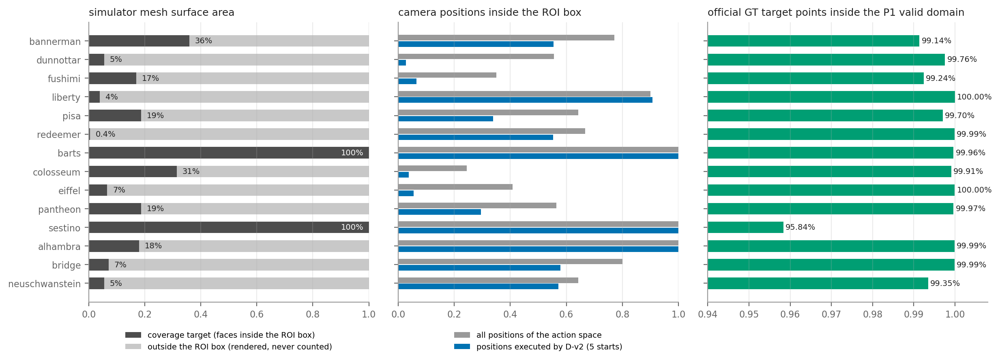
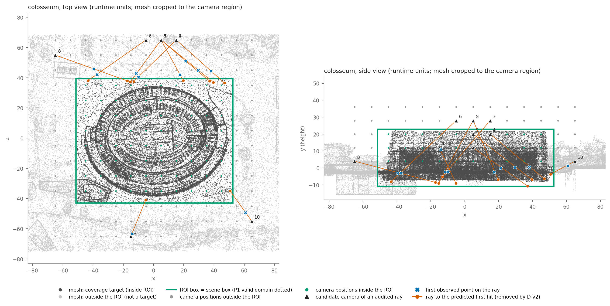
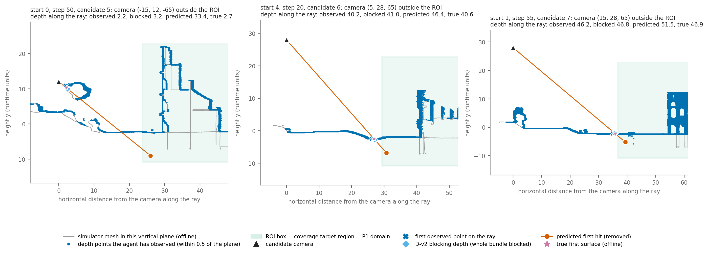

# Geometry / ROI / Observation / Scoring / Coverage 一致性审计

2026-11-05 · 对象：V3-T1 40K + D-v2（Macarons++ Outdoor，全局 P1，D100 输入 / S10 评分，深度 2，K4，Euler10，R10）· 只读审计：不训练、不重跑闭环、不改 E3 / Table 1 / 任何 checkpoint · GT 只用于离线核对

所有结论来自实际执行的代码、配置、场景数据和已存结果的重新计算，没有沿用历史报告里的机制解释。

## 结论

**没有发现 Critical 或 Major 问题。现有 V3-T1 + D-v2 的论文结果不受影响。** 有 4 个 Minor 问题，其中一个要求修正 E3 报告里的一句机制表述。

1. **优化区域、观测区域、评价区域是同一个长方体**：`settings.json` 里的场景盒（下称 ROI 盒）。官方覆盖率只统计盒内的 GT 表面和盒内的观测点；P1 的有效域就是这个盒子，只少一条窄边。
2. **GT Mesh 远大于 ROI**。仿真器渲染整个网格，但 14 个场景里有 12 个的网格表面积只有 0.4%–36% 属于覆盖率目标，其余是盒外的地形和背景。盒外表面不计分，但会挡住射线。
3. **相机经常在 ROI 盒外**。colosseum 上 D-v2 执行的相机位置只有 4% 在盒内。所以"相机和预测点都在凸盒内，射线就不可能经过盒外"这一事实并不与 E3 的解释冲突：发生遮挡时相机本身在盒外。
4. **D-v2 的机制得到几何证实，但 E3 的表述需要修正**。
   - 证实的部分：colosseum 上被删掉的预测价值里，99.1% 的相机在盒外，95.7% 的遮挡物在盒外，99.6% 通过 GT 的严格遮挡检验。
   - 需要修正的部分：E3 说"D1 的域内 first-hit 约束是正确的"。实际上还有一部分遮挡物在盒内，D1 的已知表面检测没有捕捉到它们。colosseum 上只占 4%，pisa 上占 44%。
   - 闭环结果（低平台 5/15 → 0/15 等）本身有效，不需要改。
5. **官方覆盖率不是纯几何量**。它对目标点和观测点都设了每格 1000 点的上限并随机替换，因此不单调，平均比几何覆盖率低约 0.03。这是官方协议的特性，所有方法相同。D-v2 相对 D1 的结论在两种口径下一致。

## 1. 五个概念的真实关系

| 概念 | 实际定义 | 代码来源 |
|---|---|---|
| GT Mesh | 每个场景唯一的 OBJ，顶点 ×10，y 轴向上。渲染深度、采样 GT 点、碰撞检测用的是同一个网格 | `exp3b/m_t6_sim.py`（`EpisodeSim.__init__`） |
| GT 覆盖率目标 | 三个顶点都在 ROI 盒内的面片上均匀采样 10 万点，再按粗网格（如 5×3×5）每格最多保留 1000 点。最终 2.2 万–6.9 万点 | MAGICIAN `get_scene_gt_surface`、`Scene.fill_cells` |
| ROI 盒 | `settings.json` 的 `scene.x_min / x_max` ×10。评估器的 GT 场景和已覆盖场景都用它 | MAGICIAN `setup_test_scene` |
| P1 网格 | 以 ROI 盒最小角为原点的规则网格，体素 0.011 模型单位（0.05–0.37 运行时单位）；短轴不足 256 体素时向外补齐 | `exp3b/m_common.py`（`SceneFrame`）、`m_world.py` |
| P1 有效域 | 体素中心在 ROI 盒内且被官方窗口覆盖。是一个轴对齐长方体，不是不规则区域。只有有效域内会被写入、预测和评分 | `m_world.domain_1d`、`m_p1.P1Fusion._in_domain` |
| 已观测几何 | 每步真实深度里 z < 70 的有效像素。D100 = 全部像素，S10 = 仿真器给的 10% 采样（与评估器用的是同一批点） | `m_t6_sim.observe`、`task3/p1_full.py` |

要点：
- P1 的边界在整个 episode 内固定，由 `settings.json` 和冻结的尺度表决定，不随相机变化。
- "P1 域外"在本项目里有两种含义，需要区分：
  - **网格外**：ROI 盒之外的空间。
  - **网格内但有效域外**：补齐的填充区（在 ROI 盒外）和一条没被窗口覆盖的窄边（在 ROI 盒内）。
- 网格里没有语义标签，无法精确区分"建筑"和"地面"。按几何代理（朝上的面且位于盒高最低 10%）估计，目标表面里地面类占 0%–38%。

## 2. P1 是否覆盖所有需要评价的表面（All-14）

| 场景 | 划分 | 网格面积中属于目标的比例 | GT 目标点数 | GT 点在 P1 有效域内 | 缺失窄边最大宽度 | 相机在 ROI 盒内：动作空间 / D-v2 执行 | 真实深度点落在盒外 |
|---|---|---|---|---|---|---|---|
| bannerman | Train | 35.9% | 43,586 | 99.14% | 1.54 | 77% / 55% | 15% |
| dunnottar | Train | 5.5% | 55,022 | 99.76% | 0.59 | 56% / 3% | 11% |
| fushimi | Train | 16.9% | 25,081 | 99.24% | 0.85 | 35% / 7% | 54% |
| liberty | Train | 3.9% | 23,568 | 100.00% | 0.08 | 90% / 91% | 34% |
| pisa | Train | 18.7% | 47,968 | 99.70% | 1.14 | 64% / 34% | 33% |
| redeemer | Train | 0.4% | 23,942 | 99.99% | 0.35 | 67% / 55% | 16% |
| barts | Dev | 100.0% | 47,885 | 99.96% | 0.06 | 100% / 100% | 0% |
| colosseum | Dev | 31.4% | 49,067 | 99.91% | 0.53 | 24% / 4% | 35% |
| eiffel | Dev | 6.6% | 22,443 | 100.00% | 0.17 | 41% / 6% | 30% |
| pantheon | Dev | 18.7% | 54,170 | 99.97% | 0.21 | 56% / 30% | 44% |
| sestino | Dev | 100.0% | 55,514 | **95.84%** | 0.35 | 100% / 100% | 0% |
| alhambra | Test | 17.9% | 45,355 | 99.99% | 0.79 | 100% / 100% | 10% |
| bridge | Test | 7.1% | 40,252 | 99.99% | 0.49 | 80% / 58% | 24% |
| neuschwanstein | Test | 5.5% | 68,569 | 99.35% | 2.02 | 64% / 57% | 22% |

长度单位为运行时单位（OBJ ×10）。GT 点取起点 0 的冻结种子。

- **GT 目标点 100% 在 ROI 盒内**（14 个场景全部成立），99.99% 以上在 P1 网格边界内。
- **落在 P1 有效域内的比例**：最低 95.84%（sestino），平均 99.49%。缺失的点全部位于盒子远端一条 0.06–2.02 单位宽的窄边内。按面积加权的结果相同（sestino 95.40%）。
- 跨越盒子边界的面片不计入目标，占网格面积 0%–0.38%。
- 这条窄边对指标的影响可以忽略：只统计有效域内 GT 点的覆盖率，与统计全部 GT 点的结果相差不超过 0.001；窄边里的点被覆盖的比例与域内相近。

## 3. 相机、真实观测与预测射线如何处理边界

**真实观测（Task 2）**

| 问题 | 实际行为 | 结论 |
|---|---|---|
| 相机可以在 P1 之外吗 | 可以。动作空间由 `settings.json` 的相机盒定义，与 ROI 盒无关 | 符合设计 |
| 真实射线能跨越 P1 边界吗 | 能。深度渲染整个网格，量程 z < 70 | 符合设计 |
| 哪些点更新 P1 | 体素落在有效域内的点写入 BAND；域外的点直接丢弃 | PASS |
| 盒外的真实深度是否保存 | P1 不保存。规划器另外保存全部 S10 点用于新颖性判断；D-v2 把全部 D100 点保存在一个扩大的网格里（盒子外扩 80 / 下 30 / 上 80） | PASS |
| 从盒外射入 ROI 的射线 | EMPTY 只雕刻到命中点前 3 个体素。射线如果先打到盒外的表面，盒内沿这条射线不会被雕刻，保持 UNKNOWN | PASS，遵守 first-hit |
| 已知表面是否持久 | 是。BAND 与 EMPTY 的体素数在 220 个核对状态上单调不减 | PASS |
| 每步是否融合真实深度；R10 影响什么 | 每步融合。R10 只每 10 步刷新编码器特征和噪声种子 | PASS |
| 坐标、尺度、体素索引 | 坐标往返误差 1e-14；有效域内的观测点 100% 对应 P1 的 BAND 体素；已存采样点与"深度图按相机模型反投影"的结果相差不超过 0.0013 | PASS |

**预测与评分（Task 3）**

| 问题 | 实际行为 | 结论 |
|---|---|---|
| 各候选相机的 P1 是否相同 | 相同，每个状态只构建一次 | PASS |
| 射线是否按各自位姿生成 | 是，每个候选 114×64 条 | PASS |
| first-hit 如何解码 | 只能落在"网格内、有效域内、P1 为 UNKNOWN、且在已知表面之前"的采样点上 | PASS |
| 预测点是否做域判断 | 是。约 2670 万个解码命中点中，落在网格外 0 个、有效域外 0 个、已知表面之后 0 个 | PASS |
| 域外预测点会被裁剪进域内计分吗 | 代码里有把索引夹到边界的写法，但没有任何命中点触发它（0 / 2670 万） | PASS |
| K = 4 如何进入收益 | 对 4 个样本各自求价值后取平均 | PASS |
| 两步并集与去重 | 只在"域内且新颖"的命中单元上做 | PASS |
| 第二步假想观测是否写入真实 P1 | 没有。第一层评分前后，P1、稀疏孪生图和 D-v2 网格的校验和在 220 个状态上全部相同；带完整两步前瞻的 D-v2 评分在 8 个状态上单独核对（每次评 24–46 个第二层视角），同样不变 | PASS |
| 相机在域内 / 域外时遮挡判断是否一致 | **D1 不一致**：只在网格内部找已知表面，网格外的一段不建模。D-v2 在它的扩大网格内用同一规则 | 见第 5 节 |

## 4. 规划器目标与官方评估器是否一致（Task 5）

| 项目 | 规划器（D1 / D-v2 的新颖性价值） | 官方评估器 | 判断 |
|---|---|---|---|
| 空间范围 | P1 有效域 | ROI 盒 | 一致，差一条窄边（GT 点 0%–4.2%） |
| 观测点集 | 全部历史 S10 点 | 同一批 S10 点，只取盒内 | 一致 |
| 距离容差 | 1.0 | 1.0（2 × 0.05 × 10） | 一致 |
| 目标表面 | 预测的命中点，按 1.0 单元去重 | GT 表面采样点 | 近似：预测可能落在没有真实表面的地方 |
| 权重 | 按深度平方的面积代理 | 每个粗网格最多 1000 点，面积大的格子被欠采样 | 近似：权重不同 |
| 点数上限 | 无 | GT 点和已覆盖点都有每格 1000 点上限，超出时随机保留 | 评估器特性，规划器无法建模 |
| 分母 | — | GT 点数 × 场景可见比例（0.727–1.0） | AUC 与 Final 用同一目标 |

**评估器在各方法之间是否相同**：相同。所有 Table 1 的行都走同一个仿真器和同一个覆盖率回放，入库前要求回放结果与闭环时存下的曲线逐位相等。D-v2 的 70 条全部通过。D-v2 只替换了规划器子进程，没有改评估指标或 GT 目标。

**官方覆盖率的三个特性**（所有方法相同，不是我们的实现问题）：
- **不单调**：70 条里有 64–68 条出现过覆盖率下降，单步最大降幅 0.004–0.012。
- **低于几何覆盖率**：不设上限的逐点覆盖率（即已存的 mono 口径）平均比官方值高 0.026–0.032，bannerman 高 0.12。我用 GT 目标点和 S10 点独立重算，与已存的 mono 值最大相差 0.001。
- **不按面积均匀加权**：80%–99% 的目标面积位于已达上限的格子里；各粗网格的"点数占比 / 面积占比"在 0.14–9.2 之间。

**D-v2 相对 D1 在两种口径下的结论**（All-14，场景级配对 bootstrap）：

| 指标 | 官方口径 | mono 口径 |
|---|---|---|
| AUC@20 | −0.001 [−0.003, +0.002] | 0.000 [−0.003, +0.002] |
| AUC@100 | +0.010 [−0.001, +0.025] | +0.011 [0.000, +0.026] |
| Final | +0.011 [−0.001, +0.026] | +0.012 [0.000, +0.029] |

- 结论一致。
- E3 里 bannerman 的"下降"（官方 −0.015）在 mono 口径下是 −0.001，属于上限造成的假象。
- 相对 MAGICIAN，D-v2 的 Final 在官方口径下是 +0.014 [−0.004, +0.036]，在 mono 口径下是 +0.020 [+0.003, +0.041]。

**三种情况的区分**：
- **合理近似**：空间范围、观测点集、容差。
- **可能造成性能损失**：权重方式不同；规划器会给"盒内但实际没有表面"的位置计分（见第 5 节）。这只会让我们的规划器吃亏，不会虚高指标。
- **协议缺陷**：没有发现。没有任何方法使用了不同的评价目标。

## 5. D-v2 的"域外已观测遮挡"是否得到几何证实（Task 4）

**核对方式**：在 D1 自己的 Table 1 轨迹上逐步重放规划器状态（与规划日志的价值逐位一致），每 5 步取一个状态，对每个候选相机的每条预测射线重做 D-v2 的判定，并用 GT 网格离线核对。共 11 条 episode、9 个场景、220 个状态。

**colosseum（5 个起点，100 个状态）被 D-v2 删掉的预测价值**：

| 状态 | 候选相机在盒内 | 被删价值占 D1 新颖价值 | 其中：相机在盒外 | 其中：遮挡物在盒外 | 相机盒内且遮挡物盒外 | GT 严格验证 | 已观测点验证 |
|---|---|---|---|---|---|---|---|
| 全部 | 4.6% | 79.5% | 99.1% | 95.7% | 0.000 | 99.6% | 99.7% |
| t < 20 | 19.0% | 30.3% | 90.4% | 66.7% | 0.000 | 97.1% | 98.9% |
| t ≥ 20 | 0.0% | 94.7% | 100% | 98.6% | 0.000 | 99.8% | 99.9% |
| 平台期 | 0.0% | 97.7% | 100% | 99.4% | 0.000 | 99.9% | 100% |

- "遮挡物"指射线上第一个已观测单元。
- "GT 严格验证"指真实第一表面比预测命中点近 1.0 以上。
- "已观测点验证"指在相机与预测点之间、距射线 0.33 以内确实存在一个智能体观测过的深度点（抽样核对）。

**逐项回答**：
1. **colosseum 的合法相机是否经常在 P1 外**：是。动作空间 76% 在盒外，D-v2 执行的位置 96% 在盒外，t ≥ 20 的候选 100% 在盒外。
2. **被删除的预测点是否都在有效评分区域内**：是。计入价值的预测点按定义都在有效域内，且没有任何解码命中点越界。
3. **遮挡它们的观测点是否真的在 P1 外**：colosseum 上 95.7% 是，平台期 99.4% 是。其余在盒内，见下面的修正。
4. **"域外"指什么**：指 ROI 盒之外，也就是网格外。不是指有效域掩码的不规则部分——有效域是规则长方体。
5. **坐标系与尺度是否一致**：一致。D-v2 用运行时坐标，P1 用模型坐标，两者之间的换关系经数值核对；重放得到的过滤后价值与规划器自己算出的值逐位相等。
6. **近似因素**：D-v2 用 0.5 单位的单元、5 条射线组成的射线束、1.0 的余量、0.25 的步长，没有体素膨胀。
7. **满足严格几何遮挡的比例**：colosseum 99.6%；11 条 episode 合计 99.3%。
8. **凸性核对**："相机在盒内而遮挡物在盒外"的被删价值在全部 220 个状态上恰好是 0，与几何事实一致。

**这类预测点实际是什么**。下表是 colosseum 上一步新颖性降幅最大的 10 个（状态，候选），每个按权重比例抽一条被删射线。ROI 盒为 x [−51.3, 52.6]，y [−10.8, 22.8]，z [−43.0, 39.3]；P1 有效域相同，只是 z 从 −42.5 起。10 条射线的相机都在盒外，遮挡点都在盒外，预测点都在有效域内，判定规则（预测深度 > 判定遮挡深度 + 1.0）全部复现。

| # | 起点 / 步 / 候选 | 相机 | 射线方向 | 已观测遮挡点 | 预测命中点 | 沿射线深度：遮挡点 → 判定遮挡 → 预测点（真实表面） | 一步新颖性：前 → 后 | 两步最终分数：D1 → D-v2 |
|---|---|---|---|---|---|---|---|---|
| 1 | s0 / 50 / 5 | (−15, 12, −65) | (0.29, −0.63, 0.72) | (−14.1, 10.9, −63.3) | (−5.2, −9.0, −41.0) | 2.2 → 3.2 → 33.4（2.7） | 685 → 15 | 1255 → 264 |
| 2 | s4 / 20 / 6 | (5, 28, 65) | (0.32, −0.75, −0.58) | (17.4, −2.4, 41.9) | (19.7, −6.8, 38.1) | 40.2 → 41.0 → 46.4（40.6） | 663 → 6 | 1078 → 36 |
| 3 | s1 / 55 / 7 | (15, 28, 65) | (−0.55, −0.65, −0.53) | (−9.9, −2.2, 40.4) | (−13.1, −5.2, 37.5) | 46.2 → 46.8 → 51.5（46.9） | 659 → 12 | 936 → 34 |
| 4 | s2 / 25 / 4 | (15, 20, 65) | (0.64, −0.52, −0.57) | (38.1, 0.4, 44.4) | (46.9, −6.3, 36.6) | 36.6 → 37.8 → 50.2（37.3） | 665 → 21 | 1115 → 67 |
| 5 | s4 / 35 / 4 | (5, 28, 65) | (−0.40, −0.73, −0.55) | (−11.4, −2.3, 42.8) | (−15.4, −9.0, 37.2) | 41.0 → 41.5 → 50.6（41.4） | 644 → 12 | 1058 → 66 |
| 6 | s1 / 20 / 6 | (−5, 28, 65) | (−0.65, −0.61, −0.45) | (−37.4, −3.1, 42.2) | (−43.3, −8.1, 38.1) | 50.4 → 51.2 → 59.1（51.0） | 634 → 14 | 1060 → 54 |
| 7 | s4 / 25 / 4 | (5, 12, 65) | (0.67, −0.47, −0.57) | (21.2, −0.1, 51.1) | (37.0, −10.7, 37.7) | 24.5 → 25.8 → 47.8（25.3） | 635 → 16 | 1147 → 50 |
| 8 | s2 / 80 / 0 | (−65, 4, 55) | (0.91, −0.24, −0.33) | (−39.6, −3.2, 45.8) | (−17.3, −8.5, 37.9) | 28.0 → 30.2 → 52.2（30.0） | 616 → 1 | 1112 → 115 |
| 9 | s1 / 25 / 6 | (5, 20, 65) | (0.66, −0.52, −0.54) | (29.6, 0.3, 44.9) | (39.6, −6.9, 36.9) | 37.3 → 38.2 → 52.0（38.1） | 634 → 22 | 1050 → 68 |
| 10 | s0 / 80 / 0 | (65, 4, −55) | (−0.56, −0.30, 0.78) | (60.8, 1.3, −49.3) | (50.7, −3.6, −35.0) | 7.5 → 16.2 → 25.7（15.9） | 591 → 0 | 1098 → 387 |

从坐标可以直接看出机制：相机在盒外的高处向下看，射线先打到**盒外已经观测过的地面**（y ≈ 0），延长线从地面以下进入 ROI 盒。ROI 盒的底面在 y = −10.8，比地面低约 10 个单位，这一层地下空间在 P1 里永远是 UNKNOWN。模型就在这里预测出"新表面"（预测点的 y 在 −3.6 到 −10.7 之间）。这些点物理上不可见，也不存在对应的真实表面。

**根因在训练标签**。生成监督信号时，"真实第一交点在进入网格之前"的射线被归为 `BLOCKED` 类，这类射线不参与损失（`seen2scene/futureview/geometry.py` 的 `encode_labels`，`seen2scene/v3/data.py` 的损失掩码）。所以模型从未学过这类射线应该"无命中"，推理时就按"射线畅通进入盒子"来预测。D-v2 在规划端补上了这一点。

**对 E3 表述的修正**。E3 报告写的是"原始 D1 的域内 first-hit 约束是正确的"。更准确的说法分两层：
- **成立的一层**：解码出的命中点从不落在 P1 的已知表面之后（0 / 2670 万）。
- **不成立的一层**：P1 的"已知表面"是用 TSDF 由正变负的过零点找的，它会漏掉一部分盒内已观测的表面。被 D-v2 删掉的价值里，真实第一表面在盒内的比例如下。

| episode | 被删价值占新颖价值 | 真实第一表面在 ROI 内 | 这部分的 GT 验证率 | 该表面处 P1 的状态：只有正值的 BAND / 没有 BAND |
|---|---|---|---|---|
| colosseum（5 条） | 79.5% | 4.4% | 91% | 82% / 15% |
| pisa s1 | 41.6% | 44% | 99% | 28% / 72% |
| neuschwanstein s4 | 21.8% | 18% | 97% | 31% / 68% |
| sestino s0 | 8.4% | 77% | 77% | 79% / 19% |
| bannerman s3 | 4.1% | 79% | 79% | 92% / 4% |
| alhambra s0 | 3.5% | 87% | 87% | 86% / 11% |
| barts s0 | 2.4% | 50% | 50% | 82% / 16% |

- 相机全在盒内的场景（alhambra、barts、sestino）里，D-v2 只能删这一类，量很小（新颖价值的 2%–8%），而且 GT 验证率只有 50%–87%。这与这些场景上 D-v2 没有收益一致。
- 盒内这类漏检的具体成因**没有查明**（UNKNOWN）。可能是薄结构两侧观测相互抵消，也可能是真实第一表面本身没被观测到而其后的表面被观测到。本轮只测量了现象。

**因此应这样描述 D-v2**：它用智能体已经观测到的全部真实深度做可见性判断，补上了 P1 的已知表面检测覆盖不到的两类情况——地图范围之外的已观测几何（主要来源，colosseum 上占 96%），以及地图范围之内、TSDF 过零点检测没有捕捉到的已观测表面。

## 6. GT 泄漏、坐标系、越界计分、边界处理

| 检查 | 结果 |
|---|---|
| 规划器进程读取的文件 | 70 条 D-v2 episode 的路径守卫记录里，被拒绝的访问 0 次。打开的只有本 episode 的服务记录和规划日志、`settings.json`、代码与配置 |
| 仿真器传给规划器的字段 | 全部在白名单内：位姿、深度图与掩码、S10 采样点、历史位姿、合法动作列表。没有网格、GT 点、覆盖率或未来观测 |
| D-v2 新增的输入 | `settings.json` 里的盒子，以及上述服务记录里的深度。没有新增数据源 |
| 前瞻用的位姿表 | 只由 `settings.json` 的相机网格生成 |
| 合法动作列表 | 由仿真器用 GT 网格做碰撞检测后给出。这是官方协议，所有方法（含 MAGICIAN）拿到的是同一份；前瞻第二层只用已知 BAND 判断阻挡 |
| 坐标系与尺度 | 见第 3 节，全部通过 |
| 越界计分 | 0 / 2670 万 |

## 7. Indoor 与 Outdoor 的差别（Task 6）

Indoor 部分由子代理读代码完成；我复核了其中三处关键实现（区域刷新与记录重放、区域盒定义、覆盖率目标），结论一致。其余条目标注为"未复核"。

| 项目 | Outdoor（Macarons++） | Indoor（MP3D） |
|---|---|---|
| P1 | 固定的全局场景盒，整个 episode 不变 | 以相机为中心的局部盒，被楼层盒裁剪；每 10 步重新定中心（已复核） |
| 局部盒大小 | — | 水平边长约 4.16 × 层高（EXP6 设置），约 11–19 m；高度为整层（未复核具体数值） |
| 历史观测 | P1 持久累积 | 全部历史记录保存在内存里，每次刷新时全部重新融合进新区域（已复核）。区域外的部分暂时不写入，区域移回时会恢复 |
| 评分范围 | 整个场景盒 | 只在当前局部盒内；盒外的预测点不计分 |
| 覆盖率目标 | ROI 盒内的面片，固定点数上限 | 整个楼层盒内的面片（按面片质心），30 万采样点（已复核） |
| 覆盖判定 | 距离 1.0，S10 点，每格上限 | 按层高缩放的距离（约 8–13 cm），S10 点，无上限 |
| 分母 | GT 点数 × 可见比例 | 从任一站位可见的 GT 点（已复核） |
| ROI 与评价目标的关系 | 相同 | **规划器 ROI 小于评价目标**：局部盒 ⊂ 楼层 |

论文里需要分开说明：Outdoor 的规划区域与评价区域相同；Indoor 的规划区域是随相机移动的局部窗口，评价区域是整个楼层。这也解释了此前"室内规划区域裁掉远处"的现象。

## 8. 问题清单与分级

| # | 发现 | 状态 | 级别 | 影响 |
|---|---|---|---|---|
| 1 | P1 有效域比 ROI 盒少一条远端窄边（0.06–2.02 单位），含 0%–4.2% 的 GT 点 | PARTIAL | Minor | 规划器对这条边不预测、不评分。对指标的影响 < 0.001 |
| 2 | E3 的表述"D1 域内约束正确"不完整：P1 的过零点检测漏掉部分盒内已观测表面 | PARTIAL | Minor | 只影响机制描述，不影响任何数字 |
| 3 | 官方覆盖率有每格上限和随机替换：不单调、低于几何覆盖率、不按面积加权 | PASS（各方法相同） | Minor | Final 上小于约 0.02 的差异可能是评估器造成的；需要在论文里披露 |
| 4 | 规划器会给盒内不存在真实表面的位置计分（如地面以下） | PASS（预测误差） | Minor | 只会损失我们自己的性能；D-v2 已去掉其中被已观测表面挡住的部分 |
| 5 | 模型训练时不监督"进入网格前被挡住"的射线 | PASS（设计如此） | 说明 | D1 缺口的根因；D-v2 在规划端补上 |
| 6 | 合法动作由仿真器用 GT 碰撞检测给出 | PASS（官方协议） | 说明 | 所有方法相同 |
| 7 | D-v2 的扩大网格在 redeemer 上漏掉 1.3% 的观测点 | PASS | 说明 | 漏掉的点不参与遮挡，偏保守 |
| 8 | 盒内漏检的具体成因 | UNKNOWN | — | 需要专门查才能在论文里下结论 |
| 9 | dunnottar 没有做射线级核对 | UNKNOWN | — | 审计脚本自身的缓冲在这个场景的大网格上超出显存；规划器本身运行正常 |
| — | GT 泄漏、不同方法使用不同评价目标、坐标系错误、越界计分 | 未发现 | — | — |

## 9. 对 V3-T1 + D-v2 论文结果的影响

- **数值**：没有影响。All-14 的 AUC@20 0.425、AUC@100 0.775、Final 0.921 以及 E3 的全部闭环结果保持有效。
- **需要改的是文字**：
  - 机制描述按第 5 节末尾的说法写，不要写"D1 域内约束正确，只漏了域外"。
  - 说明覆盖率目标是场景盒内的表面，盒外几何只起遮挡作用。
  - 说明相机动作空间大于场景盒。
  - Indoor 与 Outdoor 的区域定义分开写。
- **建议在论文里披露**：官方覆盖率的上限机制，并把 mono 口径作为补充指标一并报告（数据已有，不需要新实验）。

## 10. 是否需要进一步实验或修复

本轮没有需要立刻修复的问题，以下均为可选，未执行：

1. **不需要新实验即可做的**：论文表格里同时给出 mono 口径。
2. **如果想把机制讲完整**：查明盒内漏检的成因（固定状态诊断，成本低）。
3. **如果想从根上解决**：训练时把"进入网格前被挡住"的射线标成无命中，或把遮挡信息作为输入通道。这需要重新训练，属于新方法，应单独立项。
4. **有效域的窄边**：把窗口覆盖补到盒子边缘可以消除，但会改变所有冻结的网格与结果。收益小于 0.001，不建议在投稿前动。

## 文件

- `results/`
  - `a1_gt_target.json`：逐场景的网格、ROI 盒、目标面片、GT 点、相机盒。
  - `a2_p1_roi.json` / `.csv`：P1 网格与有效域、GT 点包含率、相机与观测点的盒内外统计、坐标核对。
  - `d_roi_coverage.json` / `.csv`：有效域内 / 外的覆盖率拆分（诊断量，不是官方指标）。
  - `e_metric_protocols.json`：官方与 mono 口径的对比，以及两种口径下的配对差值。
  - `f_ray_summary.json`、`rays/*.jsonl`：射线级核对的汇总与逐状态记录。
  - `top_rays_colosseum.json` / `.csv`：上表 10 条射线的完整坐标。
  - `h_leak_check.json`、`i_gt_density.json`、`j_lookahead_check.json`：信息边界核对；GT 点的面积加权情况；两步评分不改写地图的核对。
- `figures/`：总览图、colosseum 俯视与侧视图、三条射线的竖直剖面（png + pdf）。
- `logs/`：`EVENTS.md`（过程与出错记录）、各脚本日志。
- `scripts/`：全部只读审计脚本（`a1`–`j`、作图）。
- 中间数据（GT 点、网格采样、剖面数据）在 `work_dirs/cvpr_results/geometry_roi_audit/`，不入库。
