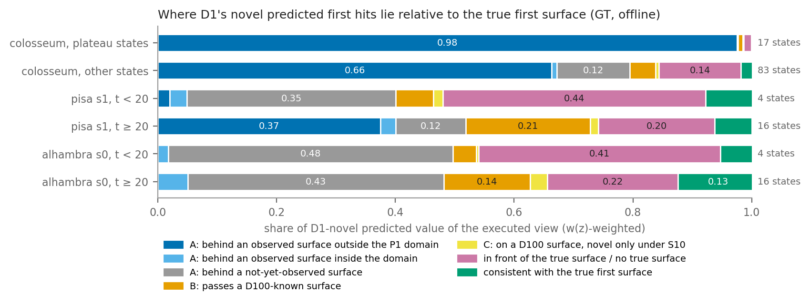
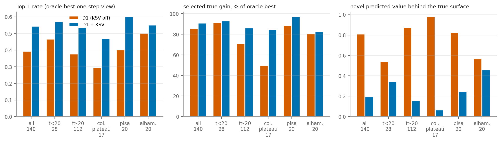
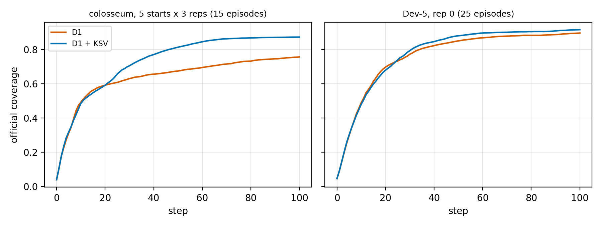
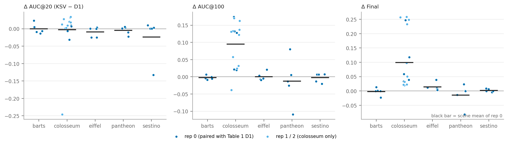

# Experiment E2 — 已观测几何一致性审计 + 最小闭环验证

2026-11-04 · 规划器 V3-T1 40K + D1（D-v1 d1，b2：D100 输入 / S10 评分，R10）· 不训练、不改 checkpoint、不改历史结果 · GT 只用于离线诊断

## 结论

1. **D1 在 P1 规划域内遵守已知表面；在规划域外不遵守，这是一个真实的物理约束缺口。**
   - 域内：解码器只在 D100 的 `t_known` 之前放置预测命中点，而 `t_known` 每步都用当步的真实深度重新计算。
   - 域外：P1 只覆盖场景盒。智能体已经亲眼看到的盒外地形、地面和周边建筑不进入任何射线约束。
   - D1 实际执行的视角里，65% 的 novel 预测价值落在这类"已观测、但在域外"的表面后面。colosseum 进入平台期后这一比例是 98%。
   - 这不是解码器或融合的实现 bug，而是 P1 只建在场景盒内这一设计带来的限制。
2. **最小修复 KSV（Known-Surface Visibility，可开关）在固定状态下明显改善打分。**
   - 关闭时逐位复现 D1：固定状态 140/140 一致；闭环 colosseum s0 的 100 步覆盖率、位姿、分数、选择全部一致。
   - 打开后：Top-1 0.39 → 0.54，所选视角真实增益 0.88 → 0.94 pp，落在真实表面之后的 novel 价值 0.81 → 0.19。
3. **闭环：colosseum 平台问题被消除，但 Dev-5 整体没有实质提升，早期 AUC 略降。**
   - colosseum（5 起点 × 3 噪声重复）：Final +0.116、AUC@100 +0.094，CI 都不含 0；平台从 5/15 降到 0/15。
   - Dev-5：AUC@100 +0.016、Final +0.020，CI 都含 0，增益全部来自 colosseum，其余 4 个场景约为 0。
   - AUC@20 −0.008，5 个场景都略降，触发了预先登记的早期门槛（≥ −0.005）。
   - 按协议：**保留 D1，不登记 Table 1，不跑 All-14。**

## 1. 审计：D1 的几何约束实际如何工作（Task 1）

审计方法：逐步重建 D1 的规划状态，重算出的 D1 价值与规划日志完全一致（最大相对误差 0）。共 7 条 episode（colosseum s0–s4、pisa s1、alhambra s0），每 5 步取一个状态，共 140 个状态、970 个候选视角。

| 检查项 | 结果 |
|---|---|
| ① 真实深度是否每步融入 D100 P1 | 是。每步先融合当步记录（全部有效像素进入 BAND，并做 EMPTY 雕刻），然后才打分；**但只融合规划域内的点** |
| ② BAND / EMPTY / UNKNOWN 是否维护 | 是，域内正确维护。D100 已知表面与 GT 第一表面在 1.0 单位内一致的比例为 0.87（执行视角） |
| ③ 新观测是否立即进入下一步射线几何 | 是。投影（`t_known`、UNKNOWN / KNOWN / EMPTY）每步由当前 P1 重算 |
| ④ R10 是否让已知几何约束滞后 | 否。R10 只每 10 步刷新编码器特征 h；几何约束没有滞后 |
| ⑤ V3 first-hit 解码是否强制已知表面遮挡 | 是，按构造强制：预测命中只能落在 `t_known` 之前的 UNKNOWN 采样上。遗漏只在 `t_known` 漏掉表面时发生（见 B 类） |
| ⑥ DistP1 是否给已知墙后的命中 novelty | 域内很少（B 类 5%）；域外大量（A 类中"已观测、域外"占 65%） |
| ⑦ D100 输入 vs S10 评分 | D100 约束解码，S10 判 novelty。两者错配造成的 C 类只占 novel 价值的 1%，可以忽略 |

**预测点分类**：对象是 D1 计为 novel 的预测命中，按 w(z) 加权、对 K 个样本取平均；"被 GT 遮挡"指预测命中位于 GT 第一表面之后超过 1.0 单位。

| 分组（执行视角） | 状态数 | A 域外已观测 | A 域内已观测 | A 尚未观测 | B 穿过 D100 | C 仅 S10 novel | 在真实表面前 / 无表面 | 与真实表面一致 | 执行视角真实增益 pp |
|---|---|---|---|---|---|---|---|---|---|
| 全部 | 140 | **0.65** | 0.01 | 0.12 | 0.05 | 0.01 | 0.14 | 0.02 | 0.88 |
| colosseum 平台期 | 17 | **0.98** | 0.00 | 0.00 | 0.01 | 0.00 | 0.01 | 0.00 | 0.07 |
| colosseum 其他状态 | 83 | **0.66** | 0.01 | 0.12 | 0.04 | 0.01 | 0.14 | 0.02 | 0.95 |
| pisa t < 20 | 4 | 0.02 | 0.03 | 0.35 | 0.06 | 0.02 | 0.45 | 0.08 | 4.76 |
| pisa t ≥ 20 | 16 | **0.37** | 0.03 | 0.12 | **0.21** | 0.02 | 0.19 | 0.06 | 0.41 |
| alhambra t < 20 | 4 | 0.00 | 0.02 | 0.48 | 0.04 | 0.01 | 0.41 | 0.05 | 2.57 |
| alhambra t ≥ 20 | 16 | 0.00 | 0.05 | 0.43 | 0.14 | 0.03 | 0.22 | 0.13 | 0.49 |

- **A 域外已观测（可修复，主因）**：真实遮挡面在 P1 域外，但 t 步之前的真实深度已经观测到它（1.0 单位内有观测点）。在线信息足以排除这类预测，D1 却没有使用。它不仅出现在平台期，在 colosseum 其他状态也占 66%。
- **B（小）**：遮挡面在 D100 BAND 中，但预测命中穿了过去。
  - 在 GT 表面附近，B 射线有 72% 在射线上能遇到 BAND 值，但只有 2% 遇到负 TSDF。也就是说，BAND 只有正侧，没有 + → − 过零，所以 `t_known` 没有触发。另外 28% 的 B 射线在射线上根本不经过 BAND（孔洞、边缘、离散化）。
  - B 在 pisa / alhambra 后期占 14–21%；同一批 B 单元在后续执行视角中的复现率为 0.22。
- **C（可忽略）**：1%，复现率 0.39。D100 / S10 错配不是问题来源。
- **A 尚未观测、在真实表面前 / 无表面**：模型对未观测区域的幻觉。它们在早期和 alhambra 占主导，在线信息无法区分，不属于本次可修复的范围。
- 已确认：没有发现融合、投影或解码的实现 bug；缺口来自 P1 域的设计边界，以及 BAND 缺负侧造成的少量漏检。

## 2. KSV 最小修复与固定状态 A/B（Task 2）

**KSV-v1 做法**（参数在任何结果之前冻结：`configs/ksv_v1.yaml`）：
- 把智能体到 t 步为止所有执行帧中的有效深度点（**包括 P1 域外**）写入 0.5 单位的占据网格。
- 对候选视角的每条射线求第一个被占据单元的距离 t_obs。
- 预测命中满足 t_pred > t_obs + 1.0 时，视为被已观测表面挡住，在计算价值前删掉。lookahead 的每一层都这样处理。
- 只使用在线信息；模型、P1、D1 的其余部分都不变。

| 分组 | 状态 | Top-1 关 → 开 | 所选真实增益 pp 关 → 开（最优） | 更好 / 更差状态 | Spearman 关 → 开 | 真实表面后 novel 占比 关 → 开 | 误截断占截断价值 | 秒 / 状态 关 → 开 |
|---|---|---|---|---|---|---|---|---|
| 全部 | 140 | 0.39 → **0.54** | 0.88 → **0.94**（1.04） | 44 / 20 | 0.35 → 0.52 | 0.81 → **0.19** | 0.02 | 3.28 → 3.10 |
| t < 20 | 28 | 0.46 → 0.57 | 3.35 → 3.41（3.68） | 5 / 0 | 0.64 → 0.72 | 0.54 → 0.34 | **0.11** | 4.00 → 3.98 |
| t ≥ 20 | 112 | 0.38 → 0.54 | 0.27 → 0.33（0.38） | 39 / 20 | 0.28 → 0.47 | 0.87 → 0.16 | 0.01 | 3.10 → 2.88 |
| colosseum 平台期 | 17 | 0.29 → 0.47 | 0.07 → 0.12（0.14） | 7 / 4 | 0.15 → 0.28 | 0.98 → 0.06 | 0.00 | 3.05 → 2.79 |
| pisa s1 | 20 | 0.40 → 0.60 | 1.28 → 1.40（1.45） | 6 / 3 | 0.23 → 0.60 | 0.82 → 0.24 | 0.04 | 3.04 → 2.90 |
| alhambra s0 | 20 | 0.50 → 0.55 | 0.90 → 0.93（1.13） | 3 / 1 | 0.61 → 0.63 | 0.56 → 0.46 | **0.28** | 3.48 → 3.38 |

**误截断检验**：被截断的预测命中中，有一部分 GT 显示前方并没有真实表面，即射线其实穿过了孔洞或擦过墙边。
- 这部分整体只占截断价值的 2%，colosseum 后期为 0.8%。
- 但早期（t < 20）为 11%，alhambra 为 28%。alhambra 的拱和柱等细结构正是"不能把观测单元当作密闭墙面"的情形。
- 因此 KSV-v1 **不满足**"不会错误截断孔洞 / 墙边射线"这一要求的严格版本。代价不大，但集中在早期和细结构场景。
- alhambra（Test-3）和 pisa（Train-6）只用作固定状态诊断，参数事先冻结，没有因为结果做任何调整。

## 3. 闭环验证（Task 3）

- 配对方式：同场景、同起点、同噪声键。rep 0 对比 Table 1 中的 D1；colosseum 的 rep 1/2 对比 Experiment E 中 D1 的重复运行。
- 35/35 条全部成功；重跑同一条的结果逐位一致。
- 场景级 bootstrap（10k）。

| 设置 | 指标 | D1 | D1 + KSV | Δ [95% CI] |
|---|---|---|---|---|
| colosseum 5 起点 × 3 重复（15 对） | AUC@20 | 0.429 | 0.422 | −0.007 [−0.045, 0.017] |
| | AUC@100 | 0.638 | 0.732 | **+0.094 [0.060, 0.125]** |
| | Final | 0.756 | 0.872 | **+0.116 [0.068, 0.166]** |
| | 平台（Final < 0.70） | 5 / 15 | **0 / 15** | |
| Dev-5，rep 0（场景均值） | AUC@20 | 0.447 | 0.439 | **−0.008 [−0.016, −0.002]**（5 个场景全部更低） |
| | AUC@100 | 0.765 | 0.781 | +0.016 [−0.008, 0.056]（2 胜 3 负） |
| | Final | 0.896 | 0.915 | +0.020 [−0.006, 0.060]（3 胜 2 负） |
| | 平台 | 2 / 25 | 1 / 25 | pantheon s2 两者都是 0.561 |
| | 规划时间 s / 步 | 6.13 | 6.26 | +2% |
| Dev-4（去掉 colosseum） | ΔAUC@20 / ΔAUC@100 / ΔFinal | | | −0.010 / −0.004 / 0.000 |

- colosseum 的 D1 平台 episode（Final 0.61–0.63）在 KSV 下全部到达 0.865–0.878，平台在机制层面被消除。这与审计结论一致：平台期 98% 的 novel 价值来自域外已观测表面后方的幻觉。
- Dev-5 的 AUC@20 下降是均值上的小幅下降，并且由少数 episode 主导（sestino s0 −0.132；colosseum s3 r1 −0.246）。按 episode 计，25 条中 14 条更好、10 条更差。
  - 首次选择改变的中位步数是 t = 8，所以早期轨迹确实被改动了。
  - 早期误截断（11%）是一个候选原因，但 **未确认**：没有做因果拆分，也可能只是轨迹分叉带来的方差。
- pantheon s3 下降明显（ΔFinal −0.082），原因未查。

## 4. 是否胜过 D1

| 问题 | 回答 |
|---|---|
| Early AUC（AUC@20） | **否**。Dev-5 −0.008（CI 不含 0，但只有 5 个场景），colosseum −0.007（n.s.） |
| Final | colosseum **是**（+0.116，显著）；Dev-5 整体 +0.020 **n.s.**，增益只来自 colosseum |
| 预先登记的 All-14 门槛 | **FAIL**（ΔAUC@100 +0.016 ≥ 0.01 满足；ΔAUC@20 −0.008 < −0.005 不满足；平台 0 ≤ 5 满足） |

## 5. 证据支持什么

- **支持（诊断性结论，可写入论文分析部分）**：
  - D1 的 colosseum 平台源于规划域外已观测几何没有参与可见性约束；
  - 一个不训练、只用在线观测的可见性约束可以完全消除该场景的平台（15/15）。
  - 这同时修正了 Experiment E 的机制描述：E 中"透视幻觉"的遮挡面绝大多数在 P1 域外。
- **不支持**：
  - 把 KSV-v1 作为 Table 1 的新主方法，或声称它在一般场景上优于 D1；
  - 声称它对早期探索无害。

## 6. 风险、局限、下一步

- 局限：
  - Dev-5 只有 5 个场景，rep 0 只有 1 个噪声重复，场景级 CI 很不稳定；
  - 固定状态评估只在 D1 自己的轨迹上做；
  - 误截断只按"GT 前方是否有表面"判定，没有区分孔洞、墙边和深度噪声。
- 风险：KSV 把 0.5 单位的观测单元当作不透明物体。在细结构场景（alhambra 28% 误截断）以及 Test-3 / All-14 中，可能出现与 pantheon s3 类似的退化。
- 建议（需要你批准，均为新版本，参数在运行前冻结，不在 Test-3 上调参）：
  1. **KSV-v2"仅域外"**：只用 P1 域外的观测单元做截断，域内仍由 D100 负责。它直接对准占比最大的缺口（A 域外已观测），预计能减少早期和细结构上的误截断。验证顺序和本轮相同：固定状态 → colosseum → Dev-5。
  2. 不做 v2 也可以：保留 D1 作为 Table 1 主方法；KSV-v1 只作为 colosseum 失败分析中的机制证据和消融。
  3. 可选的低成本诊断：对 KSV-v1 的早期误截断按射线做因果拆分（孔洞 / 墙边 / 噪声），确认 AUC@20 下降的来源。

## 文件

- `configs/`：审计与 KSV-v1 的冻结配置（含预先登记的门槛和结果行）。
- `results/`：
  - 审计逐状态记录与汇总（`audit_*.jsonl`、`audit_summary.json`）；
  - 固定状态 A/B（`ksv_fixed_*.jsonl`、`ksv_fixed_summary.json`）；
  - 闭环配对（`closed_loop_episodes.csv`、`closed_loop_summary.json`、`closed_loop_divergence.json`）。
- `figures/`：上文四张图（png + pdf）。
- `logs/`：事件记录 `EVENTS.md`、运行日志。
- `scripts/`：`geom_audit.py`、`ksv.py`、`ksv_fixed.py`、`e2_*.py`、各汇总与作图脚本。
- 闭环原始输出在 `work_dirs/exp6_v3/ablation_study/experiment_E_stability_plateau/E2_observed_geometry/`（不入库）。
