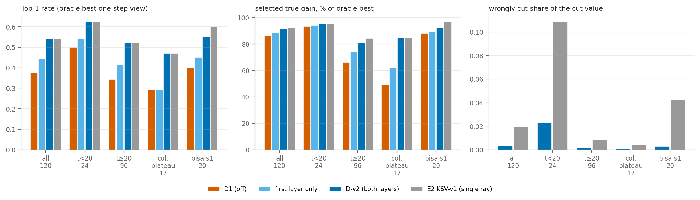
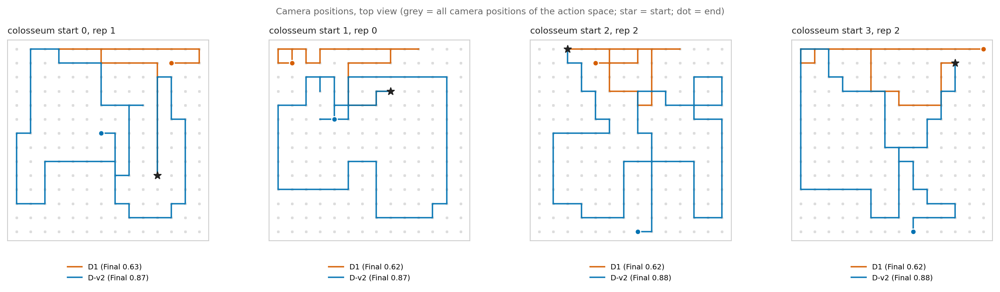
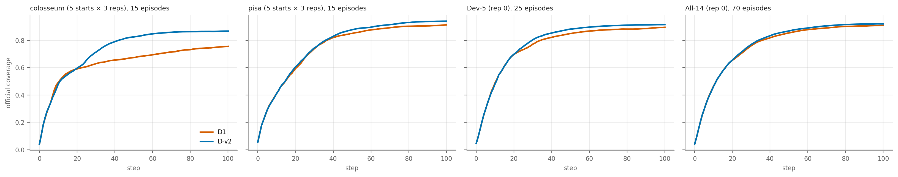
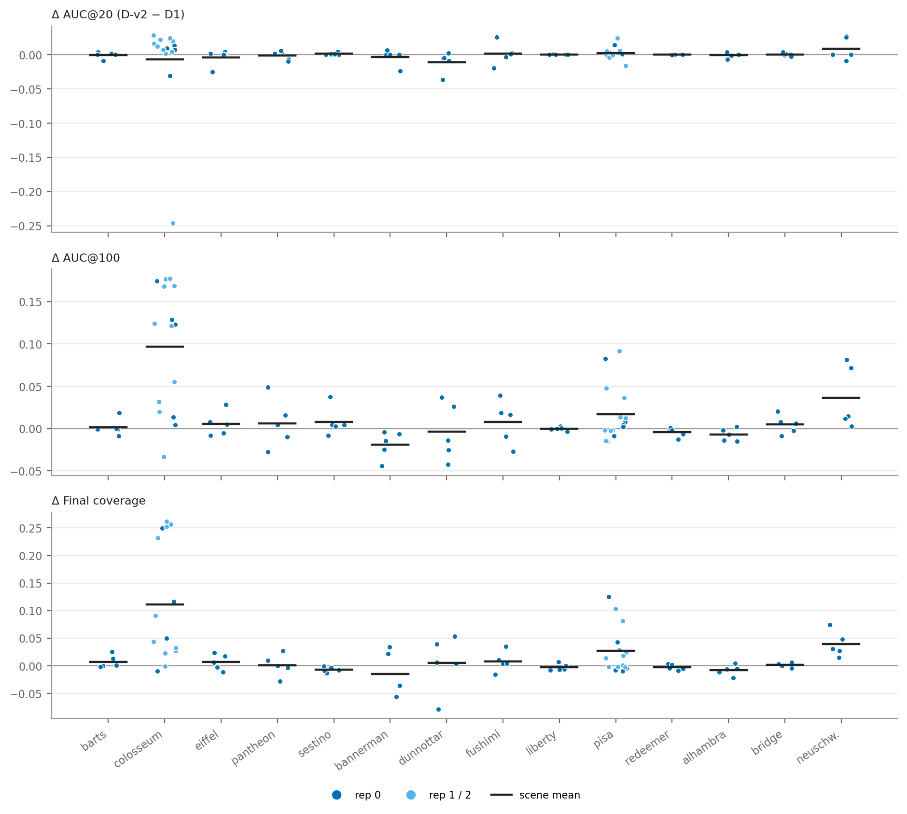

# Experiment E3 — D-v2 Observed-Geometry-Constrained Planning 闭环验证

2026-11-04 · 基线 V3-T1 40K + D1（D100 输入 / S10 评分，深度 2，λ = 0，K4，Euler10，R10，Macarons++ 100 步）· 不训练、不改权重、不改历史结果 · GT 只用于离线打分

## 结论

1. **D1 确实漏用了已观测几何，D-v2 补上之后，低覆盖率平台这一失败模式基本消失。** colosseum 的低平台从 5/15 降到 0/15；All-14 的 70 条里从 3 条降到 1 条。
2. **完整闭环里 AUC@100 和 Final 有提升，Early AUC 没有变化。** All-14：AUC@100 +0.010，Final +0.011，AUC@20 −0.001。
3. **提升集中在少数场景，All-14 的整体提升只是趋势。** 增益主要来自 colosseum、neuschwanstein、pisa 这三个 D1 原本会停滞或退化的场景；其余 11 个场景在 ±0.02 以内，bannerman 略降。All-14 的 95% CI 下界是 −0.001，刚好含 0。
4. **建议**：D-v2 可以替代 D1 作为默认规划器（没有可测的早期代价，修掉了最严重的失败），但论文里应把它表述为"消除平台失败、提高稳定性"，而不是"全面提升覆盖率"。是否替换主表由你决定。

## 1. D-v2 实际实现了什么

**D-v2 = D1 + 已观测表面可见性约束（可开关）。**

- **信息来源**：智能体到当前步为止实际执行过的帧里的全部有效深度像素（D100），包括 P1 规划域以外的点。不使用 GT、未来深度或 oracle 增益。
- **判据**：这些点写入 0.5 单位的占据网格。对每个候选相机的每条射线，只有当"中心射线 + 4 条平移一个网格的平行射线"这一整束都被已观测单元挡住时，才认为该射线被遮挡。预测命中点如果在遮挡位置之后超过 1.0 单位，就在计算价值之前删掉。
- **为什么用射线束**：一个已观测单元不是一堵无限延伸的墙。整束判据让下列情况都不被截断：
  - 比两个网格窄的孔洞；
  - 离墙边不到一个网格的射线；
  - 孤立或稀疏的观测点；
  - 掠射时擦过表面体素一角的射线。
- **两步前瞻**：过滤发生在预测命中变成"单元集合"之前，所以新颖性判断、表面去重和两步并集评分都在过滤后的集合上进行。第一步和第二步的每个相机各自重新做射线遮挡判断。第二步只用当前的真实观测网格和现有 P1，不引入未执行的观测。
- **保持不变**：模型与权重、K4、Euler10、R10、前瞻深度、S10 新颖性规则、DistP1 距离权重。
- **开关**：关闭时与 D1 逐位一致。
  - 固定状态 140/140 个状态的分数与选择等于规划日志；
  - 闭环 colosseum s0 的 rep 0 等于 Table 1 的 D1，rep 1 等于 Experiment E 的 D1 重复，覆盖率、位姿、分数、选择各 100 步全部一致。

**设计过程中的一次改动（发生在任何正式结果之前）。** 最初的方案是按 3×3×3 邻域支持数筛"可靠单元"。冒烟测试（colosseum s1，Dev）显示它没有降低误截断占比（23% → 23%）。Dev 上的诊断表明，误截断来自射线擦过表面体素的角，而不是孤立噪声点，所以改成了射线束判据并重新冻结（`configs/dv2_v2.yaml`）。门槛没有改，也没有参考任何 Test-3 状态。

## 2. 原始 D1 是否遗漏了已观测几何约束

**是，但只在 P1 规划域之外。**（依据 E2 审计，本轮沿用，没有重复添加同一机制。）

| 检查项 | 结论 |
|---|---|
| 真实深度是否每步更新 P1 | 是，每步先融合再打分；但 P1 只保存规划域内的点 |
| 候选相机能否从累计 P1 检测已知遮挡 | 域内能（`t_known` 每步重算）；域外的已观测地形和建筑不参与 |
| First-hit 解码是否实现已知表面遮挡 | 域内已按构造强制：预测命中只能落在 `t_known` 之前 |
| R10 是否让几何约束滞后 | 否，R10 只影响编码器特征 |
| D100 与 S10 的区别 | D100 约束解码，S10 判新颖性；两者错配只占 novel 价值的 1% |

离线过滤之所以仍有改善，是因为 D1 执行视角的 novel 预测价值里有 65% 落在"已观测、但在 P1 域外"的表面后面（colosseum 平台期 98%），另有约 5% 是域内 BAND 没有过零点造成的漏检。D-v2 补的正是这两部分。

**固定状态验证**（D1 自己轨迹上的状态，每 5 步一个；colosseum s0–s4 + pisa s1 共 120 个状态；真实一步增益来自 GT 反事实）：

| 分组 | 状态数 | Top-1：D1 → 仅第一层 → **D-v2** | 所选视角真实增益 pp：D1 → **D-v2**（最优） | 排序相关：D1 → D-v2 | 误截断占比：单射线 → **D-v2** |
|---|---|---|---|---|---|
| 全部 | 120 | 0.38 → 0.44 → **0.54** | 0.88 → **0.94**（1.03） | 0.31 → 0.51 | 0.019 → **0.003** |
| t < 20 | 24 | 0.50 → 0.54 → **0.62** | 3.48 → **3.55**（3.73） | 0.65 → 0.73 | 0.109 → **0.023** |
| t ≥ 20 | 96 | 0.34 → 0.42 → **0.52** | 0.23 → **0.28**（0.35） | 0.22 → 0.45 | 0.008 → 0.001 |
| colosseum 平台期 | 17 | 0.29 → 0.29 → **0.47** | 0.07 → **0.12**（0.14） | 0.15 → 0.41 | 0.004 → 0.001 |
| pisa s1 | 20 | 0.40 → 0.45 → **0.55** | 1.28 → **1.34**（1.45） | 0.23 → 0.55 | 0.042 → 0.003 |

- 这复现了此前离线重排序的核心效果（平台期 Top-1 0.35 → 0.47、排序相关 0.14 → 0.36）。状态集合略有不同，数字不完全相同。
- "单射线"是 E2 的 KSV-v1。D-v2 的排序改善与它相当，早期误截断从 11% 降到 2%。
- 只在第一层过滤时，改善约为一半；平台期 Top-1 没有变化（0.29）。
- alhambra s0（Test-3，冻结之后只做报告）：误截断 0.28 → 0.12，所选增益 0.90 → 0.93 pp。没有据此做任何修改。

## 3. Colosseum / Pisa 闭环

配对方式：同场景、同起点、同噪声键。rep 0 对 Table 1 的 D1；colosseum 的 rep 1/2 对 Experiment E 的 D1 重复；pisa 的 rep 1/2 没有历史记录，用开关关闭的方式补跑了配对的 D1。CI 为 episode 级 bootstrap。

| 场景（15 对） | 指标 | D1 | D-v2 | Δ [95% CI] | 更好 / 更差 |
|---|---|---|---|---|---|
| colosseum | AUC@20 | 0.429 | 0.421 | −0.008 [−0.045, +0.015] | 13 / 2 |
| | AUC@100 | 0.638 | 0.735 | **+0.097 [+0.060, +0.131]** | 14 / 1 |
| | Final | 0.756 | 0.868 | **+0.111 [+0.061, +0.164]** | 13 / 2 |
| | 低平台（Final < 0.70） | 5 / 15 | **0 / 15** | | |
| pisa | AUC@20 | 0.390 | 0.392 | +0.002 [−0.002, +0.007] | 7 / 3 |
| | AUC@100 | 0.753 | 0.770 | **+0.017 [+0.002, +0.035]** | 9 / 6 |
| | Final | 0.913 | 0.940 | **+0.027 [+0.008, +0.050]** | 9 / 6 |
| | Final < 0.90 | 4 / 15 | 1 / 15 | | |

逐项回答：

1. **AUC@20**：没有提高。pisa 持平；colosseum 均值 −0.008，来自一条 episode（s3 rep 1，−0.246），其余 14 条平均 +0.010。
2. **AUC@100**：两个场景都提高，CI 不含 0。
3. **Final**：两个场景都提高，CI 不含 0。D-v2 的 Final 也稳定得多（colosseum 标准差 0.099 → 0.011）。
4. **Colosseum 低平台**：5/15 → 0/15。最低 Final 从 0.614 升到 0.838。
5. **Pisa 的 Final 退化**：基本避免。s1 三次重复从 0.815 / 0.864 / 0.848 升到 0.940 / 0.945 / 0.951。
6. **轨迹**：明显改变。colosseum 首次选择不同的中位步数是 t = 4，之后两条轨迹访问的位置几乎不重合（重合度 0.08）。
7. **是否继续探索未覆盖区域**：是。colosseum 上访问的方位扇区（共 8 个）从平均 5.7 增加到 7.7；D1 停在平台的 5 条只到过 2–4 个扇区，D-v2 全部绕建筑一整圈。t ≥ 20 之后的覆盖率增量从 0.165 升到 0.271。
8. **虚假新颖性**：明显减少。后期执行视角的预测价值中位数，colosseum 从 945 降到 70，pisa 从 117 降到 38，同期真实增益反而更高。
9. **新的过度过滤问题**：有两点，见第 6 节。
10. **规划时间**：过滤本身每步 0.25–0.5 秒，但过滤后参与并集的单元变少，总规划时间基本不变（colosseum 7.26 → 7.26 秒 / 步，pisa 6.39 → 6.54）。

## 4. Dev-5 闭环

5 个场景 × 5 个起点，rep 0，与 Table 1 的 D1 配对；场景级配对 bootstrap。门槛在运行前冻结。

| 指标 | D1 | D-v2 | Δ [95% CI] | 场景胜 / 负 |
|---|---|---|---|---|
| AUC@20 | 0.447 | 0.446 | −0.001 [−0.003, 0.000] | 2 / 3 |
| AUC@50 | 0.653 | 0.669 | **+0.016 [+0.004, +0.034]** | 5 / 0 |
| AUC@100 | 0.765 | 0.788 | **+0.022 [+0.004, +0.056]** | 5 / 0 |
| Cov@20 | 0.697 | 0.699 | +0.002 [−0.004, +0.010] | 2 / 3 |
| Final | 0.896 | 0.915 | +0.020 [−0.002, +0.056] | 4 / 1 |
| 低平台 | 2 / 25 | 1 / 25 | | |
| 规划时间（秒 / 步） | 6.13 | 6.20 | +1% | |

| 逐场景 Δ | barts | colosseum | eiffel | pantheon | sestino |
|---|---|---|---|---|---|
| AUC@20 | −0.001 | 0.000 | −0.004 | −0.002 | +0.001 |
| AUC@100 | +0.002 | +0.089 | +0.006 | +0.006 | +0.008 |
| Final | +0.007 | +0.091 | +0.006 | +0.001 | −0.007 |

- 五条预登记门槛（早期不退化、有实际收益、不只来自一个场景、不牺牲多个场景、成本合理）全部通过。
- **需要如实说明**：增益的大部分仍来自 colosseum。去掉 colosseum 后，AUC@100 为 +0.005、Final 为 +0.002，方向一致但量很小。
- 与 E2 的单射线版本相比，Dev-5 的 AUC@20 从 −0.008 改善到 −0.001，AUC@100 从 +0.016 到 +0.022。
- Dev-5 此前已被单射线版本用过一次，所以它对这一类方法不是全新数据。

## 5. All-14 正式评估

D-v2 以新模型 `V3-DV2-KSV` 登记进 CVPR Table 1，70 条全部通过 Table 1 流水线运行（0 失败、0 重试）。其中 30 条此前在本实验里跑过，流水线重跑的结果与之逐位一致（30/30）。已有模型的行逐行未变；All-15 仍因 sofia_church 未完成而不可用。

场景级配对 bootstrap，D-v2 − D1：

| 集合（场景 / episode） | AUC@20 | AUC@100 | Final | 场景胜 / 负（AUC@100，Final） | 低平台 |
|---|---|---|---|---|---|
| Train-6（6 / 30） | 0.441 → 0.439，−0.002 [−0.006, +0.002] | 0.794 → 0.793，0.000 [−0.009, +0.009] | 0.934 → 0.938，+0.003 [−0.006, +0.015] | 2 / 4，3 / 3 | 0 → 0 |
| Dev-5（5 / 25） | 0.447 → 0.446，−0.001 [−0.003, 0.000] | 0.765 → 0.788，**+0.022 [+0.004, +0.056]** | 0.896 → 0.915，+0.020 [−0.002, +0.056] | 5 / 0，4 / 1 | 2 → 1 |
| Test-3（3 / 15） | 0.359 → 0.361，+0.002 [−0.001, +0.008] | 0.707 → 0.719，+0.011 [−0.007, +0.036] | 0.885 → 0.895，+0.011 [−0.008, +0.039] | 2 / 1，2 / 1 | 1 → 0 |
| **All-14（14 / 70）** | 0.425 → 0.425，−0.001 [−0.003, +0.002] | 0.765 → 0.775，+0.010 [−0.001, +0.025] | 0.910 → 0.921，+0.011 [−0.001, +0.026] | 9 / 5，9 / 5 | 3 → 1 |

- **逐场景**（Δ AUC@100 / Δ Final）：
  - 明显提高：colosseum +0.089 / +0.091，neuschwanstein +0.036 / +0.039，pisa +0.018 / +0.029。
  - 基本不变（±0.01 以内）：barts、eiffel、pantheon、sestino、fushimi、liberty、redeemer、bridge、dunnottar、alhambra。
  - 下降：bannerman −0.019 / −0.015（5 个起点里 3 个的 Final 降低约 0.04–0.06）。
- **去掉 colosseum 后**，All-14 的 AUC@100 为 +0.004，Final 为 +0.005。
- **按 episode 计**：Final 提高超过 0.02 的有 18 条，降低超过 0.02 的有 6 条（最大的一条是 dunnottar s1，−0.079）。
- **低平台**：D1 的 3 条是 colosseum s1（0.618 → 0.868）、neuschwanstein s4（0.676 → 0.750）、pantheon s2（0.561 → 0.571，未解决）。
- **相对 MAGICIAN（MAG-B，All-14）**：AUC@100 的领先从 +0.054 扩大到 +0.064；Final 从 +0.004（6 胜 8 负）变为 +0.014 [−0.004, +0.036]（9 胜 5 负），仍不显著。
- **规划时间**：5.77 → 6.18 秒 / 步（+7%）。两组运行时的 GPU 共用情况不同，这个比较只是近似；过滤本身每步约 0.4 秒。
- Test-3 此前参与过研究分析，不是盲测集。

## 6. 收益来源与遗留问题（Task 5）

**收益来自哪里。**
- **减少了虚假的可见新增**：是。被删掉的预测价值在后期占 94%，其中误删只占 0.1%。
- **改善了相机排序**：是，早期和后期的 Top-1 都提高（0.50 → 0.62、0.34 → 0.52）。
- **改善了两步并集**：是，而且是必要的。只在第一层过滤的消融（colosseum rep 0，5 对）：ΔAUC@100 +0.047、ΔFinal +0.037，低平台 1 → 1；完整两层是 +0.089 / +0.091，低平台 1 → 0。
- **降低了 colosseum 低平台概率**：是，5/15 → 0/15。

**遗留问题。**
- **过滤后分数差距变小，排序对噪声更敏感**（一条 episode 的证据）。colosseum s3 rep 1 在第 3 步的截断 98% 以上正确，但过滤后各候选分数接近，"下降到最低高度"的候选靠第二步剩余的幻觉价值以 765 对 728 胜出（其真实一步增益 0.25 pp，最优候选 2.26 pp）。相机随后在低空徘徊约 16 步，AUC@20 −0.246；Final 仍高于 D1。同一起点换噪声（rep 0、rep 2）没有出现。
- **饱和场景里全零分数的步数增加**。barts 每条 episode 的全零步从 18 增加到 35，sestino 从 0.2 增加到 16。此时规划器走固定的回退选择。这两个场景的 Final 在 0.98–1.00，没有看到明确的覆盖率损失（barts +0.007，sestino −0.007），但说明预测被全部过滤后规划器没有任何信号。
- **仍然需要 long-horizon 探索**。pantheon s2 在 D1 和 D-v2 下都停在 0.56–0.57，执行视角的预测价值接近 0：局部候选都没有可见的新增，可见性约束帮不上忙。

## 7. 哪些有统计支持，哪些只是趋势

| 发现 | 证据 | 判断 |
|---|---|---|
| colosseum 的 AUC@100、Final 提高，低平台消失 | 15 对，CI 不含 0；5/15 → 0/15 | 有统计支持 |
| pisa 的 AUC@100、Final 提高 | 15 对，CI 不含 0 | 有统计支持 |
| 固定状态下相机排序改善、虚假新颖性减少 | 120 个状态，Top-1 0.38 → 0.54 | 有支持（描述性，D1 自己的轨迹） |
| 两步前瞻里的过滤是必要的 | 固定状态 + colosseum 5 对消融 | 有支持，样本小 |
| Dev-5 的 AUC@50、AUC@100 提高 | 5 个场景全部提高，CI 不含 0 | 有支持，但 Dev 用于开发，且主要来自 colosseum |
| All-14 的 AUC@100、Final 提高 | +0.010、+0.011，CI 下界 −0.001 | **只是趋势** |
| Test-3 的提高 | 3 个场景，CI 含 0 | 只是趋势 |
| Early AUC | All-14 −0.001 [−0.003, +0.002] | 没有变化：既没提高，也没退化 |
| bannerman 下降 | 1 个场景，5 条 | 未确认原因 |

## 8. 是否值得作为 CVPR 主方法

- **支持替换 D1 的理由**：
  - 不训练、只用在线观测，物理含义清楚；
  - 没有可测的 Early AUC 代价；
  - 修掉了 D1 最明显的失败模式，Final 的稳定性明显更好；
  - 相对 MAGICIAN 的 Final 从 6 胜 8 负变为 9 胜 5 负。
- **不支持的说法**：
  - "D-v2 在 All-14 上显著优于 D1"——CI 含 0；
  - "D-v2 提高了 Early AUC"——没有；
  - "收益普遍存在"——集中在 3 个场景，bannerman 略降。
- **建议**：把 D-v2 作为主方法的规划器，D1 作为"去掉可见性约束"的消融行；正文里同时报告低平台频率和逐场景结果。如果你更看重主表数字有统计支持，就保留 D1 为主行，D-v2 作为稳定性消融。

## 9. 下一步是否还需要实验

按价值排序，均未执行，需要你批准：

1. **给 All-14 加噪声重复**（rep 1/2）。单条 episode 受噪声影响很大（colosseum 的 D1 是双峰的），现在 All-14 每个起点只有 1 次。加 2 次重复能判断 +0.010 / +0.011 是否显著。D1 和 D-v2 各需补 120 条（colosseum 和 pisa 已有），8 张卡约 3–4 小时。
2. **bannerman 的下降原因**（固定状态诊断，成本低）。
3. **预测全部被过滤后的行为**：全零分数时改用探索性回退，以及 pantheon s2 这类需要 long-horizon 探索的情形。这属于新方法，应单独立项。

## 文件

- `configs/`：`dv2_v2.yaml`（冻结的参数、各阶段门槛、改动记录）；`dv2_v1.yaml`（最初方案，未做正式运行）。
- `results/`：固定状态逐状态记录与汇总；闭环逐 episode 配对表与汇总（含 All-14）。
- `figures/`：固定状态、闭环曲线、逐 episode 差值、轨迹。
- `logs/`：`EVENTS.md`（按时间的事实记录）、运行日志、诊断输出。
- `scripts/`：`dv2.py`（实现）、`dv2_fixed.py`、`e3_planner.py` / `e3_sim.py` / `e3_queue.sh`、汇总与作图脚本。
- 闭环原始输出在 `work_dirs/exp6_v3/ablation_study/experiment_E_stability_plateau/E3_dv2_closed_loop/`（不入库）；All-14 的规范记录在 `work_dirs/cvpr_results/table1/episodes/V3-DV2-KSV/`，汇总表在 `experiments/cvpr_results/table1/`。
