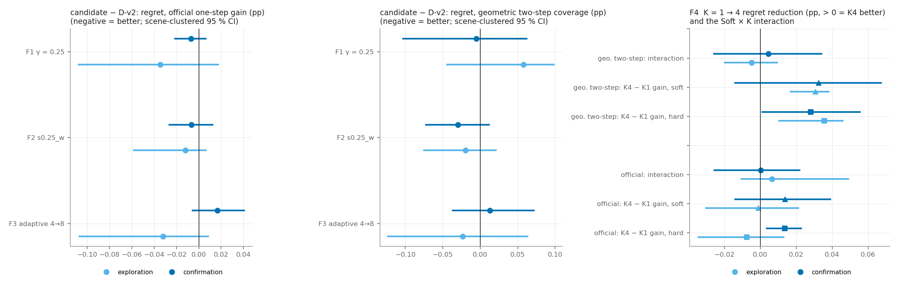
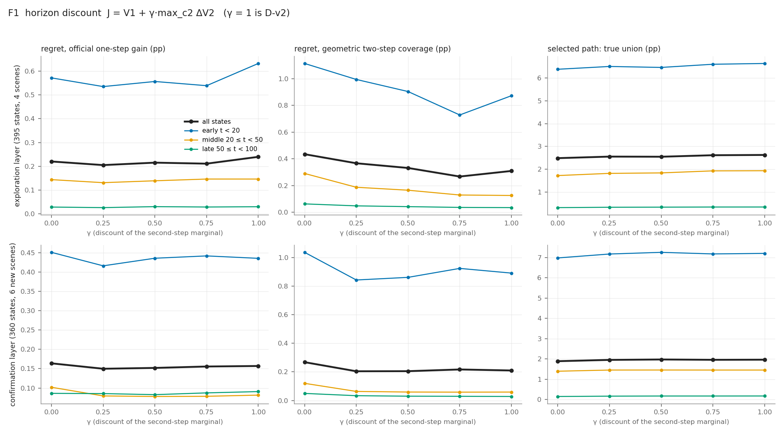
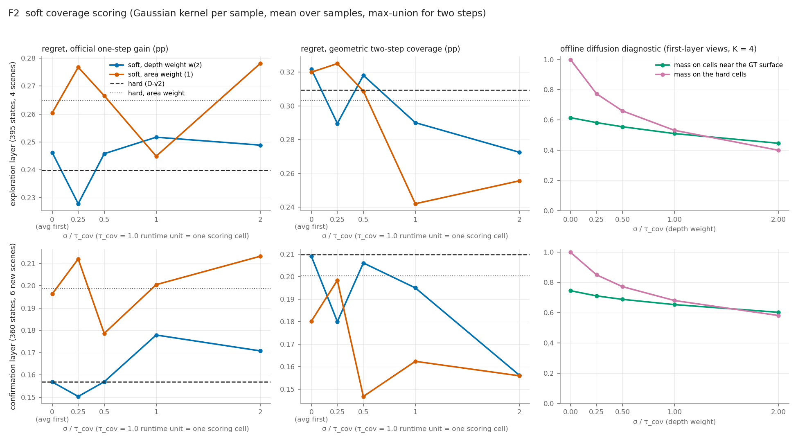
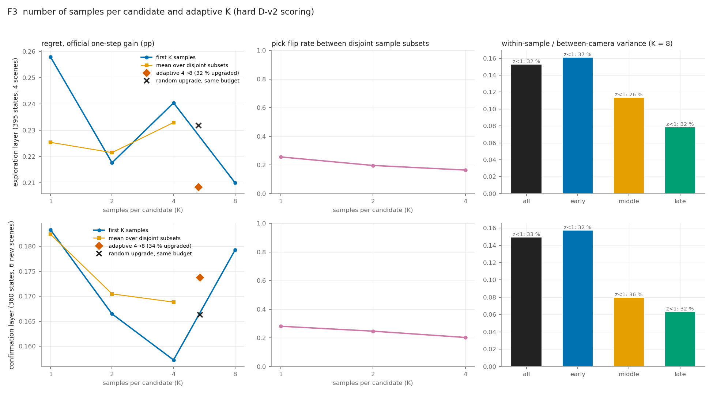

# Experiment F — Stochastic Future Views & Coverage-Aligned Decision Study

2026-11-05 · 协议：`EXPERIMENT_PLAN.md`（F-v1.0）

**冻结基线**：V3-T1 40K + D-v2。
- 输入与评分：D100 输入、S10 新颖性、可见性约束。
- 采样与前瞻：K=4、Euler10、R10、两步前瞻、λ=0。
- 评估：官方 MAGICIAN 评估。

**本轮边界**：只做固定状态的离线分析，不训练、不改模型和规划器、不覆盖任何历史结果。GT 只用于离线打分。

**口径**
- **两层数据**
  - 探索层：用于诊断，并在每个方法族中最多选出一个候选。
  - 确认层：在候选冻结之后才分析，并且只分析一次。
- **CI**：场景级配对 bootstrap（预登记，10,000 次，seed 0），轨迹级 CI 作为次要参考。
- **Regret 单位**：pp（百分点），越小越好。
- **两类真值**
  - "官方 regret"：所选相机的官方一步覆盖增益，与该状态下最优相机之差。
  - "几何两步 regret"：所选相机在其子节点中最优两步的真实并集覆盖，与最优相机之差。

| 层 | 状态数 | 轨迹 | 独立场景（CI 聚类单位） | 来源 |
|---|---|---|---|---|
| 探索层 | 395 | 36 | 4：colosseum、pisa、barts、pantheon | Multi-View 研究的同一批状态：E3 D1 轨迹 120 个 + G2 Dev-3 B0/B2 275 个 |
| 确认层 | 360 | 18 | 6：eiffel、sestino_museum、bannerman、fushimi、liberty、redeemer | D-v2 自己在 Table 1 中的闭环状态，起点 0/2/4，t=0,5,…,95；在跑任何 F 计算之前冻结 |

Test-3 未使用。dunnottar 因回放显存问题被排除（该问题见 ROI 审计）。

---

## 1. EXECUTIVE RESULT

| 阶段 | 状态 | 结论 |
|---|---|---|
| F0 基线审计 | **PASS** | 755/755 个状态逐位复现 D-v2。另外更正了一条历史结论：“价值函数喂真深度反而更差”是输入分布造成的假象，**价值函数并不是主要瓶颈**（见 §2） |
| F1 两步折扣 γ | **TREND**（未通过） | γ*=0.25：确认层官方 regret −0.007 pp，CI [−0.022, +0.006]，与探索层同号 |
| F2 软覆盖 | **TREND**（未通过） | σ*=0.25·τ、深度权重：确认层 −0.007 pp，CI [−0.026, +0.013]；大 σ 和面积权重更差 |
| F3 自适应 K | **FAIL** | 确认层 +0.017 pp（变差）；对同预算随机升级 +0.007 pp；K=8 没有稳定优于 K=4 |
| F4 交互 / 组合 | 完成（诊断） | Soft×K 交互 ≈ 0（+0.000，CI [−0.026, +0.022]）；所有组合都不可采纳 |
| F5 闭环 | **未执行** | 预登记的进入条件（至少一个候选 PASS）不满足。**没有跑任何闭环，没有 AUC 结果** |

**最佳版本：维持 D-v2（K=4、硬覆盖、γ=1）。**

三个方法族在固定状态上的变化都不超过 0.017 pp（D-v2 在确认层的官方 regret 为 0.157 pp），全部在 CI 内。F0 的结果把下一步瓶颈指向**预测质量**：同一价值函数在“模型可表达范围内的完美深度”上，一步 regret 比实际预测低 0.06–0.16 pp。

### 核心结果表（确认层，候选 − D-v2，负值 = 更好）

| 候选（探索层冻结） | 探索层 Δ官方 regret | **确认层 Δ官方 regret [场景 CI]** | 确认层 Δ几何两步 regret [CI] | 所选路径真实并集 Δ | Top-1（D-v2 0.503） | 改变的选择 | 额外成本 | 判定 |
|---|---|---|---|---|---|---|---|---|
| F1 γ=0.25 | −0.035 [−0.108, +0.017] | **−0.007 [−0.022, +0.006]** | −0.006 [−0.103, +0.062] | −0.010 pp | 0.517 | 43/360 | ≈0（复用同一批集合） | TREND |
| F2 σ=0.25·τ，深度权重，max 并集 | −0.012 [−0.058, +0.006] | **−0.007 [−0.026, +0.013]** | −0.030 [−0.073, +0.012] | +0.059 pp | 0.514 | 32/360 | +1.0 s/决策（规划 3.2 s，+31%），峰值显存 1.7 GB | TREND |
| F3 自适应 4→8 | −0.032 [−0.107, +0.008]¹ | **+0.017 [−0.006, +0.041]** | +0.013 [−0.037, +0.072] | +0.005 pp | 0.503 | 25/360 | 34% 的状态 K=8 → 平均 5.4 个样本（+34%） | FAIL |
| 交互 Soft×K（F4） | +0.006 [−0.010, +0.049] | **+0.000 [−0.026, +0.022]** | +0.004 [−0.026, +0.034] | — | — | — | — | 无交互 |

¹ 探索层的对照为同批 K=8 运行的前 4 个样本，它与规划器的 K=4 只在 1/395 个状态上选择不同。

**门槛**（预登记）：官方 regret 的点估计 < 0 且场景 CI 上界 < 0；同时几何两步 regret 点估计 ≤ +0.05 pp 且 CI 下界 ≤ 0。F3 还必须优于同预算随机升级。三个候选都没有满足第一条。

---

## 2. BASELINE / REPRODUCTION（F0）

### 2.1 复现：PASS

| 检查 | 探索层（395） | 确认层（360） |
|---|---|---|
| 记录的逐样本集合 → 两步分数 = 规划器分数（K=4 和 K=8） | 最大相对误差 0 | 0 |
| γ=1 复现 D-v2 | 395/395 逐位 | 360/360 逐位 |
| σ=0 软覆盖 = 硬覆盖（一步，单元与权重一致） | ≤ 2.3e-13 | ≤ 2.3e-13 |
| 回放分数 = 参考 | 395/395 与 Multi-View 研究存储值逐位一致 | **360/360 与 D-v2 闭环规划日志逐位一致** |
| 打分前后 P1 / S10 / D-v2 网格校验和不变 | 是 | 是 |
| 官方真值覆盖所有合法候选 | 395/395 | 360/360 |
| K=8 前 4 个样本 vs 规划器 K=4（批量大小造成的数值差） | 相对差中位数 0.3%，1/395 个选择不同 | 0.1%，3/360 个 |

**其他核对**
- **checkpoint**：task1_xattn final.pt，sha256 `639c9d3a…`，加载时校验；与 Table 1 V3-DV2-KSV 的记录一致。
- **ROI / 单位**：沿用 Geometry / ROI 审计的口径，包括 1.0 的覆盖容差和 1.0 的打分单元。
- **GT 隔离**：GT 只出现在离线真值和诊断中，所有打分变体都不读 GT。
- **确认层官方真值**：由实验 E 冻结的 GT 反事实工具生成，18/18 个 episode 全部成功。

### 2.2 历史归因审计：“同一价值函数用 GT 深度反而更差”是什么原因？

Multi-View 研究曾经报告：把 GT 深度直接代入价值函数，Top-1 只有 0.44，低于用预测深度的 0.55，并据此推断“价值函数是瓶颈”。

F0 把**真深度**分成两部分：
- 模型根本不会输出的射线；
- 经过同一投影门控之后、模型**能表达**的完美输出。门控指 encode_labels → decode：在 UNKNOWN 段上取真命中，其余射线取投影结果 t_known 或无命中。

| 一步打分（官方真值） | 探索层 regret / Top-1 | 确认层 regret / Top-1 | vs D-v2 预测（场景 CI） |
|---|---|---|---|
| D-v2 预测（K=4，一步） | 0.220 / 0.559 | 0.164 / 0.500 | — |
| 价值函数 · 原始 GT 深度（历史做法） | 0.340 / 0.435 | 0.251 / 0.458 | 确认层 +0.087 [+0.013, +0.149] |
| 价值函数 · **可表达的完美深度** | **0.062 / 0.689** | **0.104 / 0.547** | 探索层 −0.158 [−0.220, −0.124]；确认层 −0.060 [−0.118, −0.001] |
| 同上 + D-v2 可见性过滤 | 0.064 / 0.689 | 0.096 / 0.561 | 确认层 −0.068 [−0.122, −0.005] |
| 参考上限：真实命中点的几何覆盖 | 0.005 / 0.851 | 0.042 / 0.672 | — |

**机制**

原始 GT 深度的价值中，只有约 34–41% 来自模型能预测的类别（HIT）。其余来自：
- NOHIT：23% / 33%（探索层 / 确认层），真命中在射线行进范围之外；
- OUT：20% / 11%，射线没有进入 P1 网格；
- KNOWN：15% / 21%，命中已观测表面，但 S10 采样稀疏，未判定为“已覆盖”。

抽查 4 个状态、27 个视角，结果如下：
- OUT 和 NOHIT 两类的价值 **100% 来自 P1 网格外的命中点**；
- 原因是 `value_cov` 在做定义域判断之前，会把体素下标截断到网格内，网格外的命中点于是被记到了边界体素上；
- 模型的预测永远落在网格内，所以这一点**不影响规划器本身**，只让当初“直接代入 GT 深度”的对照失效。

**更正**：Multi-View 报告中“价值函数是瓶颈”的归因不成立，该历史报告本身未改动。

在模型可表达的范围内，同一价值函数配上完美预测时，一步 regret 只有 0.06–0.10 pp：
- 比当前预测低 0.06–0.16 pp；
- 距离几何覆盖上限还有约 0.06 pp。

剩余误差的主体是预测质量，价值函数只是次要部分。

---

## 3. F1 — 两步折扣 J = V1 + γ·max_c2 ΔV2

ΔV2 = max(0, V12 − V1)：同一价值泛函下、去重之后的第二步边际，使用同一批随机数。γ=1 即 D-v2（逐位一致）；没有子节点时 J = V1。

| γ | 探索层官方 regret / 几何两步 regret | 确认层官方 regret [Δ vs γ=1，场景 CI] | 确认层几何两步 regret | 确认层改变选择数 |
|---|---|---|---|---|
| 0（只看一步） | 0.220 / 0.435 | 0.164 [+0.007; −0.016, +0.032] | 0.268（+0.058，变差） | 94 |
| **0.25（冻结候选）** | 0.205 / 0.367 | **0.150 [−0.007; −0.022, +0.006]** | 0.204 | 43 |
| 0.5 | 0.215 / 0.332 | 0.152 [−0.005; −0.012, −0.000]² | 0.205 | 27 |
| 0.75 | 0.211 / 0.268 | 0.156 [−0.001; −0.005, +0.004] | 0.217 | 17 |
| 1（D-v2） | 0.240 / 0.310 | 0.157 | 0.210 | — |

² γ=0.5 在确认层的 CI 刚好不含 0，但它**不是**在探索层冻结的候选。事后改选会造成选择偏差，所以只记作观察，不能作为通过。

**分阶段**（确认层官方 regret，D-v2 → γ=0.25）
- Early：0.436 → 0.416（−0.019）
- Middle：0.082 → 0.080
- Late：0.091 → 0.086

探索层 Early 的变化更大：0.632 → 0.535。late 阶段的 regret 本来就很小。

**机制**
- **第二步主导分数**：在 D-v2 所选相机上，第二步边际是第一步价值的 1.98 倍（探索层中位数）和 1.59 倍（确认层）。ΔV2 > V1 的状态占 93% 和 74%。
- **最优子节点常被共享**：排名前两名的 c1 中，有 32–37% 共享同一个最优 c2。
- **两步打分压缩了相机之间的差距**：前两名的相对 margin 在 γ=0 时为 0.35 / 0.31，γ=1 时降到 0.20 / 0.17。

**两步是否正确**：两步本身是有用的。γ=0 在确认层的几何两步 regret 变差 +0.058 pp，官方 regret 也变差。γ=1 只是对第二步的权重略偏高。

**典型案例（探索层）**
- **Barts B2 s0，t=15**（计划中提到的早期错误）：γ≤0.25 时 regret 从 6.03 降到 0 pp。原因是 γ=1 下两个 c1 共享同一个最优子节点 [2,2,3,3,2]，第二步把差距抹平了。
- **反例 colosseum s0/s4，t=0**：γ<1 时 regret 变差 1.0–1.2 pp，这里真正的好相机需要两步之后才显现。

两类情况相互抵消，所以平均效应很小。

---

## 4. F2 — Soft Coverage

**算法**
- 每个样本的命中点就是 D-v2 硬集合中的那些新颖命中，以截断高斯核扩散到 1.0 单元上：s_k[v] = max_x w(x)·exp(−d²/2σ²)，d ≤ 2σ。
- 扩散到的单元必须通过物理过滤：在 P1 定义域内、P1 中非 EMPTY、1.0 范围内没有 S10 点、相机可见（未被 D-v2 观测网格遮挡）。
- 对 K 个样本取均值后求和；两步并集取逐单元 max。
- σ=0 时与硬覆盖完全一致。
- 没有任何基于 GT 的权重。

| 变体（K=4，两步，max 并集） | 探索层官方 / 几何两步 regret | 确认层官方 regret（Δ，场景 CI） | 确认层几何两步 regret |
|---|---|---|---|
| hard（D-v2） | 0.240 / 0.310 | 0.157 | 0.210 |
| hard，面积权重（不按深度加权） | 0.265 / 0.304 | 0.199（**+0.042 [+0.014, +0.071]**） | 0.200 |
| σ=0，先平均再并集 | 0.246 / 0.322 | 0.157（0.000，仅 4 个选择不同） | 0.209 |
| **σ=0.25，深度权重（冻结候选）** | 0.228 / 0.290 | 0.150（−0.007 [−0.026, +0.013]） | 0.180 |
| σ=0.5，深度权重 | 0.246 / 0.318 | 0.157（+0.000） | 0.206 |
| σ=1，深度权重 | 0.252 / 0.290 | 0.178（+0.021） | 0.195 |
| σ=2，深度权重 | 0.249 / 0.273 | 0.171（+0.014） | 0.156 |
| σ=0.25–2，面积权重 | 0.245–0.278 | 0.179–0.213（+0.022 到 +0.056） | 0.147–0.198 |

**发现**
1. **深度权重 w(z) 是必要的**，面积权重在两层都显著更差。这是本轮在两层上都有统计支持的结论之一。
2. **σ 越大，官方 regret 越差，但几何两步 regret 有改善的趋势**（σ=2：0.156 vs 0.210，CI 含 0）。官方真值是一步、而且按单元封顶，和两步并集口径不一致；不能把几何口径的改善当作官方收益。
3. **“先平均再并集”没有作用**：σ=0 时只改变了 4 个选择。
4. **并集规则**（只对冻结的变体做消融）：
   - clip-sum 在两层都显著优于 D-v2（确认层 −0.014 [−0.025, −0.004]，探索层 −0.037 [−0.121, −0.000]）；
   - noisy-or（假设独立）为 −0.005，不显著；
   - **但 clip-sum 不是预登记的主规则，属于事后发现**，只能作为下一轮预登记的假设。
5. **一步软打分**（探索性分析）：σ=0.5/1、深度权重在确认层显著优于一步硬打分（−0.017 [−0.031, −0.005]），但在探索层不显著，方向也不一致。

**扩散风险（离线诊断，第一层视角，K=4）**

| σ（深度权重） | 0（hard） | 0.25 | 0.5 | 1 | 2 |
|---|---|---|---|---|---|
| 软质量落在 GT 表面附近单元的比例：探索层 / 确认层 | 0.62 / 0.75 | 0.58 / 0.71 | 0.56 / 0.69 | 0.51 / 0.65 | 0.45 / 0.60 |
| 软质量仍在硬单元上的比例（确认层） | 1.00 | 0.85 | 0.77 | 0.68 | 0.58 |
| 总质量 / 硬集合质量 | 1.0 | 1.5 | 1.8 | 2.4 | 3.3 |

核主要把质量推向**离开真实表面**的位置：σ≥1 时，有三分之一以上的质量离开了硬单元，落在表面附近的比例下降 0.09–0.17。这就是幻觉扩散。物理过滤只能挡住已知空、已观测、被遮挡这几类单元，挡不住未知区中的扩散。

**成本**（σ=0.25 深度权重，eiffel s0 上 5 个状态，未优化）：每次决策额外 1.0 s（规划器自身 3.2 s，+31%），峰值显存 1.7 GB，低于规划器的 2.8 GB。

---

## 5. F3 — 样本数 K 与自适应 K（硬覆盖）

所有比较都在同一批 K=8 运行内进行（前 1/2/4/8 个样本，以及不相交子集）。

| | 探索层官方 regret | 确认层官方 regret（Δ vs 前 4 个样本，场景 CI） | 确认层几何两步 regret | 不相交子集之间的选择翻转率（确认 / 探索） |
|---|---|---|---|---|
| K=1 | 0.258 | 0.183（**+0.026 [+0.010, +0.045]**） | 0.275 | 28% / 26% |
| K=2 | 0.218 | 0.167（+0.009） | 0.251 | 25% / 20% |
| K=4 | 0.240 | 0.157 | 0.210 | 20% / 16% |
| K=6 | 0.221 | 0.164（+0.007） | 0.192 | — |
| K=8 | 0.210 | 0.179（+0.022 [−0.003, +0.054]） | 0.248 | — |
| 自适应 4→8（升级 34%，平均 5.4 个样本） | 0.208 | 0.174（+0.016） | 0.223 | — |
| 同预算：随机升级 34%（50 个 seed） | 0.232 | 0.166 | 0.224 | — |
| 同预算：固定 K=5 | 0.209 | 0.169 | 0.200 | — |

**升级规则（冻结）**：前两名两步分数的差 / 合成标准误 < 1，或者 200 次 bootstrap 中 top-1 改变的比例超过 25%。

**结论**
- **K=1 明显更差**：确认层显著，探索层同号但不显著。
- **K>4 的效果在两层方向相反**：探索层变好，确认层变差。
- **自适应 K 不优于同预算随机升级**：确认层 +0.007 [−0.005, +0.020]；在探索层，它与固定 K=5 几乎相同（0.208 vs 0.209）。

**噪声随步数的作用**（K=8，逐样本的两步路径价值）
- 样本内方差 / 相机间方差：Early 0.16，Middle 0.08–0.11，Late 0.06–0.08，即随步数下降。
- 但各阶段都有 32–37% 的状态前两名 z<1，属于统计上模糊的状态。
- 这些模糊状态中，多采样并不能稳定改对。原因是样本均值本身就带有系统偏差（同时见 §2.2），继续采样只能减小方差，消不掉偏差。

---

## 6. F4 / F5 — 交互、组合与闭环

**Soft × K 交互**
- 定义：[Gain(Soft,K4) − Gain(Soft,K1)] − [Gain(Hard,K4) − Gain(Hard,K1)]，其中 Gain = −regret；K1 为 8 个单样本的平均，K4 为两个不相交四元组的平均。

| | 探索层 | 确认层 |
|---|---|---|
| 交互项，官方 regret | +0.006 [−0.010, +0.049] | **+0.000 [−0.026, +0.022]** |
| 交互项，几何两步 regret | −0.005 [−0.020, +0.009] | +0.004 [−0.026, +0.034] |
| K1→K4 收益，hard（官方 / 几何两步） | −0.008 n.s. / **+0.036 [+0.010, +0.046]** | **+0.014 [+0.004, +0.023]** / **+0.028 [+0.001, +0.055]** |
| K1→K4 收益，soft（官方 / 几何两步） | −0.001 n.s. / +0.031 [+0.017, +0.038] | +0.014 n.s. / +0.032 n.s. |

**Soft 没有更好地利用多个样本。** 多样本的收益在 Hard 和 Soft 下几乎相同：几何两步口径在两层都约 +0.03 pp，官方口径只在确认层显著。

**组合**
- 由于没有方法族通过门槛，预登记的“只组合已通过的方法族”为空。
- 诊断性组合中，F1+F3 在确认层为 −0.013 [−0.024, −0.002]（探索层 −0.022，不显著）。但 F3 本身没有通过门槛，而且这是确认层上第 7 个以上的比较（确认层共约 25 个对照，按 5% 计预期约 1 个假阳性），不能采纳。

**F5：未执行。** 预登记的 Smoke、Dev-5（每个策略 25 个 episode）、All-14 都没有运行，**不存在任何 AUC@20、AUC@100 或 Final 结果**。确认层上 −0.007 pp 的一步 regret 变化约为 D-v2 regret 的 4%；即使它是真的，也不能直接解读为闭环 AUC 的改善。

---

## 7. CONCLUSION

**三项是否真的产生增益？没有被证实。**
- F1、F2 在两层上方向一致，但幅度很小：确认层约 −0.007 pp，约为 D-v2 regret 的 4–5%，CI 含 0。
- F3 在确认层反向，失败。

**多样本 Future View 的论文主张得到哪些支持？**
- K=4 相对 K=1 降低了决策方差：翻转率从 28% 降到 20%；几何两步 regret 在两层上都显著降低。
- 不支持“多样本带来可利用的多假设结构”：Soft×K 交互 ≈ 0，自适应 K 失败，K=8 没有稳定收益。

**下一步的阻塞点**
- 决策层已经接近当前预测质量下能做到的程度。
- 主要瓶颈是预测：在模型可表达的范围内用完美深度，一步 regret 可以下降 0.06–0.16 pp（§2.2）。

### 回答八个问题

1. **F1 折扣是否有帮助？** 只是趋势。冻结的 γ=0.25 在确认层 −0.007 pp [−0.022, +0.006]，探索层 −0.035 pp，同号但都不显著；收益集中在 Early 阶段。一步（γ=0）明显更差，所以两步前瞻本身有用，γ=1 只是对第二步的权重略偏高。
2. **F2 Soft 是否优于 Hard？** 不显著。冻结的 σ=0.25·τ 在确认层 −0.007 pp [−0.026, +0.013]。σ≥0.5 和面积权重都更差，大 σ 有明显的幻觉扩散。clip-sum 并集在两层都显著，但属于事后发现。
3. **F3：K=4 的优势与自适应 K？** K=4 优于 K=1（确认层显著）；K=8 不稳定，两层方向相反。自适应 4→8 不优于同预算随机升级（+0.007 pp），失败。
4. **Soft 是否更好地利用多个样本？** 否。交互项为 +0.000 [−0.026, +0.022]，Hard 和 Soft 从 K1 到 K4 的收益几乎相同。
5. **哪些有统计支持，哪些只是趋势？**
   - 有支持（确认层场景 CI 不含 0）：
     - F0 逐位复现；
     - 深度权重优于面积权重（两层都成立）；
     - K=1 比 K=4 差（官方口径只在确认层；几何两步口径两层都成立）；
     - 原始 GT 深度对照失效的机制（OUT/NOHIT 价值 100% 来自网格外）；
     - 可表达的完美深度显著优于当前预测。
   - 只是趋势：F1 γ=0.25、F2 σ=0.25。
   - 事后发现或多重比较（不可采纳）：γ=0.5、clip-sum 并集、一步软打分、F1+F3 组合。
6. **是否完成闭环？** 没有。门槛未通过，F5 按协议不进入；AUC@20、AUC@100、Final 均无。
7. **是否需要修改 V3 或 D-v2？** 不需要，主行维持 D-v2（K=4，硬覆盖，γ=1，深度权重）。不要采用自适应 K 或 K=8。如果还要在决策层上投入，唯一值得重新预登记的是“γ≈0.25–0.5 + clip-sum 并集”，但预期闭环收益很小；更值得投入的是预测质量（§2.2）。
8. **对 CVPR 核心创新的含义**
   - 叙述应以“生成式 Future Observation 预测 + 与覆盖对齐的两步价值”为主。K=4 应表述为“四个随机 Future Observation 带来的方差削减”，**不要称为 multi-world 推理**，也不要声称 soft coverage、自适应采样或 horizon discount 带来提升。
   - 固定状态的改进不能写成闭环 AUC 的改进。
   - 论文中原有的“价值函数是瓶颈”说法需要按 §2.2 更正为“预测质量是主要瓶颈”。

---

## 8. REPRODUCIBILITY

| 内容 | 位置（相对本目录） |
|---|---|
| 协议 | `EXPERIMENT_PLAN.md`（sha256 `6de83e9d…`，与 `experiments/exp6_v3/V3_Experiment_F_Coverage_Decision_Study.md` 相同） |
| 冻结配置 | `configs/F_config.yaml`（`49b7f66e…`）、`configs/confirmation_set.json`（`bb83f826…`）；D-v2 `E3_dv2_closed_loop/configs/dv2_v2.yaml`（`54acc610…`）；H `FROZEN_CONFIG.yaml`（`ab8aff70…`） |
| 候选冻结 | `results/selection.json`（`d6e8ef70…`，由探索层规则一次写入，重算时校验一致） |
| 脚本 | `scripts/f_core.py`（逐状态缓存与全部打分变体）、`f_run.py`（回放驱动）、`f_queue.sh`、`f_oracle_queue.sh`、`f_analyze.py`（F0–F4 统计与门槛）、`f_figures.py`、`f0_clamp_check.py`、`f2_bench.py` |
| 结果 | `results/F0_regression/`（复现、GT 深度审计、截断检查、逐状态 CSV）、`results/F1_horizon_discount/`、`results/F2_soft_coverage/`（含成本基准）、`results/F3_adaptive_K/`、`results/F4_interaction/`（门槛判定 `F_confirm_gates.json`、交互、组合）、`results/F5_closed_loop/`（空：未进入） |
| 图 | `figures/F_summary.png`、`F1_gamma.png`、`F2_soft.png`、`F3_K.png` |
| 日志 | `logs/EVENTS.md`（时间线、偏差与决定）；各 worker 和 oracle 的运行日志也在 `logs/` |
| 大文件（不入库） | `work_dirs/exp6_v3/ablation_study/experiment_F_stochastic_coverage_decision/`：states 202 MB、确认层 oracle |

**资源**：自有作业 3461041（gpu114）和 3465477（gpu115），各 4×L40S，未与他人争用。缓存约 8 GPU-h（03:20–04:19，8 卡），确认层 oracle 约 0.2 GPU-h。

**偏差**（详见 EVENTS）：
- 运行前修正了 GT 深度审计 "gated" 的措辞（参数未变）；
- 运行前补充了离线扩散诊断；
- 确认层与探索层在同一批任务中缓存，但确认层只在 `selection.json` 写入之后才分析。
