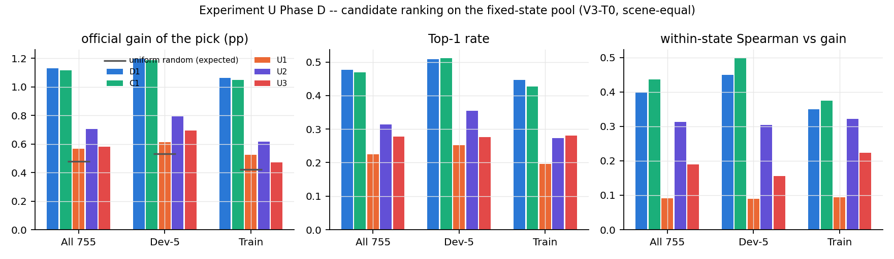
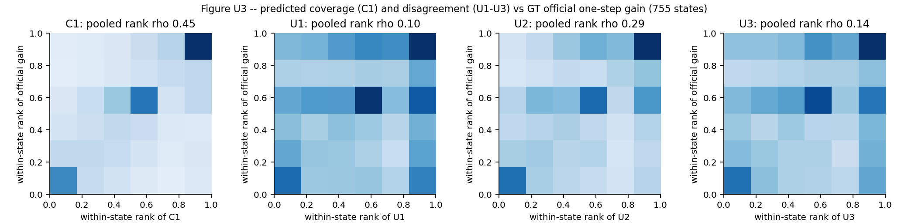
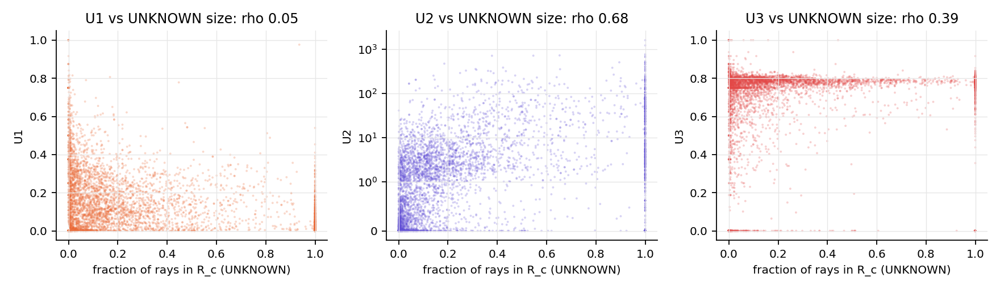

# U1 — 固定状态诊断（Experiment U Phase D，协议 U-v1）

2026-11-13 · 代码 `scripts/u_fixed.py`（回放）、`scripts/u_analyze_fixed.py`（统计、Table U3、图）、`scripts/u_fig_cases.py`（Figure U2）。原始行 `work_dirs/exp6_v3/experiment_U/fixed/states/*.jsonl`（54 条轨迹），候选预测数组 `.../fixed/arrays/`（1.4 GB）。汇总 `results/fixed/{fixed_summary.json, table_U3_decision_quality.csv, fixed_states.csv, fixed_candidates.csv, high_u_low_gain_cases.csv, figure_U2_cases.json}`。

**口径**
- 状态池：Experiment F 的 755 个户外状态（10 个场景；Dev-5 495：colosseum 192、pantheon 92、barts 91、eiffel 60、sestino 60；Train 260：bannerman / fushimi / liberty / redeemer 各 60、pisa 20）。没有 Test-3，没有 dunnottar。选择理由见 U0 §D。
- 模型与规划：V3-T0@40K（sha `7ed0ddd7…`），D1 冻结路径（D-v2 关闭），K = 4，Euler 10，R10，冻结噪声键；所有分数都来自规划器同一批预测。
- 真值：每个合法候选的**官方一步覆盖增益（pp）**（F 的 oracle 行，MAGICIAN 官方覆盖；因为覆盖有上限，增益可以为负）；次要标签 = F 的几何一步增益 `geo1`。另做了**离线 GT 归因**（GT 首次命中 → 训练标签规则 `encode_labels`），只用于回答“分歧从哪里来”，不进任何分数。
- 选择规则：与规划器相同的 `m_score.choose`（argmax、并列取最小下标、全 0 → 种子化随机回退）。
- 统计：状态 → 场景平均 → 10 个场景等权；差值用场景配对 bootstrap（10,000 次，seed 0）。
- 耗时：8 张 L40S，约 23 分钟（≈ 3.1 GPU-h）；规划 3.1 s/状态，U 指标 + GT 归因 0.27 s/状态。

## 0. 回归（全部通过）
| 检查 | 结果 |
|---|---|
| 候选列表、D1 路径与 F 一致 | 755/755、755/755 |
| D1 分数与 EXP9 Table 4 V2 的 V3-T0 行**逐位**一致 | 755/755 |
| C1 = 记录的逐样本 `value_cov` 均值 | 755/755 |
| U 计算 / GT 归因 / 数组写出失败 | 0 / 0 / 0 |

## 1. Table U3 — 决策质量（755 个状态，场景等权）

| 打分 | 角色 | 所选候选的官方增益 pp | 几何增益 pp | Top-1 | 状态内 Spearman（vs 增益） | 与 C1 选同一候选 | Δ增益 vs C1 [95% CI]（好 / 差场景） |
|---|---|---|---|---|---|---|---|
| D1 两步覆盖 | 规划器（Table 1） | **1.131** | 1.112 | **0.478** | 0.399 | 0.754 | +0.015 [−0.002, +0.034]（6 / 4） |
| C1 一步覆盖 | 规划器（受控对照） | 1.116 | 1.095 | 0.469 | **0.437** | 1 | — |
| U1 命中分歧 | 规划器（冻结） | 0.568 | 0.574 | 0.224 | 0.091 | 0.216 | **−0.548 [−0.685, −0.438]（0 / 10）** |
| **U2 深度分歧（U-best）** | 规划器（冻结） | 0.704 | 0.686 | 0.314 | 0.313 | 0.233 | **−0.412 [−0.555, −0.287]（0 / 10）** |
| U3 几何分歧 | 规划器（冻结） | 0.582 | 0.571 | 0.278 | 0.189 | 0.192 | **−0.534 [−0.625, −0.440]（0 / 10）** |
| U2-rel（弧长坐标） | 仅诊断 | 0.457 | 0.454 | 0.232 | 0.093 | 0.186 | −0.659 [−0.824, −0.508]（0 / 10） |
| U3-sum（求和，不归一化） | 仅诊断 | 1.115 | 1.094 | 0.467 | 0.429 | 0.652 | −0.001 [−0.040, +0.035]（6 / 4） |
| U1-sum | 仅诊断 | 0.839 | 0.835 | 0.374 | 0.351 | 0.388 | −0.278 [−0.386, −0.188]（0 / 10） |
| Chamfer（假设间表面距离） | 仅诊断 | 0.660 | 0.645 | 0.282 | 0.201 | 0.174 | −0.456 [−0.602, −0.333]（0 / 10） |
| 1 − Jaccard | 仅诊断 | 0.642 | 0.624 | 0.261 | 0.195 | 0.144 | −0.475 [−0.568, −0.389]（0 / 10） |
| 参照：均匀随机（期望） | — | 0.477 | — | — | — | — | — |
| 参照：状态内最优（oracle） | — | 1.330 | — | 1 | — | — | — |

分组（`results/fixed/table_U3_decision_quality.csv`）：Dev-5（495 状态）增益 D1 1.200 / C1 1.185 / U1 0.614 / U2 0.792 / U3 0.694（随机 0.532）；Train 五场景（260）D1 1.062 / C1 1.048 / U1 0.523 / U2 0.616 / U3 0.470（随机 0.423）。三个 U 在两组的每个场景都比 C1 差。附录口径的 regret（oracle − 所选）：D1 0.199、C1 0.214、U1 0.762、U2 0.626、U3 0.748 pp。

NOT_AVAILABLE：
- Test-3 的固定状态（池中没有带 oracle 的 Test-3 状态）；
- U4 的任何决策质量（U4 未定义，见 §3）；
- 第二层子视角的 GT 归因（只对第一层候选做了 GT 归因）；
- 闭环决策质量（Phase E 未运行）。

## 2. U-best（预注册规则执行结果）
规则：755 状态池上按 `choose` 选出的候选的场景等权官方增益最大者。U1 0.568、**U2 0.704**、U3 0.582 → **U-best = U2**。该规则在任何闭环运行之前执行，结果不会再改。U2 也是三者中唯一在状态内排序上与增益有中等相关的（0.313，C1 0.437）。

## 3. U4 规则（预注册）：**FAIL → U4 未定义**
在两个视角都预测到的单元上（39,212 条 D1 路径，560 万个重叠单元）：同编号一致度 0.349，不同编号 0.318，差 +0.031 [+0.023, +0.041]，10/10 个场景同编号更高；但比值 **1.10 < 1.25**。同一噪声编号有一点耦合（推测来自图像空间共享噪声在相邻视角之间的像素对齐，未单独验证），但远不足以把“样本 k”当作同一个三维世界。按冻结规则，不构造跨视角联合单元，U4 不进入 Phase E。若用户仍想要两步版本，只能是单独标注的“逐视角分歧两步启发式”（不是联合分歧，更不是信息增益），需要另外批准；其一步版本（U-best = U2）在固定状态上已明显不如 C1，两步启发式先验上不乐观。

## 4. 任务书 §5 的六个问题

**Q1 分歧能否区分候选？——U1、U2 能拉开差距，但排序与真实增益几乎无关；U3 几乎不能区分。**
- 状态内变异系数中位数：U1 0.71、U2 1.00、**U3 0.10**。U3 非零值集中在 0.63–0.82（25%–95% 分位），因为大多数单元只被 1–2 个假设命中（K = 4 时单个单元只能取 0 / 0.75 / 1）。
- 状态内与官方增益的 Spearman：U1 0.09、U2 0.31、U3 0.19（C1 0.44、D1 0.40）。U 选出的候选与 C1 相同的只有 19–23%。

**Q2 是否几乎所有候选的分歧都接近 0？——不是。**
- 候选级为 0 的比例：U1 17%、U2 21%、U3 16%（C1 20%）。
- 整个状态全为 0（触发随机回退）：U1 4.7%、U2 6.5%、U3 4.1%（场景等权；C1 6.4%、D1 1.9%）。
- 状态内最大值 < 0.01 的状态：U1 4.5%、U2 5.7%、U3 3.3%。

**Q3 高分歧是否主要来自生成噪声、无效深度或伪表面？——U1、U3 主要来自伪表面 / 推测性命中；U2 主要在真实表面上，但被深度尺度和极少数射线放大。**（离线 GT 归因，5,355 个第一层候选）
- U1 的分歧质量只有 36% 落在“真实表面就在 UNKNOWN 段里”的射线上（这类射线占 R_c 的 19%）；28% 落在真实表面在已知表面处或之后的射线（UNKNOWN 段里本来没有表面），9% 落在真无命中的射线，27% 落在被遮挡 / 近裁剪 / 网格外等其它类别。36% 的 U1 质量来自“4 个样本里只有 1 个命中”的射线。
- 命中精度：在真实表面就在 UNKNOWN 段里的射线上，生成命中与真值相差 ≤ 1.0 的只有 35%；在 HIT / NOHIT / KNOWN 三类射线上的生成命中里，13% 落在 UNKNOWN 段内根本没有真实表面的射线上（NOHIT / KNOWN）。
- U3：只有 **7.6%** 的分歧质量（8.2% 的分歧单元）落在含真实 UNKNOWN 表面点的 1.0 格子里；其余 92% 是没有真实表面的格子。这一判据很严格（同一个 1.0 格子），但足以说明 U3 的分歧主体是互相矛盾的推测表面。
- U2：77% 的方差质量在真实表面射线上；在这些射线上，候选内“样本深度离散度 vs 平均深度误差”的 Spearman 中位数 0.46 —— 深度分歧确实反映了深度误差。但它同时随距离增大（状态内与平均命中距离的 Spearman 0.44，全体 0.33），并会被极少数射线放大（下面的案例 A：U2 = 1,590 只来自 3 条射线）。U2-rel（弧长坐标）消除了部分尺度效应（与距离 0.19），决策反而更差（增益 0.457，接近随机）。
- 先验证据一致：多视角研究（T1）中 84–86% 的跨视角冲突来自幻觉表面；Experiment B（T1 / B2）中 DepthU 与 GT 深度误差的相关只有 0.13–0.25。

**Q4 高分歧视角是否通常对应有意义的未知区域？——不是。**
- 所选候选的 UNKNOWN 射线比例（均值）：U1 0.17、U3 0.25、U2 0.30，对比 C1 0.28、D1 0.29；中位数 n_rc：U1 428、U3 706、U2 883、C1 1,004。
- 所选候选的支持很小：参与 U2 的射线（≥ 2 个命中）< 100 条的比例，U2 48%、U3 52%、U1 46%，C1 31%；预测单元 < 20 个的比例，U3 32%、U1 28%，C1 17%。强度量（平均）定义在小支持上方差大，argmax 自然偏向这类候选（赢家诅咒）。
- 所选候选增益 ≤ 状态最优 10% 的比例：U1 38%、U3 32%、U2 27%，C1 20%、D1 19%（未加权）。

**Q5 分歧是否与当前地图的未知区域规模高度相关？——U2 是，U3 中等，U1 不是（但 U1 也不含有用信息）。**
- 状态内 Spearman（U vs UNKNOWN 射线数）：U1 −0.07、U2 0.37、U3 0.16（C1 0.38）；U3 vs 预测单元数 0.31，而未归一化的 U3-sum vs 单元数 **0.97**。
- 状态层面（状态平均分歧 vs 未知射线比例）：U1 −0.22、U2 **0.75**、U3 0.51；与步数 t：U2 −0.59、U3 −0.26、U1 +0.23。
- 解读：冻结的 U3（平均）确实去掉了规模效应，但也去掉了信息；U3-sum 保留了规模，于是几乎变成“预测未知表面的面积”，决策质量与 C1 相同（1.115 vs 1.116，CI 含 0）——它是覆盖的代理，而不是新的信号。U3-sum 只是诊断，没有改变冻结定义。

**Q6 是否存在分歧高、实际新增覆盖很低的典型案例？——大量存在。**
- U 的选择 ≤ 状态最优 10%、而 C1 的选择 ≥ 90% 的状态：U1 111、U3 100、U2 68（共 755 个状态；清单 `results/fixed/high_u_low_gain_cases.csv`）。
- 案例（真实模型输出，Figure U2）：
  - **A** `conf_eiffel_s0 t=10`：U2 选中的候选 U2 = 1,590，但只来自 3 条有 ≥ 2 个命中的射线，官方增益 0.57 pp；C1 选中的候选增益 3.34 pp（最优 3.62）。
  - **B** `g2_B0_barts_s2 t=5`：U2 选中的视角未知区域小，深度离散 14.5，增益 1.21 pp；C1 选中的视角有大片未知区域、四个假设差异明显（U1 0.31，反而更高），增益 18.09 pp（最优）。
  - **C** `conf_bannerman_s2 t=0`：U2 与 C1 选到同一个（最优，7.53 pp）；对照行是 U2 最低的候选，它几乎没有未知射线，U1 却有 0.29 —— 平均型 U1 在极小支持上的放大。

Figure U2（真实 K = 4 假设、逐射线 4p(1−p)、反投影点按 p_v 着色的俯视图，GT 只出现在标题的增益里）：
- `figures/U2_case_A_conf_eiffel_s0_t10.png`
- `figures/U2_case_B_g2_B0_barts_s2_t5.png`
- `figures/U2_case_C_conf_bannerman_s2_t0.png`
选例规则写在 `u_fig_cases.py` 文件头；规则 C 在第一稿选中了一个全 0 的退化状态（eiffel s2 t = 0，所有候选增益与分歧都是 0）之后，加上了“oracle 最大值 > 0 且 U-best 非全 0”的条件，已在文件头注明。

## 5. 结论（固定状态，只代表一步决策质量）
1. 三个冻结的分歧分数在固定状态上都**显著不如**同深度的覆盖分数 C1（所选候选的官方增益低 0.41–0.55 pp，10/10 场景更差），U1、U3 只比均匀随机略好（0.568、0.582 vs 0.477），U2 好一些（0.704）。D1 与 C1 的差别（+0.015）比这小一个数量级。
2. 原因：(i) U1、U3 的分歧主体是互相矛盾的推测表面，不是“观测一下就能消除的真实歧义”；(ii) 平均型定义在小支持候选上方差大，argmax 偏向未知区域小的视角；(iii) 保留规模的版本（U3-sum）退化为覆盖面积的代理，与 C1 不可区分。
3. 这些固定状态结果**不能**替代闭环：分歧策略可能在多步上表现不同（任务书关心的是前 20 步）。但一步决策质量是闭环一步策略的主要成分，按目前证据，U1–U3 进入 Phase E 后预期都会低于 C1，更低于 D1；这是预期，不是结果。
4. U-best = U2；U4 未定义。
