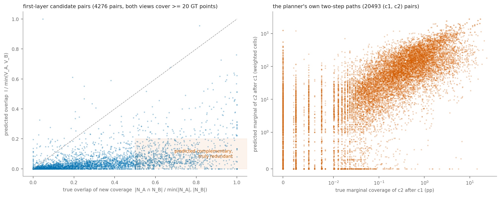
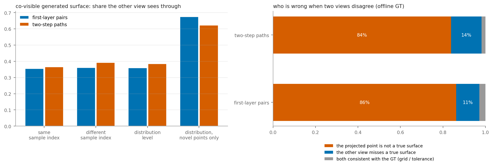
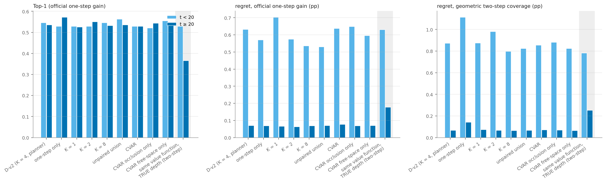
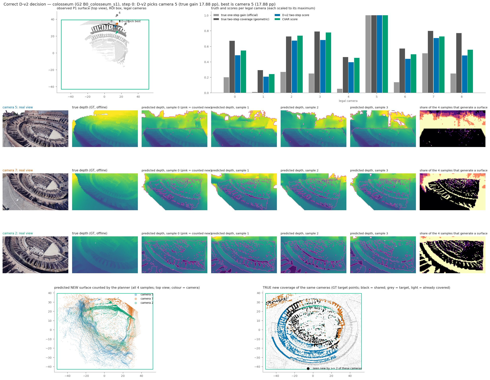
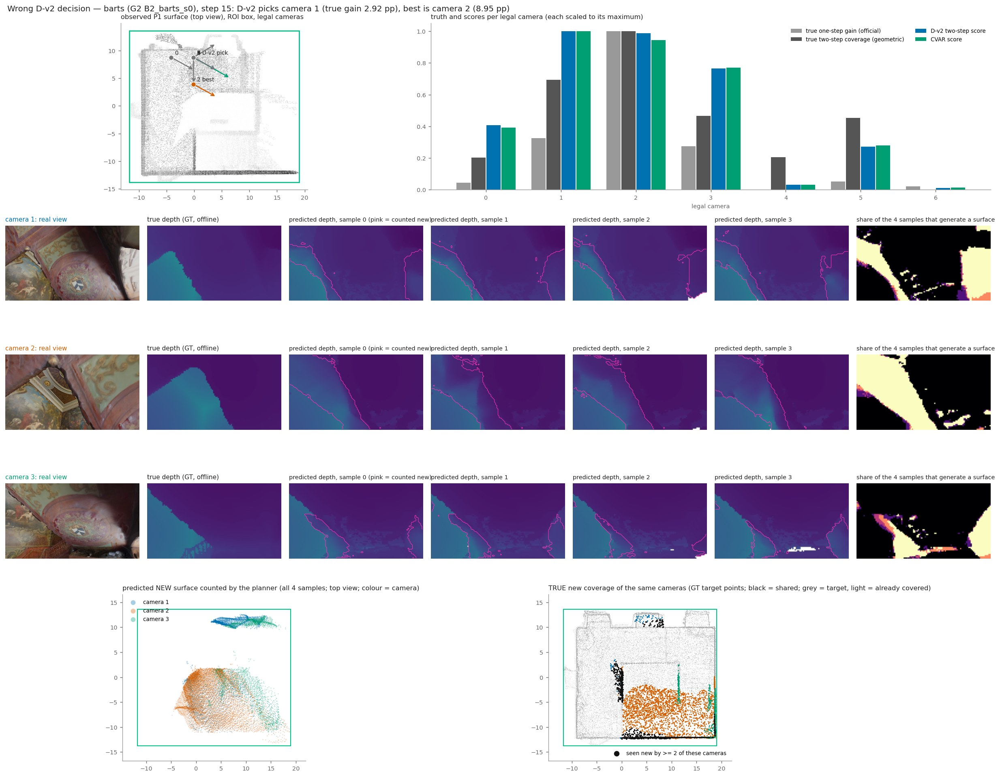

# Multi-View Coverage Reasoning Study（A/B/C/D）

2026-11-05 · 冻结的 V3-T1 40K + D-v2（D100 输入 / S10 评分，K=4，Euler10，R10，两步前瞻，λ=0）· 只做离线分析：不训练、不改模型与历史结果、不跑闭环 · GT 只用于离线打分

**口径**：ROI、世界坐标、覆盖容差（1.0）与 Geometry / ROI 审计（`experiments/cvpr_results/geometry_roi_audit/`）相同；审计没有发现 Critical 或 Major 问题，所以本研究没有未解决的空间口径依赖。

**规模**：395 个固定状态，Test-3 未使用。
- E3：D1 轨迹上 colosseum 5 个起点 + pisa s1，每 5 步一个，共 120 个。
- G2：Dev-3 的 B0/B2 轨迹，共 275 个。
- 合计约 2,760 个第一层候选相机、约 15,700 个两步视角、8,648 个第一层相机对、20,493 条两步路径。

## 结论

**本轮的核心判断：没有找到能从多个随机 Future View 的几何关系中提取、并实际改善选点的信息。真正限制选点的是价值函数本身，而不是多视角预测之间的关系。**

1. **候选之间的真实覆盖差异很大，模型却几乎看不出它们之间的重叠。**
   - 真实重叠：同一状态下两个候选的新增覆盖，中位数有 25% 是重叠的；规划器自己的两步路径上是 57%。
   - 预测重叠：分别只有 1.3% 和 5%。
   - 后果：第二步的"新增价值"有 45% 落在第一步其实已经看到的表面上。
2. **K=4 随机生成没有真正改善选点，只是让选择更稳定。**
   - 在不相交的样本子集上取平均，K=1/2/4 的 regret 都在 0.22–0.23 pp，K=8 为 0.21 pp，置信区间都含 0。
   - 同一样本编号在不同相机之间并不对应同一个"世界"。
3. **跨视角几何冲突很普遍，但与选错几乎无关。**
   - 两个相机共同可见的生成表面中，36% 被另一个相机"看穿"。冲突中 84–86% 是因为被投影的点本身就是幻觉。
   - 两个相机彼此一致的点，也只有 11–18% 是真实表面。
   - 冲突率与选点 regret 的相关系数只有 0.15，选错和选对的状态冲突率几乎相同（0.48 对 0.46）。
4. **最能解释错误决策的不是 A/B/C，而是价值函数。** 同一价值函数改用**真实深度**，Top-1 只有 0.44，比当前用预测深度的 0.55 还低；而对同一批真实命中点直接计算目标表面覆盖，Top-1 能到 0.80–0.85。在 A/B/C 之中，B（采样噪声）解释得最多：42% 的错误决策换一组样本就会选对。
5. **新机制没有找到。**
   - CVAR 未通过预登记门槛：官方 regret +0.007，Top-1 −0.010。
   - 无配对并集（只改变 5/395 个选择）、K=8、稠密观测新颖性都没有显著改善。
   - 唯一明确的方向是让价值函数与覆盖率对齐，但具体是价值函数的哪一部分出了问题，本轮还没有分离出来。
6. **不建议现在为多视角一致性去改模型架构或训练方法。** 优先级最高的是规划器的价值函数。
7. **不值得为 A/B/C/D 中的任何一项跑闭环。** 下一步应先离线拆解价值函数，有明确的离线改善后再预登记小规模闭环。

## 1. 正确性

- **集合来自规划器本身，没有重新实现**。所有预测集合都是从运行中的 D-v2 规划器抓取的：钩住 `value_cov` 和 lookahead，包括第一层和全部第二步视角。
- **两步分数逐位复现**：用抓取的集合重算出的两步分数与规划器输出完全相同，395 个状态在 K=4 和 K=8 下的最大相对误差都是 0。
- **其他校验**：
  - 逐射线新颖性的重建与规划器集合逐个单元一致；
  - 投影自检 100% 通过；
  - 两个案例状态单独重跑，结果与主运行逐位相同。
- **K 子集只是近似等价**：K=8 运行中前 4 个样本与真实以 K=4 运行的结果相比，分数中位差 0.3%，0.25% 的状态选择不同。原因是不同批大小下数值不完全一致。下文的 K 比较都在 K=8 这一次运行内部做，彼此一致。
- **几何覆盖真值可信**：它与官方一步增益的 Spearman ρ = 0.84，早期 t<20 为 0.98。

## 2. Task A：视角互补性

| 指标 | 第一层相机对 | 规划器的两步路径 (c1, c2) |
|---|---|---|
| 数量（两边都新覆盖 ≥ 20 个 GT 点） | 8,648（4,304） | 20,493（10,353） |
| 真实重叠中位数：\|N_A∩N_B\| / min | **0.25** | **0.57** |
| 预测重叠中位数：I / min(V_A, V_B) | **0.013** | **0.053** |
| 预测与真实重叠的 Spearman | 0.53 | 0.49 |
| "预测互补、真实重复"的比例（预测 < 0.2 且真实 > 0.5） | 21.5% | 49.6% |
| B 的预测边际价值中，落在 A 也真实看到的表面上的比例（重复计分） | 21% | **45%** |
| 每个 c1 下，c2 边际价值的排序与真实边际的 Spearman | — | 0.64 |
| 同一状态内，路径并集排序与真实并集的 Spearman | — | 0.69 |

- **Q1 有效覆盖差异有多大**：同一状态下各候选的真实一步覆盖，极差中位数 0.38 pp、均值 1.43 pp，早期差异大得多。候选之间确实有大量真实重叠，但预测几乎看不到。
- **原因**：同一相机的 4 个样本之间，预测新增单元的加权 Jaccard 只有 0.13；不同相机之间只有约 0.007。预测的表面位置是随机的，按 1.0 单元去重时几乎不会落进同一个单元，于是并集近似等于各部分之和。
- **两步分数因此被"最好的邻居"主导**。错误案例就是这样：两个第一步共用同一个最佳第二步，两条路径分数相差约 1%。
- **但修这一点不会改变选点**：CVAR 去掉了大量重复计分，选点却几乎没变（见第 5 节）。

## 3. Task B：随机 Future View 的价值（K）

种子：规划器噪声键的 `sha_seed`，k = 0..7，K=4 用前 4 个。

| K | 两步 Top-1（官方） | 两步 regret（官方，pp） | 两步 regret（几何两步，pp） | 一步 Top-1（官方） | 一步 regret（官方，pp） |
|---|---|---|---|---|---|
| 1（8 个单样本平均） | 0.540 | 0.225 | 0.334 | 0.550 | 0.236 |
| 2（4 组平均） | 0.542 | 0.221 | 0.320 | 0.561 | 0.223 |
| 4（2 组平均） | 0.537 | 0.233 | 0.298 | 0.565 | 0.212 |
| 4（规划器本身） | 0.539 | 0.240 | 0.309 | — | — |
| 8 | 0.537 | 0.210 | 0.287 | 0.582 | 0.214 |

- **K 主要提高稳定性**：同一状态下，K=1 的不同样本子集有 53% 选出不同相机，K=2 为 32%，K=4 为 16%。
- **K 不显著提高质量**：K=8 相对规划器，官方 regret −0.030 [−0.077, +0.004]，几何两步 regret −0.023 [−0.113, +0.057]，都不显著。按轨迹聚类 bootstrap，36 个聚类。
- **样本多样性**：
  - 8 个样本的有效样本数约 4.6；
  - 在含 UNKNOWN 的射线上，30% 的射线各样本"是否命中"不一致，命中深度的相对标准差约 5%。
- **噪声与位姿的差异相当**：样本间价值方差 / 相机间价值方差 = 0.81；后期（t≥20）为 1.08，即同一相机换一组样本的变化，已经超过不同相机之间的差别。
- **样本编号不配对世界**：不同相机之间，同编号与不同编号的加权 Jaccard 几乎相同（0.0075 对 0.0071）。D1 两步并集按同编号配对没有依据；不过改成不配对的期望并集，只改变 5/395 个选择。
- **计算代价**：含两步前瞻，K=4 每状态 3.5 秒，K=8 每状态 6.3 秒。

## 4. Task C：跨视角几何一致性

判据：把 A 的生成命中点投影进 B，与 B 的预测深度比较。排除视野外、B 已知表面之后、以及 B 认为被遮挡的点；容差为 1.0 + 横向偏移 + 一个像素块的深度跨度。

| | 第一层相机对 | 两步路径 |
|---|---|---|
| 生成表面中，对方也能看到的比例 | 32% | 52% |
| 被对方"看穿"的比例（同编号 / 不同编号 / 分布级） | 0.355 / 0.362 / 0.360 | 0.366 / 0.392 / 0.385 |
| 只看计为新增的点（分布级） | 0.68 | 0.62 |
| 早期 t<20 / 后期 t≥20（分布级） | 0.49 / 0.29 | 0.51 / 0.28 |
| 冲突的成因：被投影的点是幻觉 / 对方漏看真实表面 | **86% / 11%** | **84% / 14%** |
| 两方一致的点中，真实表面的比例 | 11% | 18% |

**一致性与真实错误的相关性（Q3 的三个输出）**：

| 关系 | Spearman |
|---|---|
| 相机的冲突率 vs 其一步价值误差 \|log(预测/真深度)\| | 混合 0.15，同状态内 0.01 |
| 相机对的冲突率 vs 并集误差 | 第一层 −0.04，路径 0.03 |
| 相机对的冲突率 vs 重复计分比例 | 0.09 / −0.01 |
| 状态的平均冲突率 vs D-v2 regret | 官方 0.15，几何两步 0.12 |
| 选错 vs 选对状态的平均冲突率 | 0.48 vs 0.46 |

- 冲突是真实存在的，几乎都来自幻觉表面。
- 但它与价值误差、并集误差、选错**几乎无关**。
- 两个视角一致也不代表正确：一致的点里只有 11–18% 是真实表面，说明模型在不同视角下会生成**同样的幻觉**，几何一致性检验识别不出来。
- 同编号和不同编号样本的一致性几乎相同，再次说明同编号样本并不对应同一个世界。

## 5. Task D：Counterfactual View Agreement Rescoring

做法（可开关，关闭时与 D-v2 逐位一致；只用第一步预测作为临时假设，不写入 P1，不用 GT）：

- **可靠的第一步表面**：4 个样本中至少 3 个在容差内一致的生成命中。
- **可靠的第一步空域**：4 个样本都看到空的区段。
- **遮挡规则**：第二步的新增命中如果落在可靠第一步表面之后或之上，视为重复或被遮挡，删去。
- **空域规则**：第二步的新增命中如果落在第一步可靠空域里，删去。
- 第一步看不到的区域一律不动。

| 与 D-v2 的配对差（395 个状态，按轨迹聚类 bootstrap） | 选择改变 | 官方 regret（pp） | 官方 Top-1 | 几何两步 regret（pp） |
|---|---|---|---|---|
| CVAR（两条规则） | 30 | +0.007 [−0.016, +0.032] | −0.010 [−0.027, +0.006] | −0.002 [−0.031, +0.022] |
| 只用遮挡规则 | 22 | +0.004 [−0.011, +0.021] | −0.003 | +0.005 |
| 只用空域规则 | 16 | −0.011 [−0.035, +0.006] | +0.008 | −0.015 [−0.058, +0.011] |
| 不配对并集 | 5 | −0.031 [−0.077, 0.000] | +0.005 | −0.014 [−0.047, +0.003] |
| 只用一步（不前瞻） | 115 | −0.020 [−0.072, +0.024] | +0.020 | **+0.126 [−0.001, +0.259]** |

- **预登记门槛 FAIL**：官方 regret 没有下降，Top-1 下降。按规定停止，不跑闭环。
- CVAR 平均只改变两步分数约 3%。它删掉的第二步命中，所落的单元大多本来就在第一步的集合里，原有的单元去重已经把它们排除了。
- 只用一步时官方指标略好（不显著），但几何两步 Top-1 显著下降（−0.071 [−0.113, −0.029]），regret 上升 0.126 [−0.001, +0.259]。两步前瞻对两步覆盖确有作用。

## 6. 错误决策归因（Q4）

D-v2 在 182/395 个状态上没有选中官方一步增益最大的相机。其中一半的 regret 小于 0.1 pp，平均 regret 0.52 pp。对这些状态逐一反事实检验，能修正的比例如下：

| 如果改为…… | 能修正的比例 |
|---|---|
| 换一组随机样本（任一 K=1 或 K=4 子集） | **42%** |
| 同一价值函数用真实深度（一步） | 31% |
| 同一价值函数用真实深度（两步） | 24% |
| 只用一步，不前瞻 | 20% |
| K=8 | 4% |
| CVAR | 4% |
| 不配对并集 | 1% |

**价值函数诊断**（395 个状态，对官方一步增益）：

| 打分方式 | 深度来源 | Top-1 | regret（pp） | Spearman ρ |
|---|---|---|---|---|
| 规划器价值函数（D-v2，即当前方法） | 预测 | **0.549** | 0.221 | 0.649 |
| 同上，不加 D-v2 过滤（D1） | 预测 | 0.453 | 0.280 | 0.456 |
| 同上，去掉深度权重 | 预测 | 0.529 | 0.239 | 0.649 |
| 新颖性改用稠密观测（D100）判断 | 预测 | 0.552 | 0.219 | 0.633 |
| 规划器价值函数 | **真实** | **0.438** | 0.339 | 0.542 |
| 同上，去掉深度权重 | 真实 | 0.446 | 0.300 | 0.536 |
| 新颖性改用稠密观测判断 | 真实 | 0.418 | 0.364 | 0.525 |
| 面积均匀的目标表面覆盖 | 真实 | **0.803** | 0.024 | 0.811 |
| 官方 GT 目标点覆盖 | 真实 | **0.846** | 0.005 | 0.843 |

- **深度完美也救不了**：即使预测完美，现有价值函数的选点（0.44）也不如现在（0.55）。同一批真实命中点，换成"目标表面覆盖"就能到 0.80–0.85。
- **已排除的原因**：
  - 深度权重 w(z)：去掉后几乎不变；
  - S10 采样稀疏：改用稠密观测判断新颖性后不变；
  - 官方 GT 点每格封顶：面积均匀采样只把 0.85 降到 0.80。
- **未查明（UNKNOWN）**：差距来自价值函数把"命中点"折算成"新表面单元"这一步本身，具体哪一环待查。
- **预测深度反而略好**的一个可能原因：生成头只在 UNKNOWN 区域产生命中，D-v2 又去掉了被已观测表面挡住的部分，等于间接做了一部分"只数真正未见过的表面"。这一点也未证实。

## 7. 真实模型案例

两个案例都是模型在这些状态下的真实输出：

- 当前 P1；
- 各候选相机的真实渲染画面与真实深度；
- K=4 的预测深度，粉色轮廓为计为新增的区域；
- 4 个样本中生成表面的比例；
- 预测新增表面与真实新增覆盖在统一世界坐标下的俯视对比。

**正确选点**：colosseum（G2 B0 s1）第 0 步。D-v2 选中真实增益 17.9 pp 的相机 5，即最优相机。三台相机预测的新增表面分布很散，与真实的环形看台覆盖并不对应，但相对大小排对了。

**错误选点**：barts（G2 B2 s0）第 15 步。D-v2 选了相机 1（真实 2.92 pp），最优是相机 2（8.95 pp）。

- **第一步价值被压缩**：真实一步覆盖相差约 3 倍（1,401 对 4,280 个新 GT 点），预测只相差 1.15 倍（207 对 239）。
- **两条路径共用一个最佳第二步**：该第二步预测价值 491，主导了两条路径的分数，结果是 662 对 654，相差约 1%。
- **真实两步覆盖反而是相机 2 更好**：17.9 对 12.4 pp。
- **只看一步会选对**：一步分数相机 2 更高。是两步前瞻把选择翻了过来。

## 8. 回答七个问题

| 问题 | 回答 |
|---|---|
| 1. 不同相机的 Future View 有多大的有效覆盖差异 | 真实差异大：一步覆盖极差中位数 0.38 pp、均值 1.43 pp；相机对之间真实重叠 25–57%。但预测几乎看不到重叠（1–5%），并集近似等于各部分之和 |
| 2. 同一相机的 K=4 随机生成是否真正改善选点 | 否。K 降低了选择对样本的敏感度（53% → 16%），但 Top-1 与 regret 没有显著改善；同编号样本也不构成配对的世界 |
| 3. 跨视角预测是否存在对覆盖有害的几何冲突 | 冲突普遍（36%，新增点上 62–68%），几乎都是幻觉表面；但与价值误差、并集误差、选错几乎无关；而且两视角一致的点多数也是幻觉，几何一致性识别不出共有的幻觉 |
| 4. A/B/C 中哪一种最能解释错误决策 | 都不是主因，主因是价值函数（真实深度下 0.44 对覆盖的 0.80–0.85）。三者中 B（采样噪声）最多（42% 的错误换样本可修），A 次之（共享邻居主导两步分数），C 最弱 |
| 5. 是否发现有潜力的新评分或生成机制 | 测过的 CVAR、不配对并集、K=8、稠密观测新颖性都没有显著改善。唯一明确的方向是与覆盖率对齐的价值函数，具体做法还要先查清差距的来源 |
| 6. 是否需要改模型架构、训练方法或 Planner | 不需要为多视角一致性改架构或训练。优先改 Planner 的价值函数。幻觉生成确实普遍（与审计发现的 `BLOCKED` 射线不监督有关），但本轮证据显示它不是选错的主要原因 |
| 7. 是否值得继续下一轮小规模闭环 | 现在不值得。建议先做一轮离线的价值函数拆解（例如统计哪些射线有价值却没有覆盖、单元去重与覆盖容差的关系），在固定状态上预登记并验证 Top-1 / regret 的明确改善后，再考虑闭环 |

## 文件

- `configs/mv_v1.yaml`：运行前冻结的分析口径、各项判据、CVAR 规则与门槛。
- `results/`：
  - `summary.json`：全部汇总，含 bootstrap 和价值函数诊断；
  - `states.csv`：逐状态的选择与 regret；
  - `cases.json`：案例的选择规则与结果。
- `figures/`：汇总图（png）与两个案例图（jpg）。
- `logs/`：运行日志、冒烟输出、案例重跑。
- `scripts/`：
  - `mv_core.py`：抓取规划器、真值、A/B/C/D 分析；
  - `mv_run.py`：状态驱动；
  - `mv_value_diag.py`：价值函数诊断；
  - `mv_summary.py`、`mv_cases.py`、`mv_render.py`（真实渲染）、`mv_figures.py`。
- 逐状态原始结果在 `work_dirs/exp6_v3/multiview_coverage_study/`，不入库。
