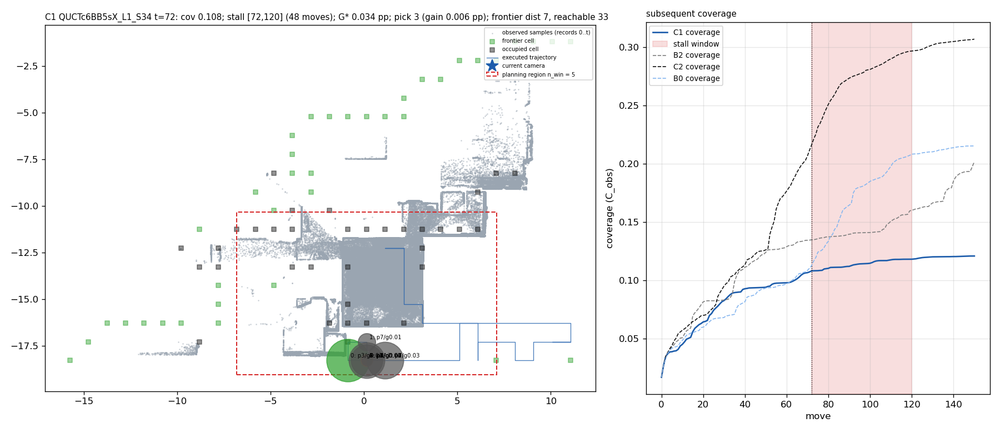
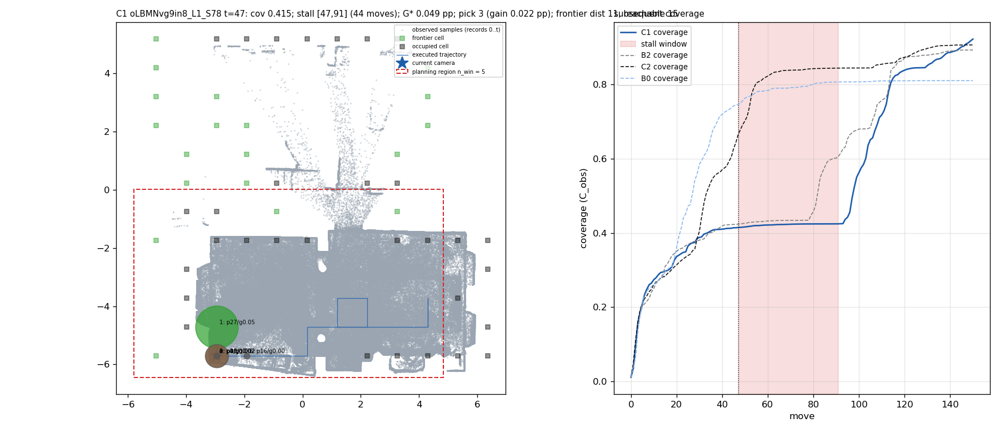
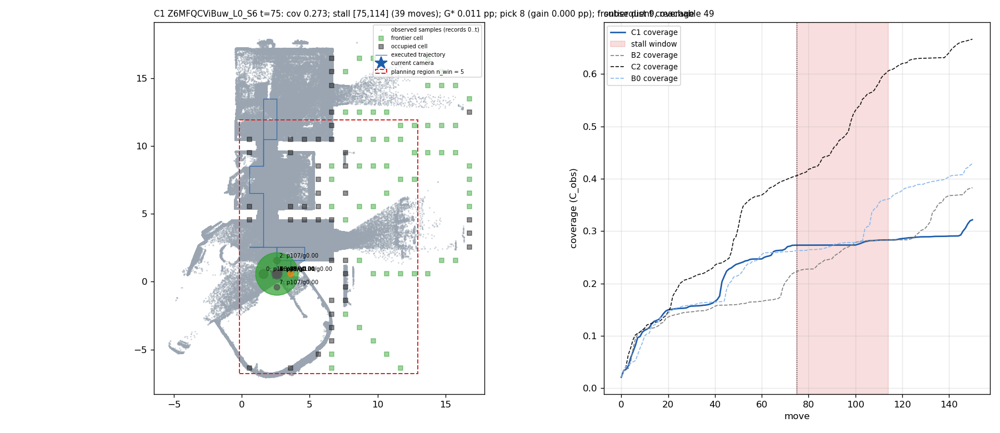
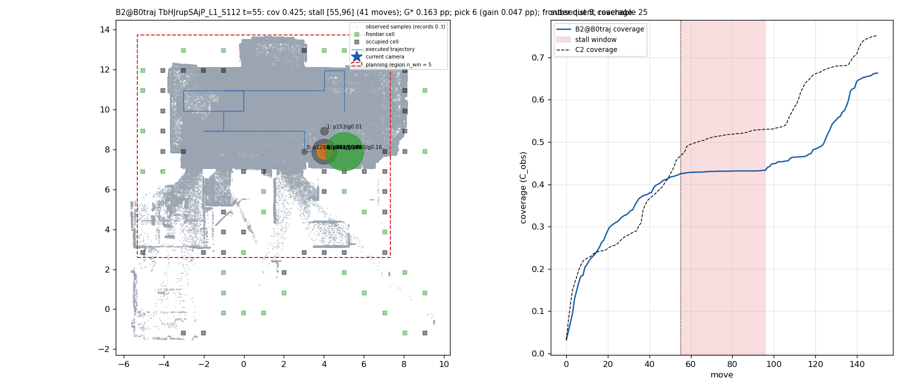
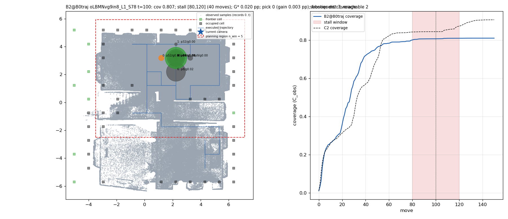
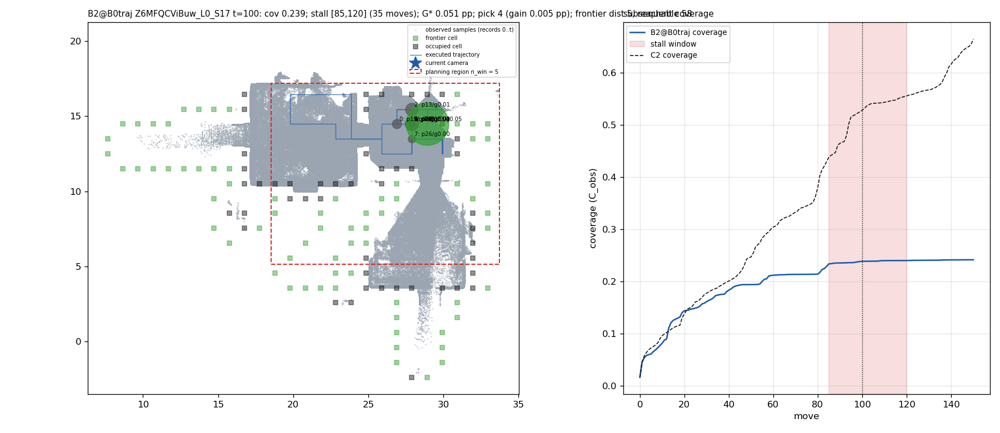

# E2 — MP3D 失败案例（自动生成 `scripts/e2_failure_cases.py`；C1 闭环与 B0 轨迹（B2 在其固定状态上的分数）各取停滞最长的 3 条 episode；GT 只在评估侧）

每个案例：(1) 覆盖率 (2) 相机位置 (3) 历史观测俯视图 (4) 规划区域 (5) 候选分布 (6) 预测增益 (7) 真实增益（离线）(8) frontier 与可达性 (9) 规划器选择 (10) 后续覆盖曲线与轨迹；类型：A 有好候选但排错 / B 区域外有收益 / C 候选皆低但有前进方向 / D 合法动作进不了未探索区 / E 候选够但 greedy 长期不理想。

## 案例 1：C1 · QUCTc6BB5sX_L1_S34 · t = 72（停滞窗口 [72, 120]，48 步；类型 **B 收益在区域外**）

| 项 | 值 |
|---|---|
| 1 当前覆盖 | 0.108（窗口末 0.118；Final 0.121）|
| 2 相机位置（m，z-up xy） | (0.1, -18.3)，位姿 [17, 0, 44, 2, 5] |
| 3 历史 P1 | 图左：记录 0..72 的 10% 采样点（灰）；550,877 点 |
| 4 评分区域 | n_win = 5 框（红虚线）x [-6.8, 7.1] y [-19.0, -10.3] m；剩余未覆盖表面在区域内 0.07，剩余 89.2% |
| 5 候选 | 8 合法，候选集 [0, 2, 3, 4, 5, 7] |
| 6 预测增益（C1 分数） | 0:3，1:7，2:2，3:8，4:1，5:5，6:8，7:7 |
| 7 真实增益 pp（离线） | 0:0.034，1:0.011，2:0.004，3:0.006，4:0.004，5:0.028，6:0.024，7:0.029；G\* 0.034 |
| 8 frontier | 可达 frontier 33 / 37，最近距离 7 格；候选 FP [-1.0, -1.0, 0.0, 0.0, 0.0, 0.0, 0.0, 0.5] |
| 9 规划器选择 | 选 3（真实 0.006 pp）；oracle 最优 0（0.034 pp） |
| 10 后续 | 图右：覆盖曲线与停滞窗口；轨迹见图左 |

## 案例 2：C1 · oLBMNvg9in8_L1_S78 · t = 47（停滞窗口 [47, 91]，44 步；类型 **B 收益在区域外**）

| 项 | 值 |
|---|---|
| 1 当前覆盖 | 0.415（窗口末 0.424；Final 0.922）|
| 2 相机位置（m，z-up xy） | (-3.0, -5.7)，位姿 [2, 1, 11, 1, 5] |
| 3 历史 P1 | 图左：记录 0..47 的 10% 采样点（灰）；558,754 点 |
| 4 评分区域 | n_win = 5 框（红虚线）x [-5.8, 4.8] y [-6.4, 0.0] m；剩余未覆盖表面在区域内 0.25，剩余 58.5% |
| 5 候选 | 7 合法，候选集 [0, 1, 3, 4, 5] |
| 6 预测增益（C1 分数） | 0:4，1:27，2:1，3:33，4:0，5:28，6:16 |
| 7 真实增益 pp（离线） | 0:0.001，1:0.049，2:0.000，3:0.022，4:0.000，5:0.024，6:0.000；G\* 0.049 |
| 8 frontier | 可达 frontier 15 / 19，最近距离 11 格；候选 FP [0.0, 1.0, 0.0, 0.0, 0.0, 0.0, 0.5] |
| 9 规划器选择 | 选 3（真实 0.022 pp）；oracle 最优 1（0.049 pp） |
| 10 后续 | 图右：覆盖曲线与停滞窗口；轨迹见图左 |

## 案例 3：C1 · Z6MFQCViBuw_L0_S6 · t = 75（停滞窗口 [75, 114]，39 步；类型 **B 收益在区域外**）

| 项 | 值 |
|---|---|
| 1 当前覆盖 | 0.273（窗口末 0.283；Final 0.321）|
| 2 相机位置（m，z-up xy） | (2.6, 0.6)，位姿 [2, 3, 16, 2, 0] |
| 3 历史 P1 | 图左：记录 0..75 的 10% 采样点（灰）；854,632 点 |
| 4 评分区域 | n_win = 5 框（红虚线）x [-0.2, 13.0] y [-6.8, 11.9] m；剩余未覆盖表面在区域内 0.16，剩余 72.7% |
| 5 候选 | 9 合法，候选集 [0, 1, 3, 4, 5, 6, 7, 8] |
| 6 预测增益（C1 分数） | 0:108，1:78，2:107，3:89，4:83，5:75，6:48，7:107，8:120 |
| 7 真实增益 pp（离线） | 0:0.001，1:0.000，2:0.000，3:0.000，4:0.011，5:0.001，6:0.001，7:0.000，8:0.000；G\* 0.011 |
| 8 frontier | 可达 frontier 49 / 57，最近距离 9 格；候选 FP [-1.0, 0.0, 0.5, 0.0, 0.0, 0.0, 0.0, -1.0, 0.5] |
| 9 规划器选择 | 选 8（真实 0.000 pp）；oracle 最优 4（0.011 pp） |
| 10 后续 | 图右：覆盖曲线与停滞窗口；轨迹见图左 |

## 案例 4：B2@B0traj · TbHJrupSAjP_L1_S112 · t = 55（停滞窗口 [55, 96]，41 步；类型 **A 排错**）

| 项 | 值 |
|---|---|
| 1 当前覆盖 | 0.425（窗口末 0.433；Final 0.663）|
| 2 相机位置（m，z-up xy） | (4.0, 7.9)，位姿 [9, 0, 5, 2, 4] |
| 3 历史 P1 | 图左：记录 0..55 的 10% 采样点（灰）；651,120 点 |
| 4 评分区域 | n_win = 5 框（红虚线）x [-5.3, 7.3] y [2.6, 13.7] m |
| 5 候选 | 8 合法，候选集 [1, 2, 3, 4, 5, 6, 7] |
| 6 预测增益（B2@B0traj 分数） | 0:128，1:153，2:121，3:121，4:144，5:83，6:241，7:210 |
| 7 真实增益 pp（离线） | 0:0.002，1:0.014，2:0.043，3:0.098，4:0.018，5:0.006，6:0.047，7:0.163；G\* 0.163 |
| 8 frontier | 可达 frontier 25 / 30，最近距离 5 格；候选 FP [0.5, 1.0, 0.0, 0.0, 0.0, 0.0, 0.0, 0.0] |
| 9 规划器选择 | 选 6（真实 0.047 pp）；oracle 最优 7（0.163 pp） |
| 10 后续 | 图右：覆盖曲线与停滞窗口；轨迹见图左 |

## 案例 5：B2@B0traj · oLBMNvg9in8_L1_S78 · t = 100（停滞窗口 [80, 120]，40 步；类型 **C/D 候选皆低**）

| 项 | 值 |
|---|---|
| 1 当前覆盖 | 0.807（窗口末 0.809；Final 0.810）|
| 2 相机位置（m，z-up xy） | (2.2, 3.2)，位姿 [7, 0, 2, 2, 0] |
| 3 历史 P1 | 图左：记录 0..100 的 10% 采样点（灰）；1,177,838 点 |
| 4 评分区域 | n_win = 5 框（红虚线）x [-3.5, 7.1] y [-2.5, 5.9] m |
| 5 候选 | 9 合法，候选集 [0, 2, 3, 4, 5, 6, 7, 8] |
| 6 预测增益（B2@B0traj 分数） | 0:52，1:32，2:14，3:14，4:46，5:34，6:8，7:27，8:9 |
| 7 真实增益 pp（离线） | 0:0.003，1:0.000，2:0.002，3:0.000，4:0.016，5:0.013，6:0.018，7:0.020，8:0.002；G\* 0.020 |
| 8 frontier | 可达 frontier 2 / 8，最近距离 7 格；候选 FP [1.0, -1.0, 0.0, 0.0, 0.0, 0.0, 0.5, 0.0, -1.0] |
| 9 规划器选择 | 选 0（真实 0.003 pp）；oracle 最优 7（0.020 pp） |
| 10 后续 | 图右：覆盖曲线与停滞窗口；轨迹见图左 |

## 案例 6：B2@B0traj · Z6MFQCViBuw_L0_S17 · t = 100（停滞窗口 [85, 120]，35 步；类型 **E greedy**）

| 项 | 值 |
|---|---|
| 1 当前覆盖 | 0.239（窗口末 0.240；Final 0.242）|
| 2 相机位置（m，z-up xy） | (27.9, 14.5)，位姿 [27, 1, 2, 2, 1] |
| 3 历史 P1 | 图左：记录 0..100 的 10% 采样点（灰）；1,163,804 点 |
| 4 评分区域 | n_win = 5 框（红虚线）x [18.5, 33.7] y [5.1, 17.2] m |
| 5 候选 | 10 合法，候选集 [0, 1, 3, 4, 5, 6, 8, 9] |
| 6 预测增益（B2@B0traj 分数） | 0:15，1:24，2:13，3:12，4:27，5:0，6:13，7:26，8:20，9:3 |
| 7 真实增益 pp（离线） | 0:0.005，1:0.005，2:0.010，3:0.001，4:0.005，5:0.001，6:0.011，7:0.003，8:0.001，9:0.051；G\* 0.051 |
| 8 frontier | 可达 frontier 58 / 70，最近距离 5 格；候选 FP [-1.0, 0.0, 0.5, 0.0, 0.0, 0.0, 0.0, -1.0, 0.0, 0.5] |
| 9 规划器选择 | 选 4（真实 0.005 pp）；oracle 最优 9（0.051 pp） |
| 10 后续 | 图右：覆盖曲线与停滞窗口；轨迹见图左 |

## 类型汇总

| 类型 | 案例数 |
|---|---|
| A 排错 | 1 |
| B 收益在区域外 | 3 |
| C/D 候选皆低 | 1 |
| E greedy | 1 |
