# EXP6 周报 —— V2 → V3 → V3.1 / V4：架构对比、双域闭环结果与结论（2026-10-29 → 11-01）

> 面向组会汇报的总结。图在 `figures/`（fig1–fig9，PNG，150 dpi），表在 `tables/`（Markdown + CSV），全部由 `scripts/make_weekly_report.py` 从实测结果文件生成（`../reports/g3_v4.json`、`../reports/g12_v4_s_final_v4.json`、训练日志、`../ablation_study/experiment_A_*/results/`）。详细报告：`../report/FINAL_REPORT.md`（V4 / V3.1 第一阶段）、`../../exp6_v3/reports/V3_COMBINED_REPORT.md`（V3）、`../ablation_study/experiment_A_distp1_dense_vs_sparse/report/A_FINAL_REPORT.md`（消融 A）。所有闭环评估场景都已被多轮实验使用，结论按"非盲、冻结协议下的对照"理解。

## 0. 一页总结
1. **这周做了什么**：在同一冻结协议下，把两套新架构从零、只用室外数据（Macarons++ Train-6，零 MP3D 样本）各训练 40k 步 —— **V4**（V2 的 3D U-Net + 原射线采样 + 新增轻量 Ray-Aligned Cross-Attention）和 **V3.1**（V3-T0 的 Simple 3D VAE 架构重训），然后在 Macarons++（30 条 × 100 步）和 **MP3D zero-shot**（10 条 × 150 步）做 G3 闭环，与 MAGICIAN、V2 Original、B0 / B2、E2-D100、V3-T0 / T1 放在同一张表里（图 2–5，表 3–4）。
2. **主要发现**：
   - 零 MP3D 样本的 V3.1 / V4 在 MP3D 闭环上达到了 Mixed 训练的 V3-T1 / B2 的 AUC 水平（0.335 / 0.327 vs 0.331 / 0.334），Final 低约 0.03（CI 含 0），并且显著高于 MAGICIAN（Final +0.12）。同架构下 **Outdoor-only 的 V3.1 比 Mixed 的 V3-T0 更好**（MP3D ΔAUC +0.024 [+0.002, +0.052]，4/1）—— V3 的 Mixed 训练没有把 MP3D 数据转化为室内收益。
   - 室外本域两组都**略低于** V2 Original（60k，稀疏 P1）和 B2（ΔAUC −0.014 ～ −0.034，CI 多含 0，按冻结标准判"退化"）；新架构在本域没有收益。
   - **V4 ≈ V3.1**（两域差异都不显著），但 V4 训练成本只有 V3.1 的 1/3.3（17.3 vs 57.6 GPU-h，0.47 vs 1.29 s/步，图 6、图 9）。
   - **一步预测质量 ≠ 闭环**：固定状态上 V4 的预测质量明显更差（室内未知射线 MAE 0.381 vs 0.237，被选动作真实增益 0.570 vs 0.883 pp），闭环却与 V3.1 持平（图 7）。这是本项目第四次得到同样的结论。
   - **消融 A（评分用稠密 P1）：NO-GO**。D100 评分把 MP3D 固定状态的被选增益从 0.570 提到 0.876 pp、闭环 AUC +0.018（CI 含 0），但 Macarons++ 闭环显著退化（ΔAUC −0.043 [−0.097, −0.007]，0/6 场景）；V2-Mix 时期的 Dense/Dense 退化在从零 D100 训练的 V4 上依旧（图 8）。
3. **还不能下的结论**：Ray X-Attn 的因果作用 —— 严格对照 U0（V2 架构、D100、40k、Outdoor-only、无 X-Attn）没有训练；V2 Original 的口径（稀疏 P1、60k）不同。
4. **建议的下一步**（等待决定）：(a) MP3D 室内微调（从 Outdoor-only 权重出发，目标 E2-D100 的 0.364 / 0.553，并量化室外遗忘）；(b) U0 对照（≈ 20 GPU-h）；(c) 不延长到 60k（S-c 开发指标已平台）。

## 核心图：各模型的平均 AUC 与平均 Final coverage（左 AUC，右 Final coverage）
每根柱子是该数据集**全部 episode 的平均值**（室内 10 条、室外 30 条；每个楼层 / 场景的起点数相同，所以与"先场景平均再平均"完全一致），不分场景。带斜线的是本周的两个 Outdoor-only 模型；颜色表示训练来源。置信区间见图 2 / 表 3。

**室内（MP3D zero-shot，150 步）**
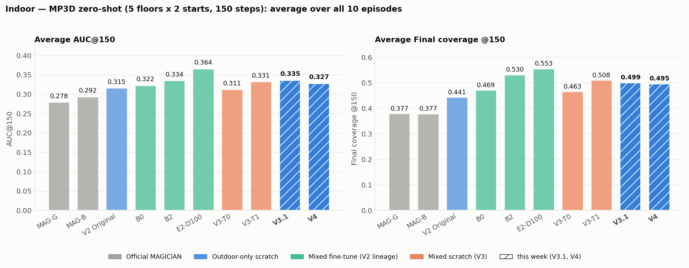

**室外（Macarons++ Dev-3 + Test-3，100 步）**
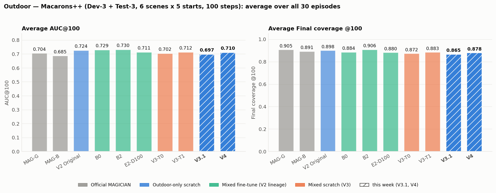

| 模型 | 室内 AUC@150 | 室内 Final@150 | 室外 AUC@100 | 室外 Final@100 |
|---|---|---|---|---|
| MAG-G | 0.278 | 0.377 | 0.704 | 0.905 |
| MAG-B | 0.292 | 0.377 | 0.685 | 0.891 |
| V2 Original | 0.315 | 0.441 | 0.724 | 0.898 |
| B0 | 0.322 | 0.469 | 0.729 | 0.884 |
| B2 | 0.334 | 0.530 | 0.730 | 0.906 |
| E2-D100 | **0.364** | **0.553** | 0.711 | 0.880 |
| V3-T0 | 0.311 | 0.463 | 0.702 | 0.872 |
| V3-T1 | 0.331 | 0.508 | 0.712 | 0.883 |
| **V3.1**（本周） | 0.335 | 0.499 | 0.697 | 0.865 |
| **V4**（本周） | 0.327 | 0.495 | 0.710 | 0.878 |

## 1. 比较的是什么：架构演进
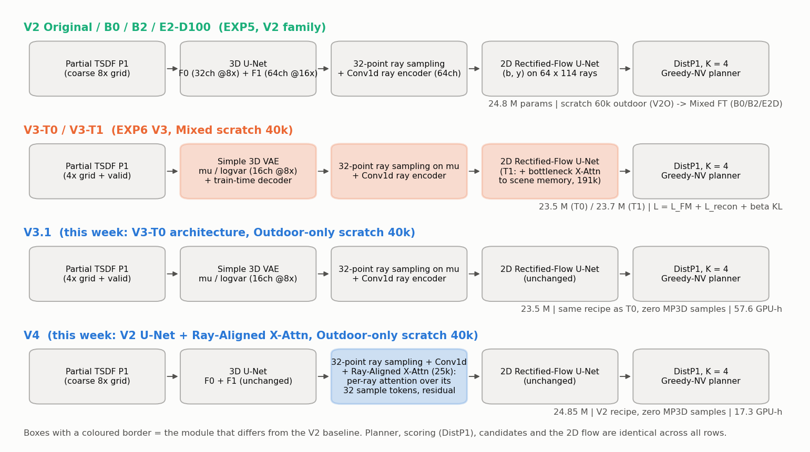

**表 1 组件与训练来源**
| 模型 | 场景编码器 | 射线条件 | 2D Flow | 新增 | 参数 | 训练数据 / 阶段 | GPU-h |
|---|---|---|---|---|---|---|---|
| V2 Original | 3D U-Net（F0 32 @8×、F1 64 @16×），输入稀疏 P1 粗网格 | 32 点采样 + Conv1d → 64 通道 | V2 U-Net（64/128/192/256） | — | 24.8 M | Outdoor-only scratch 60k（稀疏 P1） | 18.7 |
| B0 / B2 | 同上（B2 输入 D100） | 同上 | 同上 | — | 24.8 M | V2 Original → Mixed FT 20k（MP3D + Macarons++） | 24.2 |
| E2-D100 | 同上，D100 | 同上 | 同上 | — | 24.8 M | V2-Mix → Mixed FT 5k（D100 分片） | 27.8 |
| V3-T0 | Simple 3D VAE（μ / logvar 16 ch @8×）+ 训练期解码器 | 在 μ 上 32 点采样 + Conv1d | 同上 | VAE + L_recon + KL | 23.5 M | Mixed scratch 40k | 63.7 |
| V3-T1 | 同 T0 | 同 T0 | + 瓶颈 Cross-Attention 到场景记忆（191k） | X-Attn（场景级） | 23.7 M | Mixed scratch 40k | 65.0 |
| **V3.1** | 同 T0 | 同 T0 | 同上 | 无（数据域改变） | 23.5 M | **Outdoor-only scratch 40k** | 57.6 |
| **V4** | V2 3D U-Net（不变） | 32 点采样 + Conv1d **+ Ray-Aligned X-Attn**（每条射线对自己的 32 个采样 token 做 4 头注意力，残差，25k 参数） | 同上（不变） | X-Attn（射线级） | 24.85 M | **Outdoor-only scratch 40k** | 17.3 |

规划器（DistP1、K = 4、候选、n_win 5、合法性）对所有组完全相同；B2 / E2-D100 / V3 / V3.1 / V4 的输入 P1 都是 D100、评分 P1 都是稀疏（B2 口径）；V2 Original 与 B0 是稀疏 / 稀疏。

## 2. 实验设置
| 项 | 设置 |
|---|---|
| 训练数据（V4 / V3.1） | Macarons++ Train-6（bannerman, dunnottar, fushimi, liberty, pisa, redeemer）去掉 S-c 保留轨迹：138 条轨迹 / 98,887 候选视角；MP3D 样本 = 0；S-c（42 条）只做监控 |
| 预算与优化 | 两组 40,000 步、每步 64 视角 / 8 状态、4 × L40S；V4 用 V2 Original 配方（lr 2e-4），V3.1 用 V3 配方（lr 1e-4、λ_rec 1、β_KL 0.02）；checkpoint = 训练前冻结的 EMA@40k，不看任何评估场景 |
| G3 室外 | Dev-3（barts, pantheon, colosseum）+ Test-3（alhambra, bridge, neuschwanstein），每场景 5 起点 × 100 步，MAGICIAN 官方环境，单调覆盖率；AUC@100 / Final / Cov@20 |
| G3 室内 zero-shot | MP3D 5 楼层 × 2 起点 × 150 步（1 m 网格，n_win 5）；AUC@150 / Final / Cov@20 / 停滞 episode |
| 统计 | 场景 / 楼层均值 → 场景级 bootstrap 95 % CI（5 楼层 / 6 场景为独立簇）；配对差按 (场景, 起点)；"有意义" = ΔAUC ≥ 0.010 且 ΔFinal ≥ 0.010 且胜 ≥ 4 且无场景 < −0.030；"退化" = ΔAUC ≤ −0.010 或 ΔFinal ≤ −0.010 |
| 历史组 | MAG-G / MAG-B（官方权重，同动作协议）、V2 Original（Task 2 V2O）、B0 / B2 / E2-D100 / V3-T0 / T1 的既有闭环，不重跑 |

## 3. 主结果：双域 G3
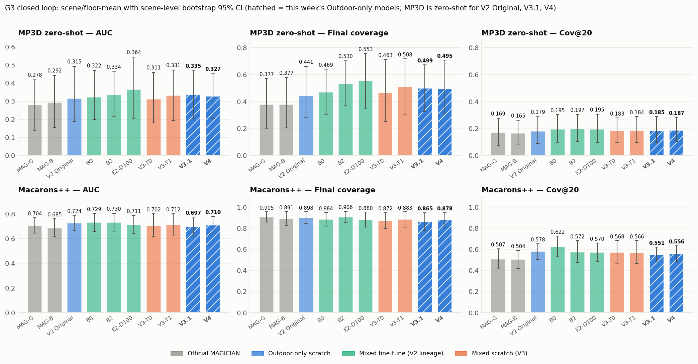

**表 3 统一对比（均值 [CI]）**
| 模型 | 训练来源 / P1 口径 | MP3D zero-shot? | MP3D AUC@150 | Final | Cov@20 | 停滞 ep | Mac++ AUC@100 | Final | Cov@20 | 参数 M | 训练 GPU-h |
|---|---|---|---|---|---|---|---|---|---|---|---|
| MAG-G | official weights, greedy | official | 0.278 [0.140, 0.417] | 0.377 [0.201, 0.570] | 0.169 [0.074, 0.277] | 7 | 0.704 [0.642, 0.768] | 0.905 [0.856, 0.955] | 0.507 [0.420, 0.604] | — | — |
| MAG-B | official weights, beam 10x10 | official | 0.292 [0.154, 0.441] | 0.377 [0.205, 0.579] | 0.165 [0.078, 0.261] | 8 | 0.685 [0.614, 0.760] | 0.891 [0.822, 0.958] | 0.504 [0.417, 0.589] | — | — |
| V2 Original | Outdoor-only scratch 60k (sparse P1) | yes | 0.315 [0.186, 0.491] | 0.441 [0.284, 0.661] | 0.179 [0.086, 0.290] | 2 | 0.724 [0.663, 0.786] | 0.898 [0.842, 0.956] | 0.578 [0.503, 0.652] | 24.82 | 18.7 |
| B0 | Mixed FT 20k (sparse / sparse) | no (Mixed) | 0.322 [0.199, 0.469] | 0.469 [0.306, 0.640] | 0.195 [0.098, 0.302] | 3 | 0.729 [0.657, 0.802] | 0.884 [0.820, 0.949] | 0.622 [0.527, 0.726] | 24.82 | 24.2 |
| B2 | Mixed FT 20k (D100 / sparse) | no (Mixed) | 0.334 [0.217, 0.461] | 0.530 [0.368, 0.703] | 0.197 [0.102, 0.304] | 4 | 0.730 [0.659, 0.805] | 0.906 [0.851, 0.960] | 0.572 [0.475, 0.683] | 24.82 | 24.2 |
| E2-D100 | Mixed FT 20k + 5k (D100) | no (Mixed) | 0.364 [0.205, 0.542] | 0.553 [0.350, 0.756] | 0.195 [0.094, 0.307] | 2 | 0.711 [0.637, 0.786] | 0.880 [0.809, 0.951] | 0.570 [0.483, 0.659] | 24.82 | 27.8 |
| V3-T0 | Mixed scratch 40k (D100) | no (Mixed) | 0.311 [0.179, 0.457] | 0.463 [0.251, 0.711] | 0.183 [0.097, 0.278] | 7 | 0.702 [0.614, 0.800] | 0.872 [0.797, 0.947] | 0.568 [0.468, 0.683] | 23.54 | 63.7 |
| V3-T1 | Mixed scratch 40k (D100) + bottleneck X-Attn | no (Mixed) | 0.331 [0.192, 0.470] | 0.508 [0.299, 0.716] | 0.184 [0.094, 0.288] | 5 | 0.712 [0.626, 0.801] | 0.883 [0.811, 0.954] | 0.566 [0.466, 0.683] | 23.73 | 65.0 |
| V3.1 | Outdoor-only scratch 40k (D100) | yes | 0.335 [0.206, 0.468] | 0.499 [0.325, 0.672] | 0.185 [0.096, 0.287] | 3 | 0.697 [0.619, 0.774] | 0.865 [0.779, 0.947] | 0.551 [0.486, 0.621] | 23.54 | 57.6 |
| V4 | Outdoor-only scratch 40k (D100) + Ray X-Attn | yes | 0.327 [0.206, 0.451] | 0.495 [0.308, 0.706] | 0.187 [0.102, 0.283] | 4 | 0.710 [0.643, 0.780] | 0.878 [0.812, 0.947] | 0.556 [0.482, 0.633] | 24.85 | 17.3 |

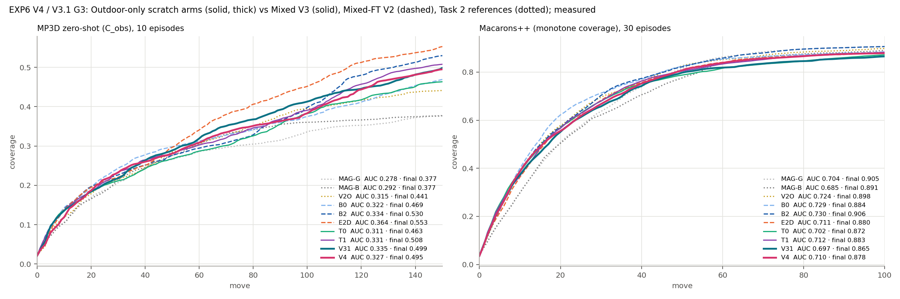

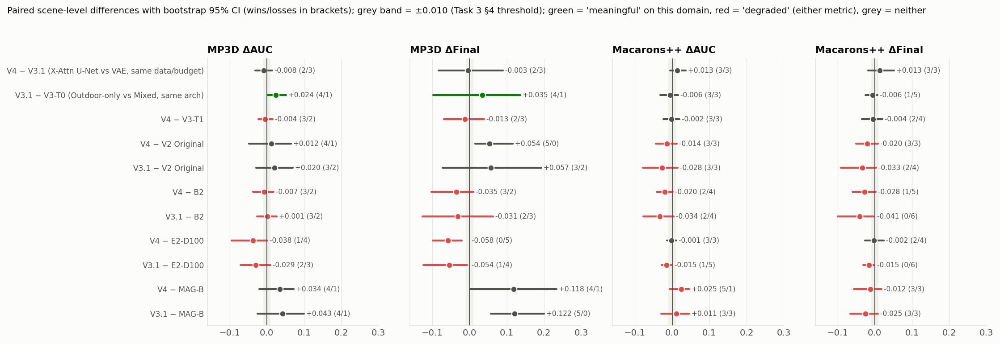

**表 4 配对差**
| 配对 | 数据集 | ΔAUC [CI]（胜/负） | ΔFinal [CI]（胜/负） | ΔCov@20 | 判定 |
|---|---|---|---|---|---|
| V4 − V3.1 (X-Attn U-Net vs VAE, same data/budget) | MP3D | -0.008 [-0.031, +0.015]（2/3） | -0.003 [-0.084, +0.090]（2/3） | +0.002 | 无差异 |
| V4 − V3.1 (X-Attn U-Net vs VAE, same data/budget) | Macarons++ | +0.013 [-0.006, +0.037]（3/3） | +0.013 [-0.018, +0.052]（3/3） | +0.004 | 无差异 |
| V3.1 − V3-T0 (Outdoor-only vs Mixed, same arch) | MP3D | +0.024 [+0.002, +0.052]（4/1） | +0.035 [-0.098, +0.137]（4/1） | +0.002 | 有意义 |
| V3.1 − V3-T0 (Outdoor-only vs Mixed, same arch) | Macarons++ | -0.006 [-0.032, +0.016]（3/3） | -0.006 [-0.025, +0.008]（1/5） | -0.017 | 无差异 |
| V4 − V3-T1 | MP3D | -0.004 [-0.023, +0.016]（3/2） | -0.013 [-0.069, +0.040]（2/3） | +0.003 | 退化 |
| V4 − V3-T1 | Macarons++ | -0.002 [-0.023, +0.019]（3/3） | -0.004 [-0.035, +0.021]（2/4） | -0.011 | 无差异 |
| V4 − V2 Original | MP3D | +0.012 [-0.048, +0.065]（4/1） | +0.054 [+0.015, +0.117]（5/0） | +0.008 | 无差异 |
| V4 − V2 Original | Macarons++ | -0.014 [-0.044, +0.012]（3/3） | -0.020 [-0.050, +0.008]（3/3） | -0.022 | 退化 |
| V3.1 − V2 Original | MP3D | +0.020 [-0.029, +0.070]（3/2） | +0.057 [-0.072, +0.193]（3/2） | +0.006 | 无差异 |
| V3.1 − V2 Original | Macarons++ | -0.028 [-0.079, +0.014]（3/3） | -0.033 [-0.091, +0.004]（2/4） | -0.026 | 退化 |
| V4 − B2 | MP3D | -0.007 [-0.037, +0.018]（3/2） | -0.035 [-0.102, +0.011]（3/2） | -0.010 | 退化 |
| V4 − B2 | Macarons++ | -0.020 [-0.041, +0.002]（2/4） | -0.028 [-0.060, +0.002]（1/5） | -0.016 | 退化 |
| V3.1 − B2 | MP3D | +0.001 [-0.026, +0.026]（3/2） | -0.031 [-0.126, +0.064]（2/3） | -0.012 | 退化 |
| V3.1 − B2 | Macarons++ | -0.034 [-0.077, +0.005]（2/4） | -0.041 [-0.100, -0.003]（0/6） | -0.020 | 退化 |
| V4 − E2-D100 | MP3D | -0.038 [-0.095, +0.001]（1/4） | -0.058 [-0.099, -0.021]（0/5） | -0.008 | 退化 |
| V4 − E2-D100 | Macarons++ | -0.001 [-0.014, +0.011]（3/3） | -0.002 [-0.026, +0.024]（2/4） | -0.015 | 无差异 |
| V3.1 − E2-D100 | MP3D | -0.029 [-0.071, +0.010]（2/3） | -0.054 [-0.124, -0.007]（1/4） | -0.010 | 退化 |
| V3.1 − E2-D100 | Macarons++ | -0.015 [-0.028, -0.002]（1/5） | -0.015 [-0.032, -0.002]（0/6） | -0.019 | 退化 |
| V4 − MAG-B | MP3D | +0.034 [-0.020, +0.072]（4/1） | +0.118 [+0.001, +0.234]（4/1） | +0.022 | 无差异 |
| V4 − MAG-B | Macarons++ | +0.025 [-0.006, +0.046]（5/1） | -0.012 [-0.056, +0.018]（3/3） | +0.052 | 退化 |
| V3.1 − MAG-B | MP3D | +0.043 [-0.024, +0.100]（4/1） | +0.122 [+0.058, +0.200]（5/0） | +0.020 | 无差异 |
| V3.1 − MAG-B | Macarons++ | +0.011 [-0.029, +0.046]（3/3） | -0.025 [-0.066, +0.009]（3/3） | +0.048 | 退化 |

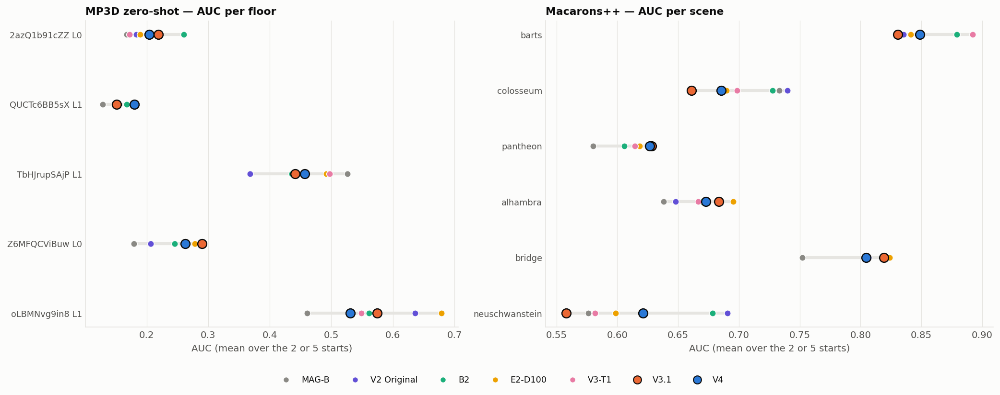

读图要点：
- MP3D：V3.1 / V4 的 AUC 与 B2 / T1 同层（0.33–0.34），都高于 V2 Original 与 MAGICIAN，低于 E2-D100（0.364）；Final 上 B2 / E2-D100 领先 0.03–0.06。逐楼层看，新模型在 TbHJrupSAjP、Z6MFQCViBuw 占优，在 oLBMNvg9in8 落后 V2 Original / E2-D100。
- Macarons++：V2 Original、B0、B2 是前三（0.724–0.730）；两组新模型 0.70–0.71，与 V3 的 Mixed 模型同层；neuschwanstein 与 colosseum 是所有新模型的共同短板。

## 4. 训练过程与成本
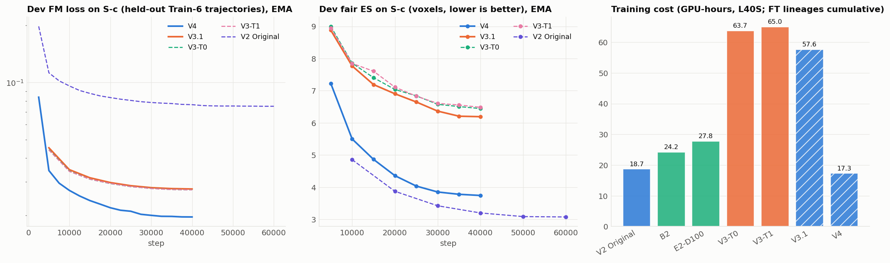

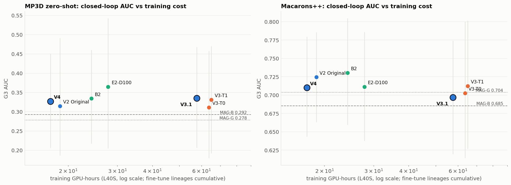

- V4 的开发指标（S-c fair ES 3.74 vox）明显优于 V3 家族（6.2–6.5），但 V2 家族与 V3 家族的 ES 本来就在不同量级（编码器输入不同），只能同族比较：V3.1 ≈ V3-T0 / T1（6.19 vs 6.4–6.5），V4 不如 60k 的 V2 Original（3.74 vs 3.10）。
- 成本：V4 17.3 GPU-h（0.47 s/步、18 GB/卡）；V3.1 57.6 GPU-h（1.29 s/步、23 GB/卡）；V3 的 Mixed 两组 64–65 GPU-h。V4 在 MP3D 上达到与 60 GPU-h 级模型同层的 AUC（图 9 左）。

## 5. 一步预测质量 vs 闭环
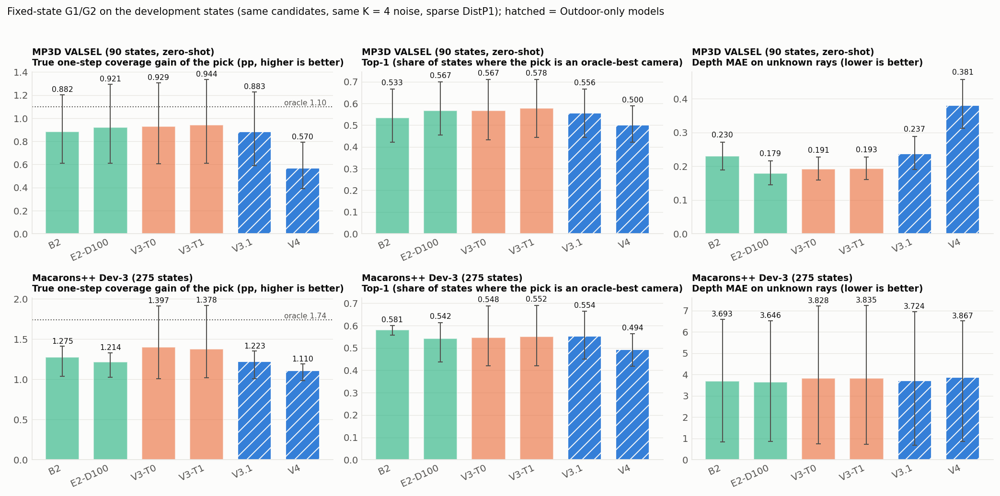

**表 5 固定状态（开发集；被选动作真实增益 pp 与 Top-1 为主，regret 在原报告附录）**
| 集 | 指标 | B2 | E2-D100 | V3-T0 | V3-T1 | V3.1 | V4 |
|---|---|---|---|---|---|---|---|
| MP3D VALSEL（90 态） | 被选动作真实增益 pp | 0.882 | 0.921 | 0.929 | 0.944 | 0.883 | 0.570 |
| MP3D VALSEL（90 态） | oracle 上限 pp | 1.099 | 1.099 | 1.099 | 1.099 | 1.099 | 1.099 |
| MP3D VALSEL（90 态） | Top-1 | 0.533 | 0.567 | 0.567 | 0.578 | 0.556 | 0.500 |
| MP3D VALSEL（90 态） | 未知射线 MAE | 0.230 | 0.179 | 0.191 | 0.193 | 0.237 | 0.381 |
| MP3D VALSEL（90 态） | 新表面 MAE | 0.848 | 0.831 | 0.862 | 0.860 | 0.963 | 1.095 |
| MP3D VALSEL（90 态） | HIT 一致率 | 0.765 | 0.759 | 0.755 | 0.756 | 0.732 | 0.754 |
| MP3D VALSEL（90 态） | K=4 相对离散度 | 0.026 | 0.023 | 0.025 | 0.025 | 0.022 | 0.035 |
| Macarons++ Dev-3（275 态） | 被选动作真实增益 pp | 1.275 | 1.214 | 1.397 | 1.378 | 1.223 | 1.110 |
| Macarons++ Dev-3（275 态） | oracle 上限 pp | 1.740 | 1.740 | 1.740 | 1.740 | 1.740 | 1.740 |
| Macarons++ Dev-3（275 态） | Top-1 | 0.581 | 0.542 | 0.548 | 0.552 | 0.554 | 0.494 |
| Macarons++ Dev-3（275 态） | 未知射线 MAE | 3.693 | 3.646 | 3.828 | 3.835 | 3.724 | 3.867 |
| Macarons++ Dev-3（275 态） | 新表面 MAE | 5.886 | 5.772 | 5.545 | 5.561 | 5.900 | 6.775 |
| Macarons++ Dev-3（275 态） | HIT 一致率 | 0.794 | 0.794 | 0.809 | 0.808 | 0.792 | 0.789 |
| Macarons++ Dev-3（275 态） | K=4 相对离散度 | 0.015 | 0.015 | 0.016 | 0.016 | 0.012 | 0.010 |

- V3.1 的一步排序质量与 B2 相当（室内 zero-shot 的 MAE 0.237 vs 0.230）；V4 明显更差（0.381），室外新表面 MAE 6.78 vs 5.9。但闭环里 V4 ≈ V3.1 ≈ T1。结合 Experiment C（GT 深度）、Task 2（评分器）、V3 G2 的结果：**固定状态的一步排序不是闭环覆盖率的可靠代理**，汇报里应以 G3 为主。

## 5.1 可视化：一次 NBV 决策中，预测深度起什么作用
**一次规划步骤做的事**：当前相机看到一帧深度 → 融合进地图（P1）→ 列出所有合法的下一步相机（6–9 个候选）→ V4 对**每个候选**生成 **K = 4 个**可能的未来深度图（只在当前地图里还是 UNKNOWN 的射线上生成，已知射线沿用地图深度）→ DistP1 统计每个预测里"新表面"的面积并对 4 个样本取平均 → 选分数最高的候选。下面的图把这个过程逐步画出来，并与 GT（网格渲染深度、真实覆盖增益）对照。

**设置**：模型用 V4（本周的 Outdoor-only EMA@40k）；状态、候选、K = 4 噪声与 G1/G2 完全相同，重放得到的分数与存档 V4 行**逐位一致**；GT 只在评估侧使用。MP3D 状态对 V4 是 zero-shot。B2 作为参照只出现在汇总图里，同一脚本换权重即可画 B2 版。

**示例怎么选（事先定好的规则，不是随手挑）**：
- 正例：早期阶段、候选 ≥ 6 个、V4 选中了真实最优相机、预测分数与真实增益的 Spearman ≥ 0.6，取候选间真实增益差距最大的那个状态。
- 失败例：早期阶段、候选 ≥ 6 个，取"真实最优增益 − V4 选中相机增益"最大的状态。
- 正例只是说明机制，**不代表平均水平**：早期阶段 V4 选中真实最优相机的比例室内只有 0.22、室外 0.35（全部状态 0.50 / 0.49）。平均水平看下面的汇总图。

### (1) 汇总：用预测深度选出的相机，真实增益比随机选高多少
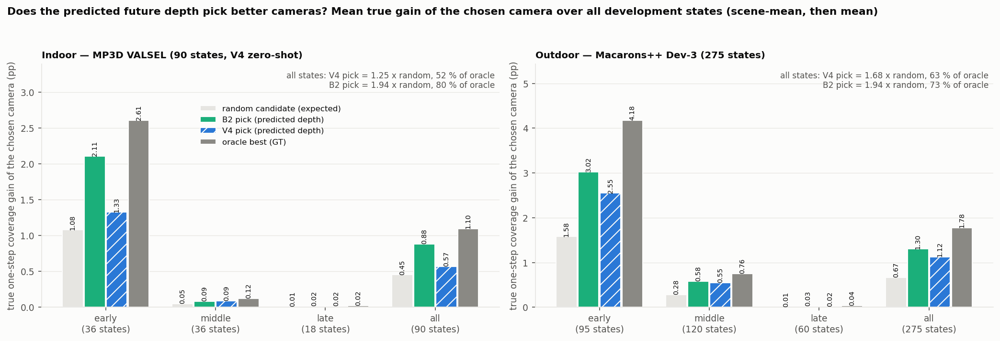

| 被选相机的真实一步覆盖增益（pp，全部开发状态平均） | 随机选（期望） | B2 选 | V4 选 | 理想上限（GT 最优） |
|---|---|---|---|---|
| 室内 MP3D VALSEL（90 态，V4 zero-shot） | 0.45 | 0.88（1.94 倍，上限的 80 %） | 0.57（1.25 倍，52 %） | 1.10 |
| 　其中早期（36 态） | 1.08 | 2.11 | 1.33 | 2.61 |
| 室外 Macarons++ Dev-3（275 态） | 0.67 | 1.30（1.94 倍，73 %） | 1.12（1.68 倍，63 %） | 1.78 |
| 　其中早期（95 态） | 1.58 | 3.02 | 2.55 | 4.18 |

两个模型在每个阶段都明显好于随机选；B2 在室内更强。这是"预测深度能帮助 NBV"最直接的证据：选择只依赖预测，没有用到任何 GT。

### (2) 正例：室内（MP3D EU6Fwq7SyZv L1，第 5 步）
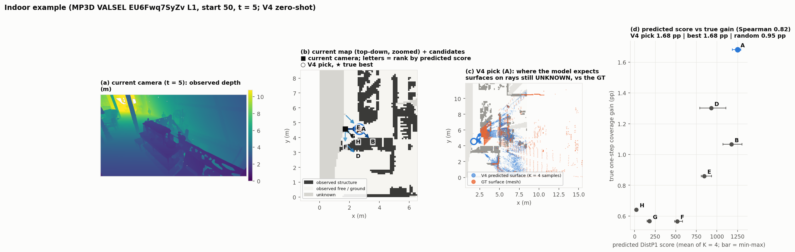
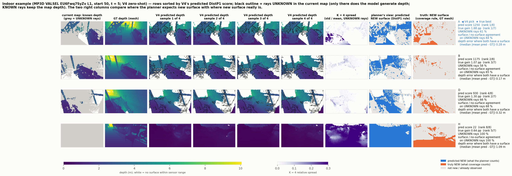

- 7 个候选的预测分数与真实增益 Spearman 0.82；V4 选中的 A 就是真实最优（1.68 pp，随机期望 0.95 pp）。
- A 有 61 % 的射线在当前地图里是 UNKNOWN；在这些射线上，预测"有没有表面"与 GT 一致 84 %，深度误差中位数 0.28 m。
- 规划器认为会新增的表面覆盖了 91 % 的真实新增表面（召回），但也把一些已经看过的表面算成新的（精度 0.32）。俯视图 (c) 显示预测表面停在规划区域边界（约 8 m）处，而 GT 表面延伸得更远，这正是之前诊断出的"区域裁剪"限制。

### (3) 正例：室外（Macarons++ colosseum，第 15 步）
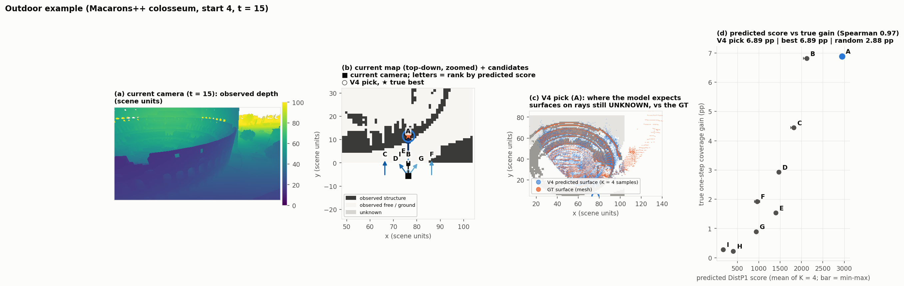
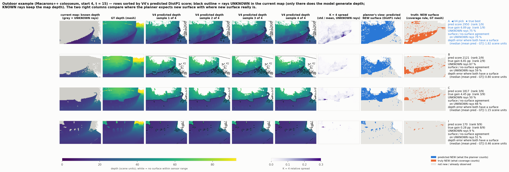

- 9 个候选 Spearman 0.97；V4 选中的 A 是真实最优（6.89 pp，随机期望 2.88 pp），排名前三与真实增益排名完全一致。
- 4 个预测样本都补出了竞技场看台的墙体，样本之间差异小（K = 4 spread 列颜色浅），说明模型对这类结构比较确定。

### (4) 失败例：两种不同的原因
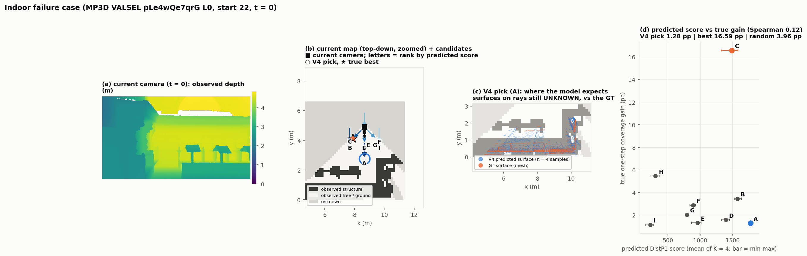
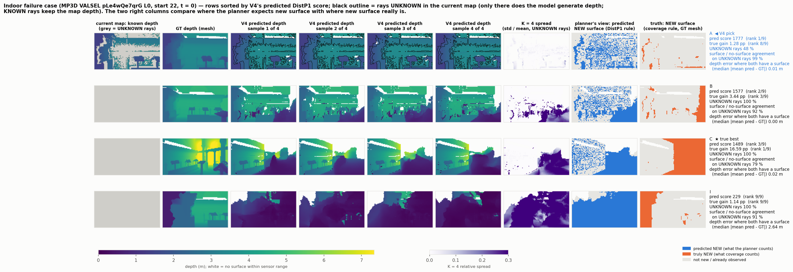

- **室内（pLe4wQe7qrG L0，第 0 步）——预测是对的，评分出错**：V4 选中的 A 只有 1.28 pp，真实最优 C 有 16.59 pp。A 的深度预测几乎完美（一致率 99 %、误差 1 cm），但规划器把大量已经看过的表面算成新的（精度 0.09），给了 A 过高的分数。原因是稀疏地图只沿 10 % 采样射线记录表面，已观测区域留有很多"洞"。这与 Task 2 发现的新颖性尺度问题相同（覆盖率尺度的新颖性 S2h 能缓解）。

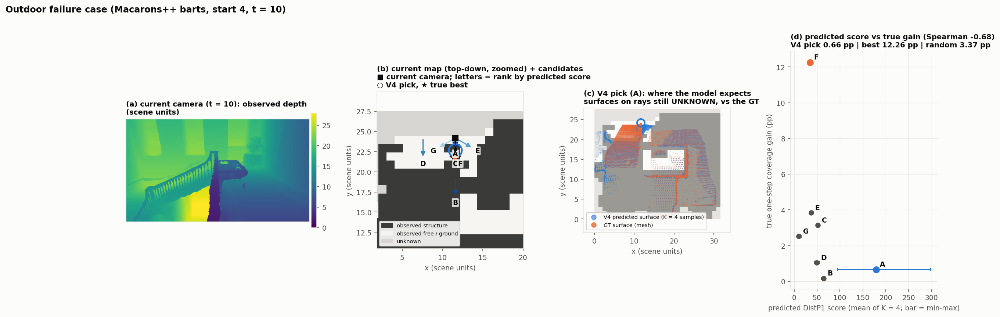
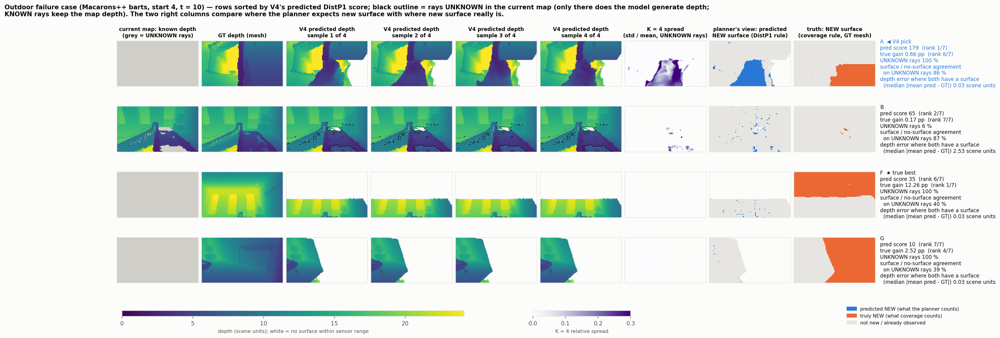

- **室外（barts，第 10 步）——预测本身错了**：真实最优相机 F（12.26 pp）前方是一面大墙，V4 的 4 个样本都预测成"没有表面"（白色；一致率只有 40 %），于是规划器认为那里没有新东西可看，F 排第 6。V4 选中的 A 只有 0.66 pp。

### 读图说明
- 总览图：(a) 当前相机实际看到的深度；(b) 当前地图俯视（深色 = 已观测到的高于地面的结构，浅色 = 已观测的空地 / 地面，灰色 = 未知），箭头 = 候选相机朝向，字母 = 按预测分数排名，○ = V4 选中，★ = 真实最优；(c) V4 选中相机在 UNKNOWN 射线上的预测表面（蓝，4 个样本）与 GT 表面（橙）；(d) 每个候选的预测分数（横轴，误差条 = 4 个样本的最小–最大）与真实增益（纵轴）。
- 候选网格图：每行一个候选，按预测分数从高到低排；列依次是当前地图的已知深度（灰 = UNKNOWN）、GT 深度、4 个预测样本（黑线圈出 UNKNOWN 区域，模型只在这里生成）、4 个样本的相对差异、规划器认为的新表面（蓝）、真实的新表面（橙）；右侧文字给出预测分数与排名、真实增益与排名、有无表面一致率、深度误差。

## 6. 消融 Experiment A：DistP1 评分用稠密 P1？
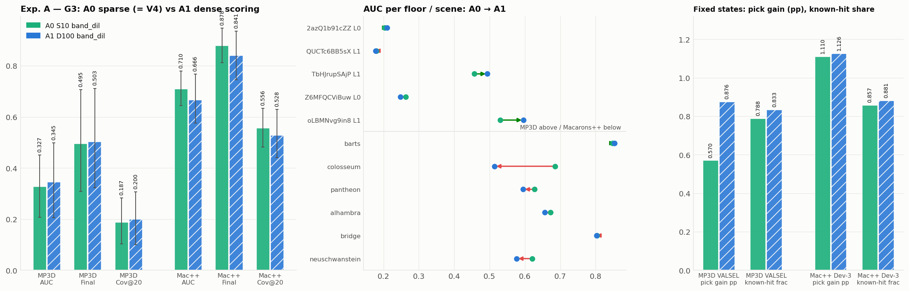

**表 6 Experiment A（唯一变量 = 评分用 band_dil：S10 稀疏孪生 vs D100）**
| 数据集 | 方法 | AUC [CI] | Final [CI] | Cov@20 [CI] |
|---|---|---|---|---|
| MP3D | A0 V4-SparseScore | 0.327 [0.206, 0.451] | 0.495 [0.308, 0.706] | 0.187 [0.102, 0.283] |
| MP3D | A1 V4-DenseScore | 0.345 [0.205, 0.498] | 0.503 [0.323, 0.712] | 0.200 [0.100, 0.307] |
| Macarons++ | A0 V4-SparseScore | 0.710 [0.643, 0.780] | 0.878 [0.812, 0.947] | 0.556 [0.482, 0.633] |
| Macarons++ | A1 V4-DenseScore | 0.666 [0.575, 0.767] | 0.841 [0.746, 0.936] | 0.528 [0.441, 0.629] |
| MP3D | A1 − A0 | +0.018 [-0.005, +0.043]（3/2） | +0.008 [+0.002, +0.016]（5/0） | +0.013 |
| Macarons++ | A1 − A0 | -0.043 [-0.097, -0.007]（1/5） | -0.038 [-0.078, -0.008]（0/6） | -0.028 |

- 稠密评分让更多预测命中被判为"已知"（MP3D 0.788 → 0.833，Macarons++ 0.857 → 0.881），在 MP3D 固定状态上明显改善被选动作的真实增益（0.570 → 0.876 pp，early 阶段 1.33 → 2.09），闭环上只有小幅改善（AUC +0.018，CI 含 0；停滞 4 → 2）；在 Macarons++ 闭环上显著退化（0/6 场景），与 Task 3 E1 对 V2-Mix 的观察相同。**结论 NO-GO，保留稀疏评分。**

## 7. 分析与结论
1. **数据域 vs 架构**：在 V3 架构族里，Mixed 训练的 MP3D 数据没有转化为室内闭环收益（V3.1 > T0），而 E2-D100 的室内优势来自 V2 Original → V2-Mix → D100 微调这一链。室内性能更可能来自"微调链"而不是"混合从零训练"。
2. **本域上新架构没有收益**：V3（Mixed）和 V3.1 / V4（Outdoor-only）都没有超过 60k 步的 V2 Original 或 B2。V2 的 3D U-Net + 原射线采样仍是室外最强的编码器 / 条件组合。
3. **V4 的价值在效率**：与 V3.1 闭环相当、成本 1/3.3、每步快 2.7 倍；但其一步预测更差、K = 4 样本更不分散，是继续研究 V4 时要先诊断的现象。
4. **X-Attn 的因果结论待 U0**：两次 X-Attn（V3-T1 的场景级、V4 的射线级）都没有拿到严格对照下的显著闭环增益；T1 − T0 为 "meaningful on one"（MP3D +0.020），V4 − 对照缺失。
5. **评分口径**：稠密输入 + 稀疏评分（B2 口径）仍是两域折中的默认；稠密评分只对 MP3D 有利。

## 8. 下一步选项（等待决定）
| 选项 | 建议 | 预期成本 |
|---|---|---|
| MP3D 室内微调（V4-FT、V3.1-FT 从各自 EMA@40k 出发，MP3D train 228 条，5k 步；微调前后双域 G3，量化室外遗忘） | Conditional Go：目标 E2-D100 水平（0.364 / 0.553） | ≈ 10 GPU-h / 组 |
| U0（V2 架构、无 X-Attn、同数据 / 预算 / 种子） | Go，若要对 Ray X-Attn 下任何结论 | ≈ 20 GPU-h |
| 延长到 60k | No-Go（S-c 指标已平台） | — |
| n_win 7 / 9 规划器消融（冻结模型） | 独立决定；先固定状态再闭环 | ≈ 2 + 3 GPU-h / 模型 |
| V4 一步质量诊断（注意力熵、样本离散度 vs 闭环） | 与 U0 并行 | CPU + 少量 GPU |

## 附录：文件索引
- 可视化（5.1 节）：`figures/viz_summary_pick_gain.png`（汇总）、`viz_{indoor,outdoor}_{good,fail}_{overview,candidates}.png`（4 个示例 × 2 张）；脚本 `scripts/viz_extract.py`（GPU，重放并导出）与 `scripts/viz_candidates_plot.py`（画图）。
- 图：`figures/fig10_indoor_average_auc_coverage.png` / `fig11_outdoor_average_auc_coverage.png`（核心图：室内 / 室外平均 AUC 与 Final coverage）、`fig1_architectures.png`（架构）、`fig2_g3_bars.png`（G3 柱状 + CI）、`fig3_coverage_curves.png`（覆盖率曲线）、`fig4_paired_differences.png`（配对差森林图）、`fig5_per_scene_auc.png`（逐场景）、`fig6_training_and_cost.png`（训练曲线 + 成本）、`fig7_fixed_state_g1g2.png`（固定状态）、`fig8_experiment_A.png`（消融 A）、`fig9_cost_vs_performance.png`（成本 vs 性能）。
- 表：`tables/T3_g3_unified.{md,csv}`、`T4_paired_differences.md`、`T5_fixed_state_g1g2.md`、`T6_experiment_A.md`。
- 数据与协议：`../AUDIT_BASELINES.md`、`../CHECKPOINT_LINEAGE.md`、`../FROZEN_PROTOCOL.md`、`../report/`、`../reports/`、`../ablation_study/experiment_A_distp1_dense_vs_sparse/`。
- 资源：第一阶段 ≈ 85 GPU-h（L40S）+ 消融 A ≈ 3.5 GPU-h；EXP6 V3 ≈ 161 GPU-h。
